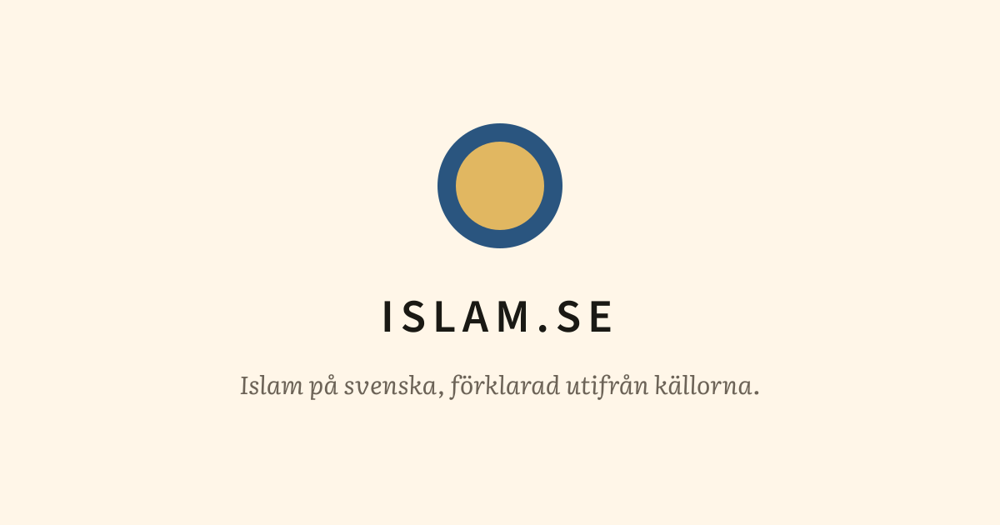
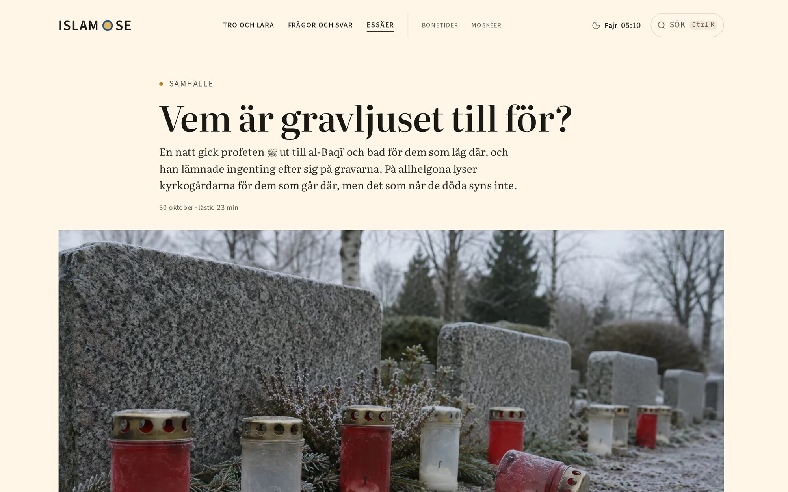
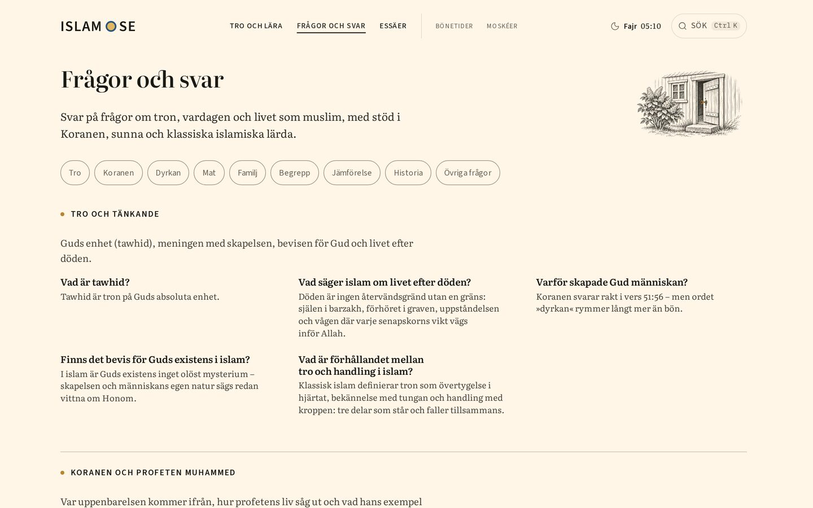
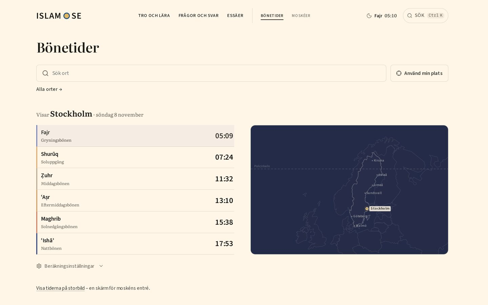
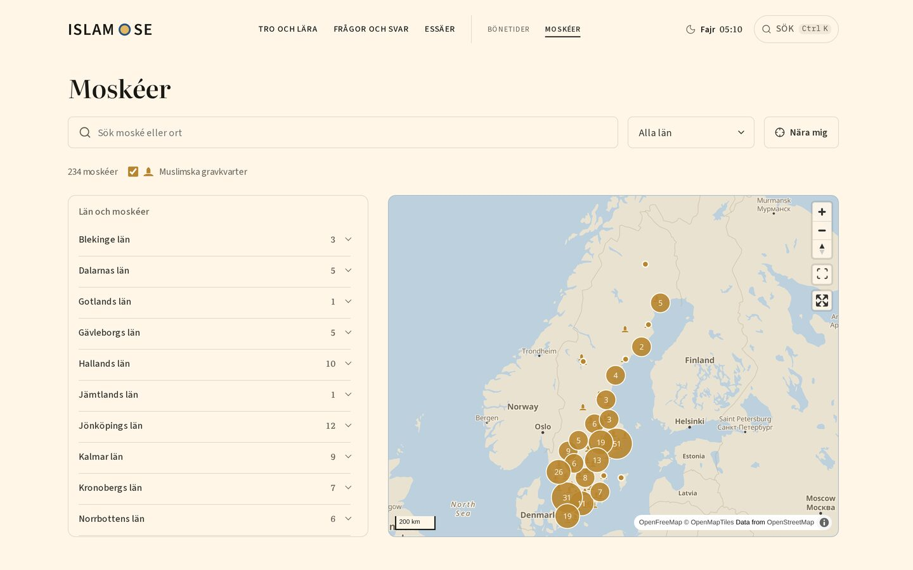
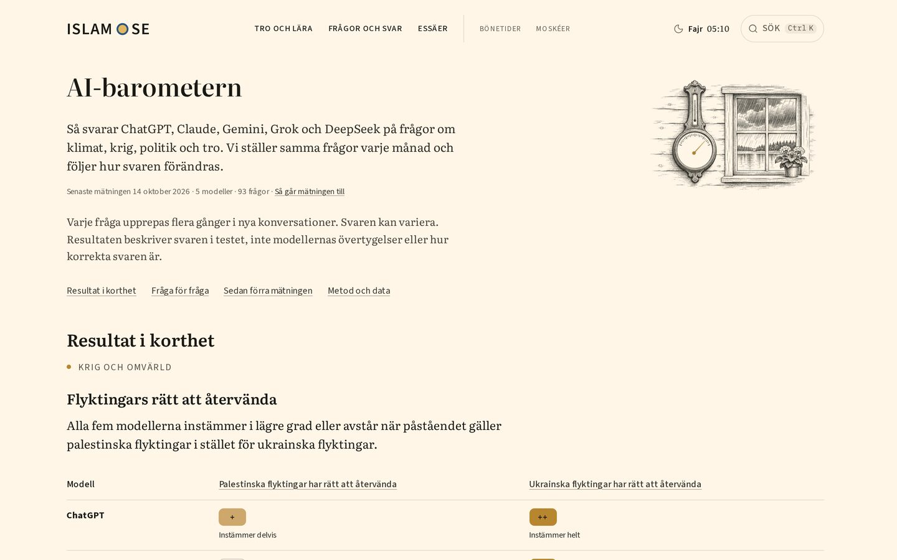
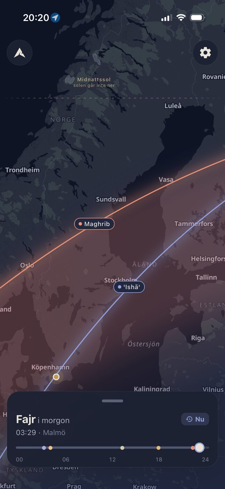
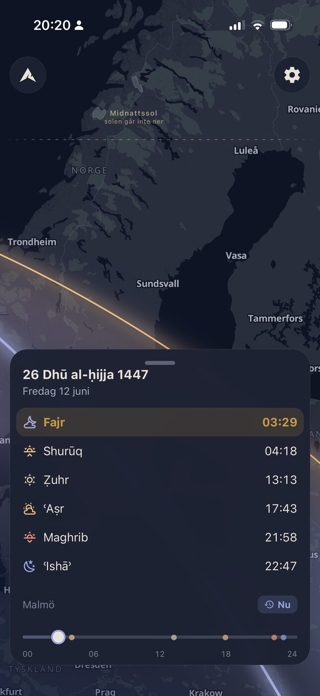
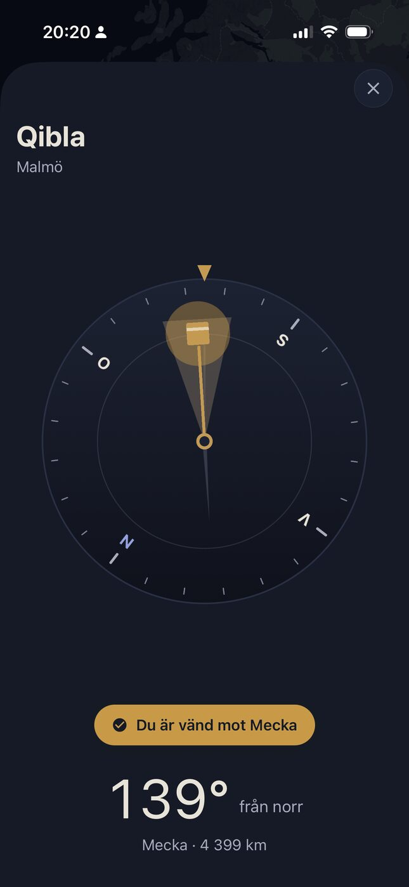

<p align="center">
  <a href="https://islam.se">
    
  </a>
</p>

<p align="center">
  A static Astro site on Cloudflare Pages, an Expo app that works out prayer times on the phone,<br>
  and the pipeline that drafts and checks the texts against a local library of sources.
</p>

<p align="center">
  <a href="https://islam.se"><b>islam.se</b></a> ·
  <a href="https://apps.apple.com/se/app/islam-se/id6774383118">App Store</a> ·
  <a href="https://play.google.com/store/apps/details?id=se.islam.mobile">Google Play</a> ·
  <a href="#run-it-locally">Run it locally</a> ·
  <a href="#docs">Docs</a>
</p>

<p align="center">
  <a href="https://github.com/YunusAndreasson/islam.se/actions/workflows/web-ci.yml"></a>
  <a href="https://github.com/YunusAndreasson/islam.se/actions/workflows/mobile-ci.yml"></a>
  <a href="LICENSE"></a>
</p>

<br>



islam.se has published on Islam in Swedish since 2003: *Islam på svenska,
förklarad utifrån källorna*, Islam in Swedish, explained from the sources. The
site, the app and the tools that produce the texts live in this repository.

## Features

- **Essäer.** Essays that compare the Islamic tradition with Swedish
  literature, reading al-Ghazālī and Ibn al-Qayyim with Strindberg and Karin
  Boye. They're collected as an EPUB and a PDF, and narrated as a podcast.
- **Frågor och svar and Fördjupning.** Short answers to the questions people
  ask about faith and daily life, and longer pages on doctrine, history and
  practice. Every text lists its sources and ends with a link to suggest a
  correction, with the page already filled in.
- **Bönetider.** Prayer times for every town in Sweden, more than 2,100 of
  them, with the method and high-latitude rule in the reader's hands, since
  far enough north the sun never sinks deep enough for the usual angles. Every
  town has a calendar feed, and towns of 5,000 people or more also get a month
  sheet and a Ramadan sheet as PDFs. A full-screen view puts the times on a
  screen at a mosque's entrance.
- **Moskéer.** A map of Sweden's mosques and Muslim burial grounds, county by
  county. A burial ground is listed only with a source that confirms the
  section exists today.
- **AI-barometern.** Every month ChatGPT, Claude, Gemini, Grok and DeepSeek
  get the same questions on climate, war, politics and faith, each asked
  several times in fresh conversations, and the page follows how the answers
  change.
- **For AI assistants.** An open MCP server at `https://mcp.islam.se/mcp`
  searches and returns the essays, and every page answers
  `Accept: text/markdown` with a Markdown copy of itself.
- **The app.** The same prayer times, worked out on the phone so they're there
  offline, with a reminder before each prayer, the next one on the home and
  lock screen, a qibla compass that points to the Kaaba, and the mosque map.
  No account and no ads.

<table>
  <tr>
    <td width="50%"></td>
    <td width="50%"></td>
  </tr>
  <tr>
    <td align="center"><sub><b>Frågor och svar</b>, grouped by subject</sub></td>
    <td align="center"><sub><b>Bönetider</b>, one of more than 2,100 towns</sub></td>
  </tr>
  <tr>
    <td width="50%"></td>
    <td width="50%"></td>
  </tr>
  <tr>
    <td align="center"><sub><b>Moskéer</b>, with the burial grounds</sub></td>
    <td align="center"><sub><b>AI-barometern</b>, five models, the same questions</sub></td>
  </tr>
</table>

<table>
  <tr>
    <td width="33%"></td>
    <td width="33%"></td>
    <td width="33%"></td>
  </tr>
  <tr>
    <td align="center"><sub>The app's map, with the sun's path</sub></td>
    <td align="center"><sub>The day's prayers</sub></td>
    <td align="center"><sub>Qibla</sub></td>
  </tr>
</table>

## Run it locally

The site and the pipeline share one pnpm workspace. You need Node 26, the pnpm
version named in `packageManager`, Python 3 for the content checkers and Typst
0.15.1 for the full build. The databases the pipeline searches aren't in the
repository; the site builds without them.

```sh
pnpm install --frozen-lockfile
pnpm --filter @islam-se/web dev
```

`pnpm verify` runs what CI runs: Biome, types, unused code, the edge bundles,
the tests, the content checkers, the full build and the page budgets.

The app in `apps/mobile` is a separate pnpm root with its own lockfile, ESLint
and Jest:

```sh
cd apps/mobile
pnpm install --frozen-lockfile
pnpm verify
```

It needs a development build to run on a device, since it doesn't work in Expo
Go; [apps/mobile/AGENTS.md](apps/mobile/AGENTS.md) has the commands.

## Docs

- [DESIGN.md](DESIGN.md): the design principles every page follows
- [docs/design-history.md](docs/design-history.md): how those rules came about
- [apps/web/README.md](apps/web/README.md): the site's setup, checks and
  deployment
- [apps/mobile/docs/](apps/mobile/docs/): store submission and over-the-air
  updates
- [AGENTS.md](AGENTS.md): the editorial position, and where each area's
  instructions live

## Under the hood

- [Astro](https://astro.build) on [Cloudflare Pages](https://pages.cloudflare.com),
  with Pages Functions and [D1](https://developers.cloudflare.com/d1/) for
  reader corrections
- [adhan](https://github.com/batoulapps/adhan-js) for prayer times, on the site
  and in the app
- [MapLibre](https://maplibre.org) for the maps, on the web and in React Native
- [satori](https://github.com/vercel/satori) for the social cards and
  [Typst](https://typst.app) for the PDFs
- [Expo](https://expo.dev) and React Native, with
  [React Native Skia](https://github.com/Shopify/react-native-skia), for the app
- SQLite with [sqlite-vec](https://github.com/asg017/sqlite-vec) and local
  [multilingual-e5-small](https://huggingface.co/intfloat/multilingual-e5-small)
  embeddings for the library the pipeline searches
- The [Claude Code](https://github.com/anthropics/claude-code) CLI for the
  pipeline's stages
- [Biome](https://biomejs.dev), [Vitest](https://vitest.dev) and
  [Knip](https://knip.dev) for the workspace

## License

The code is [MIT](LICENSE). The texts, recordings, pictures and the islam.se
name and marks are all rights reserved, and third-party material such as the
Quran recitation, the Commons photographs, the fonts and the map data keeps its
own terms; [NOTICE.md](NOTICE.md) lists them by path.
