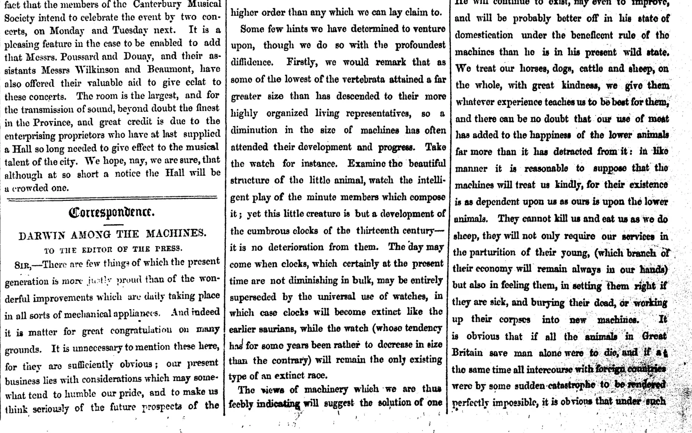
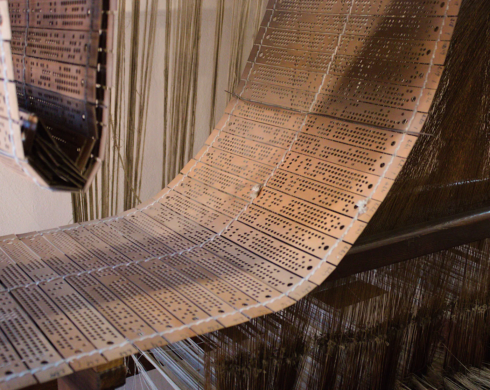
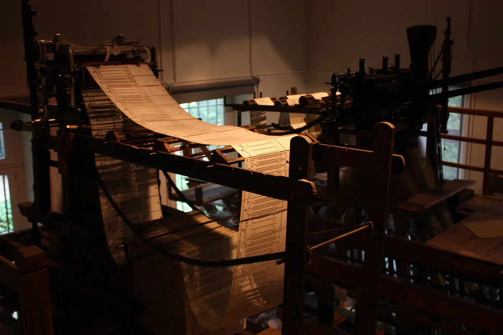

Paul Atreides är femton år och har nyss fått dra handen ur en låda. Så länge den satt kvar kändes det som om huden brann. Mot hans hals höll en gammal kvinna en giftnål, redo att sticka honom om han drog undan handen. Nålen kallas gom jabbar, och provet gällde om han var människa. Han klarade det. Samtalet som följer, i första kapitlet av Frank Herberts *Dune* från 1965, kommer in på maskiner.

Paul citerar ett budord som han har fått lära sig: "Du skall inte göra en maskin i människosinnets likhet." Den gamla kvinnan, Reverend Mother Mohiam, känner igen det. Det är hämtat ur den butlerska jihaden och Orangekatolska bibeln, säger hon. Men bibeln borde ha sagt något annat: "Du skall inte göra en maskin som förfalskar ett mänskligt sinne."[^1]

Den som bara har sett Denis Villeneuves filmer har knappast hört talas om den butlerska jihaden. I bokens värld är den ett krig mot de tänkande maskinerna, fört tusentals år före handlingen, och budordet är det som blev kvar av det. Ett ord i repliken är lätt att missa: jihad. Herbert hämtade det ur islam och använde det om ett utrotningskrig mot redskap.

Mohiam byter likhet mot förfalskning, och därmed flyttar hon gränsen. Var går den egentligen mellan ett tillåtet redskap och en förbjuden likhet? Och vem tjänar på att den suddas ut?

## Mannen som förklarade kriget

Namnet anses komma från Samuel Butler, en ung engelsman i Nya Zeeland. Den 13 juni 1863 trycktes insändaren "Darwin among the Machines" i *The Press* i Christchurch, undertecknad Cellarius. Om maskinerna utvecklas som arterna, resonerade han, kommer en dag då de har den verkliga makten över världen och dess invånare. Och han drog slutsatsen fullt ut:

> Vår mening är att krig på liv och död genast bör förklaras mot dem. Varje maskin av varje slag bör förstöras av den som vill sin art väl.[^2]

Två år senare hävdade Butler det motsatta i samma tidning. I "Lucubratio Ebria" har maskinerna blivit människans "lemmar utanför kroppen". När han sedan utvecklade den första tanken i romanen *Erewhon* antydde han i förordet till andra upplagan, 1872, att kapitlen om maskinerna kunde läsas som en satir över "det bestickande missbruket av analogier".[^3] Mannen som förklarade kriget lekte med båda tankarna och menade kanske ingen av dem helt allvarligt. Herbert behöll kriget.

## Ett ord för ansträngning

Roten *j-h-d* betyder på arabiska att anstränga sig till det yttersta. I Koranen och sunnan är jihad ansträngning på Guds väg, bunden av regler och gränser. I traditionen omfattar den både ansträngningen mot den egna själen och, under rättmätig ledning, striden med vapen. Hos at-Tirmidhī står ett profetord, återgivet av Faḍāla ibn ʿUbayd, i samma berättelse som löftet till den som dör som gränsvakt på Guds väg:

> Den som verkligen kämpar är den som anstränger sig mot sin själ.[^4]

Ibn Qayyim al-Jawziyya (d. 1350) delar in jihad i fyra slag – mot själen, mot Satan, mot de otrogna och mot hycklarna. Till de fyra lägger han kampen mot dem som står för orättfärdighet, religiösa nymodigheter och förkastliga handlingar, sammanlagt tretton grader. Efter uppräkningen anför han profetordet att den som dör utan att ha stridit, och utan att ens ha haft det i sinnet, dör med en gren av hyckleri.[^5] Hans lärare Ibn Taymiyya angav ordningen mellan graderna: jihad mot själen och lusten är "grunden för jihad mot de otrogna och hycklarna, ty han förmår inte kämpa mot dem förrän han först har kämpat mot sin själ och sin lust".[^6] Grunden ersätter inte huset, men den bär det.

Herberts jihad har ingen själ att kämpa mot. Den är helt och hållet vänd utåt, mot redskapen. Av Ibn Taymiyyas ordning följer att ett sådant krig bara kan förstöra det som frestar, aldrig stärka den som frestas. Redskapen går att bränna, men benägenheten att lämna ifrån sig sitt omdöme överlever branden, och man vänder sig till nästa som erbjuder sig att tänka i ens ställe.

## En andra bedömning

Hösten 2026 skriver språkmodeller brev, uppsatser och programkod. Det är program som har tränats på väldiga textmassor och svarar som en människa. Så kallade AI-agenter utför dessutom uppgifter i flera steg på egen hand. Internetstiftelsens undersökning kom i september: 62 procent av internetanvändarna från åtta år och uppåt hade använt en särskild AI-tjänst det senaste året, mot 41 procent året innan.[^7] Statsminister Ulf Kristersson berättade 2025 för Dagens industri att han frågade ChatGPT och franska LeChat, om inte annat för att få en andra bedömning. Virginia Dignum, professor i ansvarsfull AI vid Umeå universitet, invände i Dagens Nyheter att ingen hade röstat på ChatGPT.[^8] Forskare vid Carnegie Mellon och Microsoft gjorde en enkät bland 319 kunskapsarbetare. Ju mer deltagarna litade på verktyget, desto mindre ansträngde de sig enligt egen uppgift att tänka kritiskt.[^9]

I Albanien har regeringen utnämnt ett AI-system, Diella, till minister. Uppdraget är att gradvis ta över bedömningen av offentliga upphandlingar och göra slut på korruptionen i dem. I oktober avvisade författningsdomstolen oppositionens begäran att upphäva utnämningen. Enligt albansk press skedde det av formella skäl. Men domstolen underströk att AI inte kan skapa, utvidga, överföra eller ersätta offentliga befogenheter och inte heller överta myndigheternas ansvar. Premiärminister Edi Rama har själv sagt att de slutliga besluten fattas av tjänstemän. Myndigheten som tog fram systemet heter AKSHI. Specialåklagaren misstänker dess dåvarande direktör och sju andra för riggade upphandlingar. Ingen har ställts inför rätta, misstankarna är oprövade, och Diellas egen utveckling ingår inte i utredningen.[^10]

Andra vill hejda utvecklingen innan den går för långt. I oktober 2025 krävde ett upprop från Future of Life Institute ett förbud mot att utveckla superintelligens – AI som överträffar människan i så gott som allt tänkande. Förbudet ska gälla tills det råder bred vetenskaplig enighet om att utvecklingen kan ske säkert och kontrollerbart, och tills allmänheten står bakom. Tiotusentals har skrivit under, bland dem forskare, politiker och kristna ledare som Paolo Benanti, påvens rådgivare i AI-frågor.[^11] Uppropet är en sentida och mer måttfull släkting till Butlers insändare, och det ska tas på allvar: de som skriver under fruktar att något kan gå förlorat som inte går att vinna tillbaka.

## Ge liv åt det ni har skapat

En likhet kan vara ärlig. En förfalskning ger sig ut för att vara det äkta. Mer än sexhundra år före Herbert gjorde Ibn Taymiyya (d. 1328) en liknande åtskillnad, men han var strängare än Mohiam. Han skrev om alkemisterna, som förfalskade mynt, ädelstenar och mysk. Han ställde dem bredvid bildmakarna, om vilka Profeten ﷺ sade:

> De som gör dessa bilder straffas på Uppståndelsens dag; det sägs till dem: Ge liv åt det ni har skapat.[^12]

I en hadith qudsi, där Gud själv är den som talar, heter det: "Vem är orättfärdigare än den som ger sig i kast med att skapa så som jag skapar? Låt dem skapa ett sädeskorn, låt dem skapa ett stoftkorn."[^13]

Ibn Taymiyya påpekar att en bild av ett djur inte bedrar någon, "ty alla vet att den avbildade bilden av ett djur inte är ett djur". Ändå står förbannelsen över bildmakarna kvar. Därför skiljer man mellan det som har liv och det som saknar det: träd och metaller får avbildas. Ibn ʿAbbās sade till en man som frågade honom: avbilda träd och det som inte har någon ande. Det första felet, *muḍāhāt*, är alltså att efterlikna Guds skapande av det som har ande, och det är ett fel även när ingen luras. Det andra felet, *ghishsh*, förfalskningen, är alkemisternas. Deras avsikt är att "låta det ena gälla för det andra, så att de kan ge ut det och handla med människor med det", och de tiger om var varan kommer ifrån.[^14] Alkemisten begår båda felen. Mohiams rättelse gäller bara det andra.

Var hamnar då en språkmodell? Hadithen gäller avbildningar av levande varelser. Om en maskin som efterliknar mänskligt tal är *muḍāhāt* finns det ingen klassisk dom, och den här texten fäller ingen. Butler drev med det bestickande missbruket av analogier, och linjen från bildmakaren till ingenjören är en analogi. Men den belyser två saker som inte kräver någon fatwa: anspråket och förfalskningen.

Var och en som gör en bild av något levande "åläggs på Uppståndelsens dag att blåsa in anden i den, och han kan inte blåsa in den".[^15] Koranen beskriver i vilken ordning människan blev till:

> […] därefter formar Han henne och andas in i henne något av Sin ande och skänker henne hörsel och syn samt förmågan att känna och förstå. Men ni visar sällan tacksamhet![^16]

Först formen, sedan anden, sist hörseln, synen och hjärtats förstånd. Hadithen och versen drar gränsen på samma ställe: formen går att göra, anden går inte att ge. En maskin kan formas så att den liknar mänskligt tal allt mer, men formen är allt den har fått. Om alkemins efterbilder skrev Ibn Taymiyya att "allt avslöjas förr eller senare, men en del liknar mycket".[^17] Koranen riktar utmaningen till allt som människor sätter i Guds ställe:

> MÄNNISKOR! Hör på den liknelse, som här framställs [för er]: de som ni anropar i Guds ställe kommer aldrig att kunna skapa [ens] en fluga, även om de förenar [alla sina krafter] för [att åstadkomma] detta. Och om en fluga stjäl något från dem, kan de inte ta det ifrån denna [fluga]. […][^18]

Flugan är enligt Ibn Kathīr "bland Guds svagaste och ringaste skapelser", och utmaningen gäller just det minsta. Gränsen är ingen fråga om grad: den som inte kan skapa det minsta kommer inte närmare genom att göra efterbilden större eller skickligare. Likheten med mänskligt tal kan växa utan att anspråket på liv blir sannare. Det enda som växer med likheten är utrymmet för förfalskning.

Om maskinen har något inre lämnas här därhän. Essän "[Döm maskinen efter vad den gör](/vittnesmal-utan-vittne/)" har visat att den frågan inte går att avgöra och därför inte kan ligga till grund för någon slutsats. Anspråket gäller vad maskinen sägs vara: att likheten skulle vara ett liv, och att den som byggde maskinen skulle ha gett det livet. Det andra felet, förfalskningen, leder tillbaka till Mohiam.

## Herrar i Guds ställe

Strax innan Paul citerar budordet har Mohiam berättat varifrån det kommer:

> En gång överlät människorna sitt tänkande åt maskiner i hopp om att det skulle göra dem fria. Men det lät bara andra människor med maskiner förslava dem.[^19]

Repliken nämner inget maskinuppror. De som lämnade ifrån sig sitt tänkande blev slavar, och herrarna var andra människor. Att faran låg hos människorna med maskinerna är en tolkning, men repliken ger stöd åt den. I Popular Science i mars läste Andrew Paul Dune på samma sätt: den butlerska jihaden drevs mindre av rädsla för robotar än av rädsla för de teknokrater som styrde dem.[^20] Herbert gav kriget ett islamiskt namn och riktade det mot redskapen. Hans egen gestalt pekar på något annat, och det har Koranen ett namn för:

> De har tagit sina rabbiner och klosterbröder till herrar och beskyddare i Guds ställe, och [detsamma har de gjort med] Kristus, Marias son, trots att de har förmanats att inte dyrka någon annan än den Ende Guden - det finns ingen gud utom Han; stor är Han i Sin härlighet, fjärran från allt vad de vill sätta vid Hans sida![^21]

Vad betydde det att ta dem till herrar? Ḥudhayfa ibn al-Yamān och Ibn ʿAbbās svarade att de följde dem i det som de förklarade tillåtet och förbjudet. Abū al-Bakhtarī sade vad det inte var: "De bad inte till dem … men de befallde dem, och de gjorde Guds tillåtna till förbjudet och hans förbjudna till tillåtet, och de lydde dem, och det var herraskapet." Abū al-ʿĀliya beskrev människor som hade Guds bok framför sig och ändå sade: "Vi går inte före våra skriftlärda i något."[^22]

Gränsen måste dras noga, annars blir versen en anklagelse mot var och en som frågar någon om något. Ibn Taymiyya skiljer mellan två fall. Det ena är den som vet att ledarna har förvanskat religionen och ändå tror som de. Det har Gud och hans sändebud kallat *shirk*. Det andra är den som behåller sin tro men lyder dem i synd, som en muslim som begår en synd han vet är synd.[^23] Att fråga de lärda är dessutom en plikt. "Fråga dem som går efter [de tidigare uppenbarelserna], om ni inte vet det", sägs det till mekkanerna om de tidigare skrifterna. Ur versen har de lärda dragit den allmänna regeln att den som inte vet ska fråga den som vet, och enligt al-Qurṭubī är de inte oense om att allmänheten ska följa sina lärda.[^24] Den lydnaden följer av lydnaden mot Gud och har sin gräns. När en befälhavare befallde sina soldater att gå in i en eld sade Profeten ﷺ: "Ingen lydnad i synd; lydnaden gäller bara det som är rätt."[^25] Att fråga en maskin är ingen *shirk*. Det som skiljer maskinen från den lärde är vem som står bakom svaret.

## Nämn era män

Frågar man en lärd i god tro är man skyddad: "Den som får ett svar utan kunskap – synden för det ligger på den som gav honom svaret."[^26] Men skyddet förutsätter någon som kan bära synden, och al-Qurṭubī kräver att den okunnige följer någon vars urskillning han litar på. Förr frågade man inte efter berättarkedjan, säger Muḥammad ibn Sīrīn, men när oroligheterna kom sade man: "Nämn för oss era män." Sedan dess har traditionen hållit sig till hans regel: "Denna kunskap är religion, så se efter från vem ni tar er religion."[^27] En lärd har ett namn och en kedja av lärare, är känd för kunskap och redbarhet och står själv till svars. En maskin är inte ålagd några plikter, har ingen redbarhet att pröva och kan inte nämna sina män.

Invändningen ligger nära till hands: inte heller ett uppslagsverk kan svara för sig självt, och ingen har tagit ett lexikon till herre. Men uppslagsverket har en avsändare, en författare och en redaktion som kan namnges, granskas och rättas. Också maskinsvaret har avsändare, men de syns inte. Det är företagen, som har valt vad modellen har fått läsa, vilka regler den följer och vad den vägrar att svara på. Deras val formar svaret, men deras namn står inte under det. Där står i stället att maskinen kan göra misstag. Företagen är Herberts andra människor med maskiner. På en punkt liknar de Ibn Taymiyyas alkemist: köparen får inte veta var varan kommer ifrån.

Profetordet om svaret utan kunskap handlar inte om maskiner. Men om synden ligger på den som svarar, och maskinen inte kan bära någon synd, stannar den hos människor. Den stannar hos dem som bygger, säljer och tar systemet i bruk, och hos den som valde en källa han inte kunde pröva. Domstolen i Tirana sade detsamma på juridikens språk. Låter någon ett sådant svar avgöra vad som är tillåtet och förbjudet har han inte därmed tagit någon till herre i versens mening. Men han är på väg dit.

## Örat, ögat och hjärtat

Essän "[Bergen som vägrade](/bergen-som-vagrade/)" har visat att förtroendet i 33:72 kräver en bärare som kan bäva, och att vanan att låta system avgöra söver hjärtat. Att systemen har ägare ändrar inte vem som till sist ska svara:

> Befatta dig inte med det som du inte riktigt vet; ditt öra och ditt öga och ditt hjärta skall [alla en Dag] tillfrågas om detta.[^28]

Qatāda förklarade versen: "Säg inte: jag såg, när du inte såg; jag hörde, när du inte hörde; jag vet, när du inte vet – ty Gud ska fråga dig om allt detta."[^29] Den som klistrar in ett maskinsvar och ger ut det som sitt eget omdöme säger just det: jag vet.

Hjärtat i versen heter på arabiska *fuʾād*, samma ord som Bernström i 32:9 återger med "förmågan att känna och förstå". Det är samma tre förmågor som först ges, efter anden, och sedan ställs till svars. Mönstret återkommer i Koranen, där det om de nyfödda heter att Gud "gav er hörsel, syn och hjärta". Ibn Taymiyya ställde själv samman verserna: hörseln och synen är grunden för den kunskap som skiljer människan från djuren, och därför för Gud samman dem med hjärtat på flera ställen.[^30] Gud, som ger anden, ger också det som ska tillfrågas. En maskin kan efterlikna vad de tre förmågorna frambringar, men den har inte fått dem och kan inte svara för dem. Människan, som har fått dem, kan inte lämna över svaret, varken till maskinen eller till dem som äger den.

## Kvarnen och vävstolen

Islam kräver alltså ingen butlersk jihad. Ibn Taymiyya räknar själv upp vad människor tillverkar: de maler säd, väver kläder, bygger hus och gör glas av sand och småsten.[^31] Det människor tillverkar skapar Gud "endast genom människornas förmedling", skriver han. Han anför Ibrāhīms fråga till dem som dyrkade bilder som de själva hade huggit: "Dyrkar ni [bilder] som ni har huggit till [med era egna händer], fastän Gud har skapat både er och ert hantverk?" På annat ställe slår Ibn Taymiyya fast att det skapade inte är tillverkat och det tillverkade inte är skapat. Regeln gäller bara åt ett håll: människor kan inte tillverka det Gud skapar.[^32] Kvarnen ger sig inte ut för att vara vete. Så länge modellen inte ger sig ut för att vara något annat än ett redskap är den ett redskap.

Som essän "[Kaffet inför rätta](/kaffet-infor-ratta/)" har visat är grundregeln bland de lärda att ting och bruk är tillåtna tills ett förbud är belagt, eftersom bara Gud förklarar något tillåtet eller förbjudet. Principen slår åt båda hållen. Ett budord som utan belägg gör ett redskap till synd förbjuder det som Gud inte har förbjudit. Om bildförbudet omfattar maskinerna är en fråga för de lärda och deras belägg, inte för ett budord. Att låta systemens ägare avgöra vad som är tillåtet och förbjudet är å sin sida att låta andra än Gud dra gränsen. I den butlerska jihaden och i kapitulationen begås samma fel från var sitt håll, det fel som 9:31 beskriver.

Förbudsrösterna har ändå rätt i att vissa vägar måste stängas. Maliki- och hanbalijuristerna har särskilt betonat principen att stänga vägar till skada, *sadd adh-dharāʾiʿ*. Den ger utrymme att stänga vissa användningar: maskingenererade fatwor utan lärd granskning, innehåll som döljer att en maskin har gjort det och system som fattar beslut om människor utan att någon människa svarar för dem. Alkemisten teg ju också om varans ursprung. Visar det sig att en viss utveckling för med sig övervägande skada kan också den stoppas efter samma princip. Men en stängd väg har ett ändamål och en gräns. Profeten ﷺ förbjöd först gravbesök för att stänga vägen till *shirk* och tillät dem senare. Enligt Ibn al-Qayyim får regeln vika när ett övervägande intresse står emot den.[^33] Principen förbjuder inte redskapet som sådant. Och det Herbert varnade för förutsätter ingen superintelligens. Det börjar med vanliga verktyg och vanan att låta dem svara i ens ställe.

## Handen i lådan

Herbert lät kriget mot maskinerna ta slut tusentals år före bokens början. Kvar blev budordet och en gammal kvinna med en giftnål. Hon prövade om en pojke kunde hålla kvar handen i smärtan i stället för att låta reflexen bestämma. Det var hennes prov på om han var människa.

Ibn al-Qayyims tretton grader börjar varken med svärdet eller med tungan. Den första är att kämpa med själen så att den lär sig vägledningen och sanningens religion, "utan vilken den inte har någon framgång eller lycka, varken i detta liv eller i det kommande".[^34] Ordningen säger det han lämnar osagt: utan den graden har de andra ingenting att stå på. Den graden kan heller ingen ta åt någon annan. Man ska fråga den som vet, och man kan låta en maskin sammanfatta, översätta och räkna, men lärandet sker i det egna örat, ögat och hjärtat. En sura sitter först när den har upprepats högt, vers för vers, tills blicken inte längre söker sidan. Ordet som Herbert lånade till ett krig mot redskap står i Koranen som ett verb, *jāhadū*, och Bernström behöver två svenska ord för det:

> Men dem som strävar och kämpar för Vår sak skall Vi sannerligen leda på de vägar som för till Oss. Gud är alltid med dem som gör det goda och det rätta.[^35]

---

[^1]: Frank Herbert, *Dune* (1965), första kapitlet. Originalets lydelse: "'Thou shalt not make a machine in the likeness of a man's mind,' Paul quoted. 'Right out of the Butlerian Jihad and the Orange Catholic Bible,' she said. 'But what the O.C. Bible should've said is: Thou shalt not make a machine to counterfeit a human mind.'" Citat ur engelska och arabiska källor är översatta för den här texten. Koranen citeras i Knut Bernströms översättning. Bilderna i texten: *The Press*, Christchurch, [13 juni 1863](https://commons.wikimedia.org/wiki/File:The_Press_13_06_1863_page_1.png), fri från upphovsrätt, beskuren; Przykuta, Kamienna Góra, [15 juli 2023](https://commons.wikimedia.org/wiki/File:Muzeum_Tkactwa_w_Kamiennej_G%C3%B3rze_maszyna_%C5%BCakardowa_-_fragment_15.07.2023_p.jpg), licens [CC BY-SA 3.0](https://creativecommons.org/licenses/by-sa/3.0/); Sunfox, Saint-Étienne, [29 november 2012](https://commons.wikimedia.org/wiki/File:Punch_cards_sewing_loom.jpg), licens [CC BY-SA 2.0](https://creativecommons.org/licenses/by-sa/2.0/). Samtliga via Wikimedia Commons.
[^2]: Samuel Butler (under pseudonymen Cellarius), "Darwin among the Machines", *The Press* (Christchurch), 13 juni 1863, omtryckt i Butler, *Canterbury Pieces*: "Our opinion is that war to the death should be instantly proclaimed against them. Every machine of every sort should be destroyed by the well-wisher of his species." Om överhögheten: "the time will come when the machines will hold the real supremacy over the world and its inhabitants".
[^3]: Samuel Butler, "Lucubratio Ebria", *The Press*, 29 juli 1865, i *Canterbury Pieces*: "extra-corporaneous limbs". Samuel Butler, *Erewhon*, förordet till andra upplagan, daterat 9 juni 1872: "the specious misuse of analogy". Kapitlen om maskinerna, "The Book of the Machines", är kapitel 23–25.
[^4]: *Sunan at-Tirmidhī*, Kitāb faḍāʾil al-jihād, nr 1621 (4:165–166), efter Faḍāla ibn ʿUbayd: المجاهد من جاهد نفسه. at-Tirmidhī bedömer hadithen som ḥasan ṣaḥīḥ, och Ibn Taymiyya kallar kedjan *jayyid* (*Majmūʿ al-fatāwā* 7:7). Det ofta anförda ordet om att återvända "från den mindre jihaden till den större" har däremot enligt Ibn Taymiyya "ingen grund". Han tillägger att jihad mot de otrogna hör till de största gärningarna (*Majmūʿ al-fatāwā* 11:197: فلا أصل له … وجهاد الكفار من أعظم الأعمال).
[^5]: Ibn Qayyim al-Jawziyya, *Zād al-maʿād* 3:9–10: فهذه ثلاثة عشر مرتبة من الجهاد. Profetordet finns i *Ṣaḥīḥ Muslim*, Kitāb al-imāra, nr 1910 (ṣaḥīḥ): من مات ولم يغز، ولم يحدث به نفسه، مات على شعبة من نفاق.
[^6]: Ibn Qayyim al-Jawziyya, *Rawḍat al-muḥibbīn* 1:478, efter Ibn Taymiyya: جهاد النفس والهوى أصل جهاد الكفار والمنافقين فإنه لا يقدر على جهادهم حتى يجاهد نفسه وهواه أولا حتى يخرج إليهم.
[^7]: Internetstiftelsen, *Svenskarna och internet 2026*, kapitlet "AI – Artificiell intelligens", publicerad 28 september 2026: andelen internetanvändare från 8 år som under de senaste 12 månaderna har använt någon AI-tjänst ökade med 21 procentenheter, från 41 procent 2025 till 62 procent 2026. Se även Andreas Bergsman, "AI-explosion i Sverige", *M3*, 28 september 2026. 52 procent hade använt ChatGPT. Räknas Googles AI-översikter in uppger 81 procent att de använder AI.
[^8]: "Swedish PM sparks criticism over frequent AI use in his role", *The News*, 6 augusti 2025, efter *The Guardian*. Kristerssons ord till Dagens industri återges där som "If for nothing else than for a second opinion" och Dignums ord till Dagens Nyheter som "We didn't vote for ChatGPT". Enligt regeringens presschef förs ingen säkerhetskänslig information in i verktygen.
[^9]: Hao-Ping Lee m.fl., "The Impact of Generative AI on Critical Thinking: Self-Reported Reductions in Cognitive Effort and Confidence Effects From a Survey of Knowledge Workers", *CHI 2025*. Studien omfattar 936 exempel på arbetsuppgifter och bygger på deltagarnas egna uppgifter. Den mäter inte förmågan över tid.
[^10]: "Albania introduces AI-powered minister to end corruption in public procurement", *Global Government Forum*, 16 september 2025. "Albania's Constitutional Court Rejects Opposition Bid to Overturn 'Diella' Appointment", *Albanian Daily News*, 8 oktober 2026, där domstolen återges: AI kan inte "create, expand, transfer or replace public powers, responsibilities or accountability". Begäran kom från 39 oppositionsledamöter, och domstolen prövade inte om utnämningen är grundlagsenlig. Om AKSHI: "SPAK Announces Charges Against AKSHI Director and Seven Others in Tender Corruption Probe", *Albanian Daily News*, 16 december 2025. OCCRP, 11 augusti 2026, återger Ramas uttalande om att tjänstemän fattar de slutliga besluten och uppger att Diellas egen utveckling inte ingår i utredningen. Anklagelserna framställdes under förundersökningen, och AKSHI:s direktör lämnade posten i februari 2026 (Balkanweb, 13 februari 2026). Enligt Gazeta Shqiptare den 12 oktober 2026 pågår utredningen fortfarande.
[^11]: Future of Life Institute, "Statement on Superintelligence", 22 oktober 2025: "a prohibition on the development of superintelligence, not lifted before there is" bred vetenskaplig enighet och starkt stöd hos allmänheten. Om undertecknarna: Future of Life Institute, pressmeddelande 27 mars 2026, som bland undertecknarna nämner "Papal AI Advisor Paolo Benanti" och de evangelikala ledarna Johnnie Moore och Walter Kim.
[^12]: *Ṣaḥīḥ al-Bukhārī*, Kitāb al-libās, nr 5951, efter Ibn ʿUmar: إن الذين يصنعون هذه الصور يعذبون يوم القيامة، يقال لهم: أحيوا ما خلقتم. Samma ord står efter ʿĀʾisha i Kitāb at-tawḥīd, nr 7557. Hadithen finns även hos Muslim och är ṣaḥīḥ.
[^13]: *Ṣaḥīḥ al-Bukhārī*, Kitāb al-libās, nr 5953, efter Abū Hurayra: ومن أظلم ممن ذهب يخلق كخلقي، فليخلقوا حبة، وليخلقوا ذرة. Även hos Muslim; ṣaḥīḥ.
[^14]: Ibn Taymiyya, *Majmūʿ al-fatāwā* 29:370–371. Om bilden: وهذا التصوير ليس فيه تلبيس وغش فإن كل أحد يعلم أن صورة الحيوان المصورة ليست حيوانا. Ibn ʿAbbās ord: صور الشجر وما لا روح فيه. Om alkemisterna: فينفقونه ويعاملون به الناس وهذا من أعظم الغش. Där står också att de inte låter människor veta att varan kommer från alkemin. Att alkemisterna även "efterliknar Guds skapelse" säger han i 28:72, där han beskriver dem som förfalskar mynt, ädelstenar och väldoft. Hans resonemang slutar i att alkemin är förbjuden som förfalskning (29:390–391), och domen gäller alkemin. Samtida lärda är oense om huruvida fotografier och digitala bilder omfattas av bildförbudet. Frågan berör också maskingenererade bilder av levande väsen, men den ligger utanför den här texten.
[^15]: *Ṣaḥīḥ al-Bukhārī*, Kitāb al-libās, nr 5963, efter Ibn ʿAbbās: من صور صورة في الدنيا كلف يوم القيامة أن ينفخ فيها الروح، وليس بنافخ. Ṣaḥīḥ.
[^16]: Koranen 32:9 (as-Sajda), i Knut Bernströms översättning. Meningen börjar i 32:7. Anden är skapad. Att Gud kallar den "Sin" är enligt Ibn Taymiyya en ägandets genitiv och ingen beskrivning av en egenskap hos honom, på samma sätt som när Koranen talar om "Guds kamelsto" (*Majmūʿ al-fatāwā* 4:215–216; 9:290).
[^17]: Ibn Taymiyya, *Majmūʿ al-fatāwā* 29:391: وكل ينكشف قريبا أو بعيدا ولكن منه ما هو شديد الشبه.
[^18]: Koranen 22:73 (al-Ḥajj), i Knut Bernströms översättning. Ibn Kathīr, *Tafsīr al-Qurʾān al-ʿaẓīm* 5:453–454, läser versen tillsammans med hadithen om sädeskornet: هذا والذباب من أضعف مخلوقات الله وأحقرها.
[^19]: Herbert, *Dune*, första kapitlet: "Once men turned their thinking over to machines in the hope that this would set them free. But that only permitted other men with machines to enslave them."
[^20]: Andrew Paul, "'Dune' tried to warn us against AI", *Popular Science*, 19 mars 2026.
[^21]: Koranen 9:31 (at-Tawba), i Knut Bernströms översättning.
[^22]: Ibn Kathīr, *Tafsīr al-Qurʾān al-ʿaẓīm* 4:135, om Ḥudhayfa och Ibn ʿAbbās: إنهم اتبعوهم فيما حللوا وحرموا. Ibn Taymiyya, *Majmūʿ al-fatāwā* 7:67, om Abū al-Bakhtarī: أما إنهم لم يصلوا لهم … ولكن أمروهم فجعلوا حلال الله حرامه وحرامه حلاله؛ فأطاعوهم فكانت تلك الربوبية, och om Abū al-ʿĀliya: لن نسبق أحبارنا بشيء. Hadithen om ʿAdī ibn Ḥātim anförs ofta till versen. at-Tirmidhī kallar den *gharīb* (nr 3095) och Ibn Taymiyya *ḥasan* (7:67). Följeslagarnas förklaring bär betydelsen oberoende av den.
[^23]: Ibn Taymiyya, *Majmūʿ al-fatāwā* 7:69–71. Om det första fallet: فهذا كفر وقد جعله الله ورسوله شركا.
[^24]: Koranen 16:43 (an-Naḥl), i Knut Bernströms översättning. Nästan samma ord står i 21:7. al-Qurṭubī, *al-Jāmiʿ li-aḥkām al-Qurʾān* 11:272, vid 21:7: لم يختلف العلماء أن العامة عليها تقليد علمائها، وأنهم المراد بقول الله عز وجل: فاسألوا أهل الذكر إن كنتم لا تعلمون. Om den som själv saknar förmåga att avgöra: لا بد له من تقليد غيره ممن يثق بميزه.
[^25]: *Ṣaḥīḥ al-Bukhārī*, Kitāb akhbār al-āḥād, nr 7257, efter ʿAlī (ṣaḥīḥ): لا طاعة في معصية، إنما الطاعة في المعروف. Jfr Ibn Taymiyya, *Majmūʿ al-fatāwā* 1:316: de lärda och makthavarna ska lydas "bara när de befaller lydnad mot Gud och hans sändebud".
[^26]: *Sunan Abī Dāwūd*, Kitāb al-ʿilm, nr 3657 (3:359–360), efter Abū Hurayra: من أفتي بغير علم كان إثمه على من أفتاه. Abū Dāwūd tiger om hadithen. al-Albānī (*Ṣaḥīḥ Ibn Māja* nr 47) och Shuʿayb al-Arnaʾūṭ bedömer den som ḥasan.
[^27]: *Ṣaḥīḥ Muslim*, inledningen, 1:15: إن هذا العلم دين، فانظروا عمن تأخذون دينكم och لم يكونوا يسألون عن الإسناد، فلما وقعت الفتنة، قالوا: سموا لنا رجالكم.
[^28]: Koranen 17:36 (al-Isrāʾ), i Knut Bernströms översättning.
[^29]: Ibn Kathīr, *Tafsīr al-Qurʾān al-ʿaẓīm* 5:74: لا تقل: رأيت، ولم تر، وسمعت، ولم تسمع، وعلمت، ولم تعلم؛ فإن الله سائلك عن ذلك كله.
[^30]: Koranen 16:78 (an-Naḥl), i Knut Bernströms översättning. Samma tre ord, *as-samʿ*, *al-abṣār* och *al-afʾida*, står i 23:78, 46:26 och 67:23, där Bernström återger det tredje med "hjärta" eller "förstånd". Ibn Taymiyya, *ar-Radd ʿalā al-manṭiqiyyīn* 1:96: وهاتان الحاستان هما الأصل في العلم بالمعلومات التي يمتاز بها الانسان عن البهائم … ولهذا يقرن الله بينهما الفؤاد في مواضع. Han anför där också 7:179, som med andra arabiska ord beskriver baksidan: hjärtan som ingenting förstår, ögon som ingenting ser och öron som ingenting hör – "de är de tanklösa, de likgiltiga".
[^31]: Ibn Taymiyya, *Majmūʿ al-fatāwā* 29:390–391: فهم يطحنون الطعام وينسجون الثياب ويبنون البيوت ولم يخلق لهم مثل ذلك.
[^32]: Ibn Taymiyya, *Majmūʿ al-fatāwā* 28:73: ولهذا كانت المصنوعات مثل الأطبخة والملابس والمساكن غير مخلوقة إلا بتوسط الناس. Regeln om det skapade och det tillverkade står i 29:369–370. Ibrāhīms fråga: Koranen 37:95–96 (aṣ-Ṣāffāt), i Knut Bernströms översättning. al-Bukhārī satte orden "Ge liv åt det ni har skapat" i ett kapitel i Kitāb at-tawḥīd som har just den versen som rubrik.
[^33]: Ibn Qayyim al-Jawziyya, *Zād al-maʿād* 3:531, om förbudet mot gravbesök som سدا لذريعة الشرك, och 5:135: وقاعدة باب سد الذرائع إذا عارضه مصلحة راجحة قدمت عليه. Profetordet om att gravbesöken åter tilläts finns i *Ṣaḥīḥ Muslim*, Kitāb al-janāʾiz, nr 977 (ṣaḥīḥ).
[^34]: Ibn Qayyim al-Jawziyya, *Zād al-maʿād* 3:9–10: أن يجاهدها على تعلم الهدى ودين الحق الذي لا فلاح لها ولا سعادة في معاشها ومعادها إلا به.
[^35]: Koranen 29:69 (al-ʿAnkabūt), i Knut Bernströms översättning. Det arabiska verbet är *jāhadū*, av samma rot som jihad.
