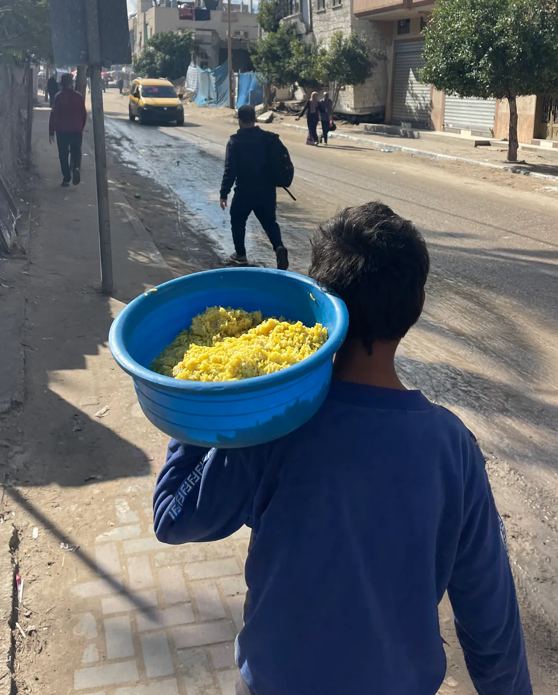
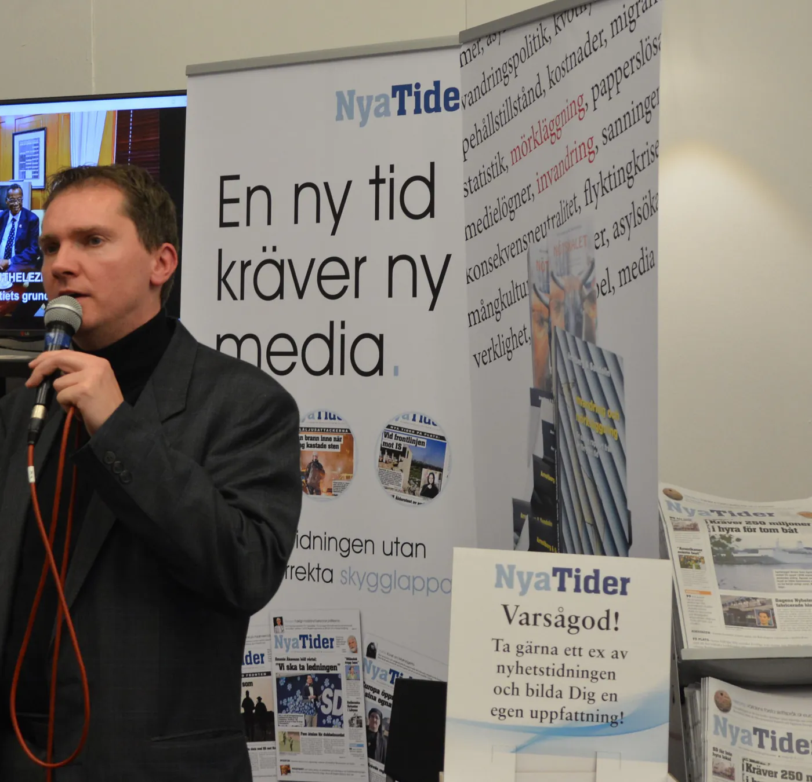

Bisan Edwan skulle ha läst poesi på Bokmässan i Göteborg i september 2026. Den palestinska poeten ställde in. "Jag kan inte läsa poesi i ett rum medan det pågår militärpropaganda", sade hon till SVT.[^1]

Den egyptiska författaren Iman Mersal meddelade på Instagram att också hon avstod. Samtalet de protesterade mot hölls på torsdagsförmiddagen den 24 september, mellan tio och halv elva, i monter H01:20 på Demokratitorget. Arrangör var Vänskapsförbundet Sverige-Israel, och rubriken löd "Israel och det internationella systemet – att kämpa i uppförsbacke". Huvudpersonen Jonathan Conricus, tidigare talesman för den israeliska armén, deltog via länk. Kulturnyheternas reporter Hannah Lindgren beskrev "väldigt lugn stämning med ett femtiotal åhörare och hög polisnärvaro".[^2]

Mässans svar kom i två led. Det ena var yttrandefriheten: "Vi har sympati för att det här väcker reaktioner. Men en öppen mötesplats som har yttrandefriheten som grund kommer alltid att väcka känslor", sade Bokmässans chef Oskar Ekström. Det andra var ansvarsfördelningen: mässan hade inte bjudit in Conricus, bara godkänt en utställare.[^3] Båda leden stämmer, men båda ligger vid sidan av saken. Conricus får säga vad han vill, i Göteborg och överallt annars. Det som står på spel är en regel som mässan själv har skrivit för just den här ytan, med krav på respekt för mänskliga rättigheter. Vad betyder en sådan regel om den aldrig syns prövad mot den som har förnekat en fastställd svält och ett folkmord medan bombningarna av Gaza ännu pågick?

## Ett torg med en kod

Demokratitorget är nytt. I mars presenterade mässan det som "en levande mötesplats för samtal om demokrati, samhällsfrågor och framtidens utmaningar – där aktörer med fokus på demokrati, mänskliga rättigheter och yttrandefrihet samlas".[^4] För den ytan har mässan i år uppdaterat sin uppförandekod. Enligt SVT och TT kräver koden att utställarna respekterar mänskliga rättigheter och följer demokratiska principer. "Det gäller utställarna och vi förväntar oss att alla följer den", var Ekströms besked.[^5]

Med koden har mässan flyttat den gräns den själv drog 2017. Mitt i striden om tidningen Nya Tider skrev den då: "Även avskyvärda åsikter kan därför förekomma på en bokmässa – så länge de ryms inom demokratins gemensamma regler: lagen."[^6] På Demokratitorget kräver mässan i dag något som lagen inte kräver, och där kan den inte längre svara att allt lagligt är välkommet.

Förhistorien gör frågan svår att kringgå. Inför mässan 2025 planerade samma utställare bland annat en programpunkt med rubriken "Den fabricerade svälten i Gaza". Ekström kallade rubrikerna "onödigt polariserande", och mässan förklarade att den inte stod bakom dem. Efter dialog med arrangören ändrades de.[^7] Programpunkten om svälten fick heta "Svälter Gaza?". En student anmälde programpunkterna för hets mot folkgrupp, och polisen beslutade "baserat på de uppgifter som angavs vid anmälningstillfället" att inte inleda förundersökning.[^8] Med lagen som enda gräns räckte det med en ny rubrik. Ett år senare fanns en uppdaterad kod, och mässan kände redan till utställarens linje i frågan om svälten.

## Fem dagar efter kommissionen

Conricus har varit den israeliska arméns internationelle talesman. Han återtog rollen som reservist hösten 2023, när anfallen mot Gaza inleddes. I dag är han knuten till den amerikanska tankesmedjan Foundation for Defense of Democracies.[^9] Hans ord om Gaza är offentliga och lätta att datera, och det är dateringen som avgör.

Den 12 juni 2025 skrev han på X att människorna i Gaza led av "objektiva umbäranden" och tillade: "Men det råder ingen svält."[^10] IPC är det klassificeringssystem för hungerkriser som FN-organ och biståndsorganisationer står bakom. I maj hade det räknat med 470 000 människor i fas 5, katastrof, och varnat för en kritisk risk för svält.[^11] I juni uttalade sig Conricus alltså om något som formellt ännu inte var avgjort.

Sedan avgjordes det. Den 22 augusti fastställde IPC svält i guvernementet Gaza, där Gaza City ligger, med prognos om spridning söderut till Deir al-Balah och Khan Younis. Mer än en halv miljon människor i Gazaremsan levde i katastrofläge. IPC:s granskningskommitté konstaterade: "Eftersom denna svält är helt och hållet människoskapad kan den stoppas och vändas."[^12]

Även slutsatserna om folkmord hade hopats. I december 2024 fann Amnesty International att Israel har begått och begår folkmord i Gaza.[^13] Den 28 juli 2025 kom de israeliska organisationerna B'Tselem och Physicians for Human Rights Israel till samma slutsats.[^14] Den 31 augusti antog genocidforskarnas internationella förening, International Association of Genocide Scholars, en resolution med samma innebörd.[^15] Den 16 september fann FN:s oberoende internationella undersökningskommission att Israel har begått folkmord i Gazaremsan. Israeliska myndigheter och säkerhetsstyrkor hade enligt kommissionen gjort sig skyldiga till fyra av de fem handlingar som folkmordskonventionen räknar upp.[^16] Fem dagar senare skrev Conricus:

> Lögner och åter lögner. Ingen svält, inget folkmord och ingen annan absurd anklagelse mot Israel håller för någon seriös granskning. Skam över de mediearbetare, "humanitärer" och politiker som sprider dessa osanningar.[^17]

Det här är inte längre en bedömning av ett oklart läge. Förnekandet står mot den instans som mäter svält och mot fyra slutsatser om folkmord. Det skrevs medan folkmordet pågick, och det är ett vittnesmål om människor som inte längre kan vittna själva.

Vapenvilan trädde i kraft den 10 oktober 2025, men i november slog Amnesty fast att folkmordet fortgick trots den. Först i december klassades inget område längre som svält, och även då räknade IPC med över hundratusen människor i katastrofläge.[^18] Ett år efter inlägget hördes hans röst på Demokratitorget.

## Ett godkännande är ett beslut

Mässans försvar är starkare än parollen om det fria ordet. Bokmässan bjöd inte in Conricus och deltog inte i planeringen. Enligt Ekström står utställarna själva för fler än 3 000 programpunkter, och mässans del var att godkänna Vänskapsförbundet Sverige-Israel som utställare.[^19] På programsidan friskriver sig mässan uttryckligen: "Arrangören ansvarar för innehåll och medverkande i programmet."[^20] Medverkan är inte heller medhåll. "Att en person tillåts medverka på Bokmässan, via en utställare, betyder inte per automatik att Bokmässan ställer sig bakom personens åsikter", framhöll Ekström för TT. Byrån rapporterar också att Ekström är "kritisk även till flera av hans uttalanden, till exempel har Conricus förnekat svälten i Gaza".[^21]

Försvarets kärna ligger ett lager djupare: koden gäller utställarnas uppträdande, inte sanningshalten i vad en gästtalare en gång har skrivit, och en bokmässa ska inte avgöra omstridda sakfrågor. Mässan förhandsgranskar inte utställarnas program, vilket kommunikationschefen Maria Rogstad uppgav redan 2025. I stället följer den demokratiområdet på plats, med Ekströms ord "på olika sätt".[^22] Ingen av de redaktioner som bevakade samtalet återger heller att Conricus upprepade orden om svälten där.

Varje led håller tills det ställs bredvid koden. Friskrivningen lägger ansvaret för "innehåll och medverkande" på arrangören. Koden kräver att samma arrangör, i egenskap av utställare, respekterar mänskliga rättigheter. Tillsammans gör de två texterna valet av talare till den handling som koden gäller. Friskrivningen skulle hålla mässan på avstånd, men den sluter i stället cirkeln. Den part som därmed bär ansvaret har mässan godkänt, och det för ett torg som den har beskrivit som en samlingsplats för aktörer med fokus på mänskliga rättigheter. Ett godkännande är ingen frånvaro av beslut. Det är mässans beslut.

Neutraliteten i sakfrågan har mässan redan lämnat. Den markerade avstånd 2025, när den kallade rubrikerna onödigt polariserande. Den tog ställning 2026, när dess chef enligt TT var kritisk till att Conricus hade förnekat svälten. Den som redan har kritiserat förnekandet kan inte gömma sig bakom att frågan är omstridd. Om det som koden gäller har mässan däremot inte yttrat sig offentligt: om det är förenligt med kravet på respekt för mänskliga rättigheter att ge plats på Demokratitorget åt den som mitt under bombningarna avfärdade en fastställd svält och slutsatserna om folkmord som lögner.

Att mässan inte förhandsgranskar ändrar inte heller saken, för programpunkten var känd i förväg. Den 22 september, två dagar innan portarna öppnade, rapporterade SVT Väst om den och om att Bokmässan åter hade polisanmälts. Utställaren var densamma som året innan.[^23] Att pröva en enda programpunkt mot en kod kräver ingen granskningsapparat, bara ett beslut att se efter och att säga vad man såg. "Vi förväntar oss att alla följer den" uttrycker en förväntan och ingenting mer. Någon prövning av programpunkten mot koden har mässan inte offentligt redovisat.

Till sist ordet som mässan själv satte först. Yttrandefriheten i regeringsformen skyddar den enskilde mot det allmänna. Regeringen skrev 2020, i ett svar om sociala medier, att yttrandefriheten "enbart gäller för enskilda i förhållande till det allmänna" och att privata plattformar har "en principiell rätt att själva bestämma över vad som ska få publiceras där".[^24] Bokmässan är ingen myndighet, och den censurerar ingen genom att tillämpa sin egen kod. Den som här åberopar yttrandefriheten har bytt fråga, från vad mässan gör med sitt torg till vad staten får göra med en talare. Den senare frågan avgörs av lagen. Den förra kan bara mässan besvara. "Där en människa har sin säregna makt, där måste hon äfven få sitt sedliga mått", skrev Ellen Key.[^25] Mässans säregna makt ligger i godkännandet, och där ska den mätas.

## Vad mässan visste redan 2016

Mässan vet hur man åberopar en värdegrund. Den 19 augusti 2016 meddelade den att Nya Tider inte längre skulle få ha någon monter. Dåvarande vd:n Maria Källsson förklarade: "Vi kom fram till att den här utställaren inte delar samma värdegrund som vi på en springande fråga, och det är alla människors lika värde." Hon medgav också att mässan hade vetat för lite när tidningen först godkändes: "Vi gjorde en för dålig research, det är jag den första att erkänna."[^26] Den 31 augusti återkallades beslutet med motiveringen: "Det visar sig att det saknas grund för uppsägning av det här avtalet." Nya Tider ställde ut 2017, trots en bojkott som till slut samlade över 200 författare. När tidningen i november 2017 nekades plats inför 2018 var skälet ett annat än värdegrunden: uppmärksamheten kring en enskild utställare hade skymt mässans innehåll.[^27]

Jämförelsen gäller mässans eget värdegrundsargument. Den likställer inte Conricus med Nya Tider och hävdar inte heller att tidningen borde ha fått stanna. Det som föll 2016 var inte viljan att åberopa värdegrunden utan det skriftliga stödet för att göra det. Tio år senare finns stödet, en kod om mänskliga rättigheter, och den gäller just den yta där Vänskapsförbundet har sin monter. Vad koden väger i ett avtal kan bara mässan bedöma. Men den finns, och ändå talar mässan, när det väl gäller, om yttrandefrihet och inte om sin kod. Att ett godkännande kan vila på "för dålig research" har Bokmässan redan medgett en gång.

Mässan försäkrar dessutom att den är konsekvent. Taha Khatab i studentgruppen GU Students for Palestine polisanmälde Bokmässan och Vänskapsförbundet och formulerade en jämförelse: "Man skulle aldrig acceptera att en rysk talesperson skulle komma till Bokmässan och förklara varför det är legitimt att rikta raketer mot civila i Ukraina." Jämförelsen är Khatabs. Mässan bjöd inte in Conricus; den godkände utställaren. Polisanmälan avgör ingenting, och resonemanget här förutsätter inte att ett brott har begåtts. SVT Väst förde frågan vidare till mässan: "Hade ni låtit en person som tidigare varit talesperson för en rysk myndighet prata om att världen är orättvis mot Ryssland?" Ekström svarade: "Vi spekulerar inte i hypotetiska frågor, men vi har regler och villkor som är konsekventa."[^28]

Konsekvens är emellertid en egenskap som bara syns i jämförelsen. Den som avböjer jämförelsen har försäkrat sin konsekvens men inte visat den. Enligt programtexten skulle samtalet i montern handla om att internationella organisationer mäter Israel med andra mått än andra stater, och med den tesen kan konsekvensfrågan vändas mot kritikerna. Men det är mässan som här ska mätas, inte hur Israel behandlas i det internationella systemet, och måttet är dess egen kod.

## Att vara närvarande vid det falska

Bisan Edwan motiverade sitt beslut utan att bestrida mässans rätt att fatta sitt: "Jag har en klar röd linje. Jonathan Conricus är inte vem som helst med en annan politisk ståndpunkt." Och: "En kulturinstitution har rätt att fatta egna beslut men måste också ta konsekvenser av det." Ekström talade om författarnas val: "Vi är förkrossade över att de här författarna valt att hoppa av Bokmässan."[^29] Edwan pekade på ett annat val. Att ge Conricus en plattform var enligt Sejfers referat av henne "ett aktivt val".[^30] Varken hon eller Mersal hindrade någon. Deras protest bestod i att utebli.

Koranen har ord för ett sådant val. I sura al-Furqān, i uppräkningen av den Nåderikes tjänare, heter det:

> [Den Nåderikes sanna tjänare är] också de som inte vittnar falskt och som, när de träffar på [människor inbegripna i] lättsinnigt tal, går vidare med värdighet[^31]

Uttrycket *lā yashhadūna az-zūr* rymmer två läsningar, och Ibn Kathīr redovisar båda. Enligt den ena handlar det om falskt vittnesmål, att medvetet ljuga om en annan, och här anför han hadithen från Abū Bakra. I al-Bukhārīs återgivning räknade Profeten ﷺ upp de största synderna: att sätta medgudar vid Guds sida och att vara olydig mot föräldrarna. Han hade legat tillbakalutad. Då satte han sig upp och sade: "Och se upp för falskt tal och falskt vittnesmål." Han upprepade det tills Abū Bakra tänkte att han inte skulle tystna.[^32] Sammanhanget talar ändå enligt Ibn Kathīr tydligast för den andra läsningen: att de inte är *närvarande* vid det falska, och att de, om de råkar passera det, går vidare "utan att fläckas av det".[^33]

Verbet *shahida* betyder både att vittna och att vara närvarande. Mässans försvar förutsätter att man kan upplåta ett rum utan att stå i det. Ordet håller ihop det som försvaret vill hålla isär: den som är närvarande vid ett vittnesmål står som vittne till det. Ett torg som bär namnet Demokratitorget och har en kod om mänskliga rättigheter är inget tomrum. Det intygar något om varje röst som får plats där och lånar ut sitt namn åt den, vad som än sägs just den förmiddagen.

Hos al-Bukhārī finns också en berättelse om hur regler tillämpas. En gång ville någon utverka ett undantag för en kvinna ur en förnäm släkt. Profeten ﷺ reste sig och höll ett tal: "Det som störtade människorna före er var att när den förnäme bland dem stal lät de honom gå, och när den svage bland dem stal verkställde de straffet mot honom."[^34] I båda berättelserna ändrar han hållning innan han talar: i den ena sätter han sig upp, i den andra reser han sig. Det som får honom att räta på sig är det falska ordet och en regel som tillämpas olika på olika människor, samma två frågor som Demokratitorget väcker. Berättelsen om den förnäme och den svage prövar en regel på ett enda sätt: håller den där den kostar något?

## En regel syns där den kostar

En uppförandekod är ett löfte om prövning. Mässan har skrivit ett sådant löfte för Demokratitorget och försäkrar att dess regler är konsekventa. Programpunkten som fick en palestinsk poet att stanna borta var ett samtal med en man som hade skrivit "Lögner och åter lögner" om svälten och folkmordet, en månad efter att svälten fastställts och fem dagar efter FN-kommissionens slutsats. Om löftet hölls har mässan inte visat. En prövning kan ha gjorts. I så fall kan den redovisas, och för den som står utanför är det bara redovisningen som skiljer en regel från en dekor. Frågan till Bokmässan är därför enkel: prövades programpunkten mot kravet på respekt för mänskliga rättigheter? Och om den prövades, på vilka grunder blev svaret ja?

---

[^1]: Abdul Hibombo, "Författaren hoppar av Bokmässan i protest: 'Har en klar röd linje'", SVT, 24 september 2026. Bilderna i texten: Jaber Jehad Badwan, Deir al-Balah, [24 januari 2025](https://commons.wikimedia.org/wiki/File:A_Gazan_child_carrying_food_for_his_family_during_the_Gaza_war_23-25.jpg), och Bengt Oberger, Bokmässan i Göteborg, [24 september 2016](https://commons.wikimedia.org/wiki/File:Nya_tider_01.jpg), båda via Wikimedia Commons, licens [CC BY-SA 4.0](https://creativecommons.org/licenses/by-sa/4.0/), beskurna.
[^2]: Simon Löfroth, "Kritiserade Israelsamtal och ny uppförandekod – nu startar Bokmässan", SVT, 24 september 2026, där också Mersals besked. Tid, plats och arrangör enligt programsidan "Israel och det internationella systemet – att kämpa i uppförsbacke", bokmassan.se.
[^3]: Ekströms citat i Löfroth, SVT, a.a. Att mässan inte bjöd in Conricus utan godkände utställaren enligt Ekström i "Två författare lämnar Bokmässan efter omstridd programpunkt", Sejfer, 24 september 2026.
[^4]: "Bokmässan stärker sitt demokratiarbete – med ny scen och nytt område", bokmassan.se, 2 mars 2026.
[^5]: Löfroth, SVT, a.a.; TT (Elin Swedenmark), "Bokmässan polisanmäld för andra året i rad", Göteborgs-Posten, 23 september 2026, uppdaterad 24 september. Koden återges här efter SVT:s och TT:s referat.
[^6]: "Låt oss göra gemensam sak mot intoleransen", bokmassan.se, 21 april 2017.
[^7]: "Bokmässan polisanmäls efter programpunkter om Gaza", SVT, 24 september 2025.
[^8]: Tamara Fuentes, polisregion Väst, i "72 kulturpersoner anklagar Bokmässan för folkmordspropaganda", SVT, 25 september 2025. Där redovisas också namnbytet till "Svälter Gaza?".
[^9]: Enligt tankesmedjans presentation av honom. Programsidan på bokmassan.se kallar honom "tidigare talesperson för IDF och FN-tjänsteman".
[^10]: Jonathan Conricus (@jconricus), X, 12 juni 2025: "To be clear: there is objective hardship for people in Gaza as a result of the war that Hamas started and continues to wage. But there is no famine. Hamas hoards food and then clowns like this blame Israel for it. Absurd." Översättningarna från engelska är gjorda för den här texten.
[^11]: IPC, "The Gaza Strip is still confronted with a critical risk of Famine amid ongoing conflict, aid blockade", ipcinfo.org, 12 maj 2025; UNICEF, "Risk of famine for children across Gaza, new report says", 12 maj 2025.
[^12]: IPC, "Gaza Strip: Famine confirmed in Gaza Governorate, projected to expand", Special Snapshot, 22 augusti 2025. Granskningskommitténs (Famine Review Committee) ord: "As this Famine is entirely man-made, it can be halted and reversed." Prognosen för 16 augusti–30 september 2025 var 641 000 människor i fas 5.
[^13]: Amnesty International, "Amnesty International concludes Israel is committing genocide against Palestinians in Gaza", 5 december 2024, om rapporten *You Feel Like You Are Subhuman*. Underlaget omfattar intervjuer med 212 personer och 102 granskade uttalanden, varav 22 av höga befattningshavare med ansvar för offensiven.
[^14]: B'Tselem och Physicians for Human Rights Israel, gemensamt pressmeddelande, 28 juli 2025, med rapporterna *Our Genocide* och *Destruction of conditions of life: a health analysis of the Gaza genocide*.
[^15]: International Association of Genocide Scholars, resolution om Gaza, antagen 31 augusti och offentliggjord 1 september 2025 med stöd av över 80 procent av de röstande medlemmarna.
[^16]: OHCHR, "Israel has committed genocide in the Gaza Strip, UN Commission finds", 16 september 2025. De fyra handlingarna är dödande, allvarlig kroppslig eller psykisk skada, levnadsvillkor avsedda att förinta gruppen och åtgärder för att förhindra födslar. Benämningen folkmord i den här texten vilar på de fyra slutsatser som redovisas ovan. Internationella domstolen har inte avgjort saken. Sydafrikas mål mot Israel pågår, och enligt domstolens tidsplan ska Sydafrikas replik lämnas senast i november 2027 och Israels duplik senast i maj 2029 (EWN, 3 juni 2026).
[^17]: Jonathan Conricus (@jconricus), X, 21 september 2025: "Lies and more lies. No famine, no genocide and no other absurd allegation against Israel stand up to any serious scrutiny. Shame on the media workers, 'humanitarians' and politicians who spread these falsehoods."
[^18]: "Gaza famine pushed back, but millions still face hunger and malnutrition, UN says", UN News, 19 december 2025; Amnesty International, "Israel's genocide against Palestinians in Gaza continues unabated despite ceasefire", 27 november 2025.
[^19]: Sejfer, a.a., med referat av Ekström.
[^20]: Programsidan, bokmassan.se, a.a.
[^21]: TT, Göteborgs-Posten, a.a.
[^22]: Rogstad i SVT, 24 september 2025, a.a.; Ekström i TT, Göteborgs-Posten, a.a.
[^23]: "Bokmässan polisanmäls igen – tidigare IDF-talesperson på programmet", SVT Väst, 22 september 2026, uppdaterad 24 september.
[^24]: Justitieminister Morgan Johansson, svar på skriftlig fråga 2019/20:1831, "Yttrandefrihet på nätet", 19 augusti 2020.
[^25]: Ellen Key, *Lifslinjer*, tredje delen.
[^26]: "Bokmässan förklarar Nya Tider-turerna", Journalisten, 25 augusti 2016.
[^27]: "Nya tider och alternativa bokmässor – så gick det till", SVT.
[^28]: SVT Väst, a.a., för Khatabs citat, SVT:s fråga och Ekströms svar. Om polisanmälan även Löfroth, SVT, a.a.
[^29]: Hibombo, SVT, a.a., för Edwans citat och för Ekströms svar.
[^30]: Sejfer, a.a.
[^31]: Koranen 25:72 (al-Furqān), i Knut Bernströms översättning.
[^32]: Ṣaḥīḥ al-Bukhārī, Kitāb al-adab, nr 5976: "ألا وقول الزور، وشهادة الزور"; parallell i Kitāb al-shahādāt, nr 2654. Återgivningen i texten följer nr 5976. Ibn Kathīr anför hadithen från Abū Bakra ur de två Ṣaḥīḥ-samlingarna i *Tafsīr al-Qurʾān al-ʿaẓīm* 6:130. Översättningarna från arabiska är gjorda för den här texten.
[^33]: Ibn Kathīr, *Tafsīr al-Qurʾān al-ʿaẓīm* 6:130–131: "والأظهر من السياق أن المراد: لا يشهدون الزور، أي: لا يحضرونه".
[^34]: Ṣaḥīḥ al-Bukhārī, Kitāb al-maghāzī, nr 4304: "فإنما أهلك الناس قبلكم: أنهم كانوا إذا سرق فيهم الشريف تركوه، وإذا سرق فيهم الضعيف أقاموا عليه الحد"; parallell i nr 3475, där det heter att han reste sig och höll ett tal.
