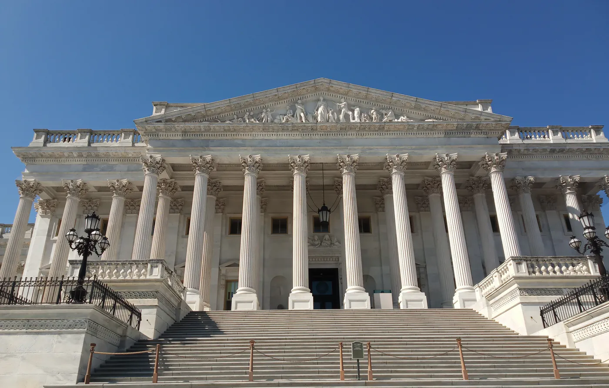
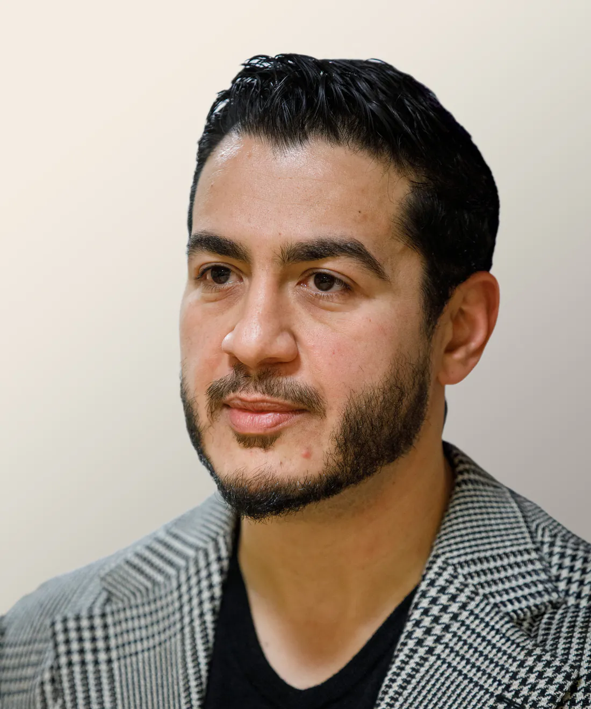
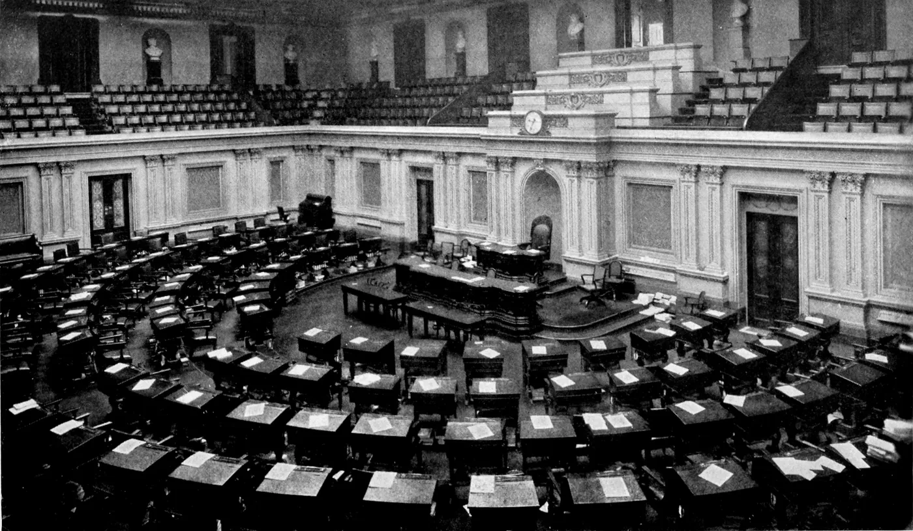

Omkring en timme innan nyhetsbyrån Associated Press utropade honom till segrare gjorde Abdul El-Sayed det själv, på Michigans demokratiska partis valvaka i Detroit: "Michigan, vi klarade det."[^1] AP gav sitt besked klockan 2.27 på natten, östamerikansk tid. När 85 procent av rösterna var räknade låg han nästan sex procentenheter före republikanen Mike Rogers, och på morgonen var avståndet omkring tio enligt de preliminära siffrorna. Han är 42 år, son till egyptiska invandrare och har aldrig tidigare varit folkvald. Nu är han den förste muslim som har valts till USA:s senat, och han tillträder den 3 januari.[^2]

Rösterna räknas fortfarande. Men vad valet skulle handla om avgjordes långt innan vallokalerna öppnade, och det var inte han som avgjorde det.

## Namnet på valsedeln

På examensceremonin vid University of Michigan 2007 föreslog Bill Clinton att El-Sayed kanske borde kandidera till något ämbete. Så här har han själv återgett sitt svar: "Jag vet inte om du såg mitt namn. Det kommer inte att gå för mig."[^3]

Nitton år senare hade namnet blivit en valfråga. President Donald Trump kallade honom gång på gång vid mellannamnet, Mohamed, och kritiker beskrev det som en signal till vissa väljare.[^4] Mohamed är också faderns namn. Mohamed El-Sayed växte upp i Alexandria, blev professor i maskinteknik vid Kettering University i Flint och är dessutom imam.

Förtalet i egentlig mening var något annat. Trump och andra republikaner kallade honom "jihadist".[^5] Rogers, presidenten och vicepresident Vance påstod att han eller hans familj hade band till Muslimska brödraskapet. Påståendena saknade grund. El-Sayed har förnekat dem och tagit avstånd från rörelsen.[^6] "Det har funnits mycket öppen islamofobi i omlopp", sade Yasmin Bazzi, 31 år, i Dearborn.[^7]

I segertalet berättade han vad han hade fått höra: "De sade till oss att någon med ett namn och min historia, en muslim, inte gick att välja – än mindre i ett senatsval över hela Michigan."[^8] Omdömet förutsatte att mannen är sin religion, och att väljarna skulle döma religionen när de dömde honom.

## Förtalet slog fel

Väljarna svarade. Dearborn är förorten till Detroit som kallas det arabiska Amerikas huvudstad. Där var valdeltagandet högt, med köer vid vallokalerna, och enligt inofficiella siffror fick El-Sayed mer än 82 procent av rösterna mot knappt 17 för Rogers. I Dearborn Heights fick han 75 procent.[^9] Ali Baleed Almaklani, en ledargestalt bland jemenitiska amerikaner, sade till Al Jazeera att kampanjen mot muslimerna hade fått arabiska och muslimska väljare att rösta i högre grad. Sally Howell, professor emeritus i historia vid University of Michigan-Dearborn, sade: "Den här förändringen innefattar också ett avvisande av hatet i politiken, särskilt hatet mot muslimer."[^10]

Det Israel gör i Gaza är ett folkmord, och han kallade det så: "Om du inte kan kalla det vad det är, ett folkmord, hur ska du då kunna stå upp mot Donald Trump?"[^11] Inför primärvalet den 4 augusti lade United Democracy Project, AIPAC:s super-PAC, tiotals miljoner dollar på att stödja hans motståndare Haley Stevens och angripa honom. Han vann ändå, med omkring en procentenhet.[^12]

Här finns något att glädjas åt, och det ska sägas utan omsvep. Väljarna avvisade förtalet, och den som kallade ett folkmord vid dess rätta namn vann. Pengarna avgjorde inte.

## Samma slutsats åt andra hållet

Ändå finns det en frestelse i glädjen, och den är svår att få syn på eftersom den liknar upprättelse. Motståndarna sade: en muslim kan inte väljas. De som jublar svarar: en muslim valdes. Båda sidor gör namnet till måttstock, och båda ser valet som en dom över islam. De ena väntade sig en fällande dom, de andra tror sig ha fått en friande.

Traditionen godtar ingen av domarna, eftersom den aldrig har godtagit måttet. Profeten ﷺ sade:

> Gud ser inte till era gestalter och era ägodelar, utan Han ser till era hjärtan och era gärningar.[^13]

Meningen med hadithen, skriver an-Nawawī, är att det är hjärtat som räknas i allt detta.[^14] Namnet står inte med bland gestalterna och ägodelarna, men det hör till samma sida: det yttre, det man har fått och inte det man har gjort. En annan hadith säger samma sak om härkomsten: "Den vars gärning håller honom tillbaka, honom skyndar inte hans härkomst fram."[^15] Man ska inte förlita sig på släktens ära och fädernas förtjänst och försumma gärningen, förklarar an-Nawawī.[^16] Hadithen talar om härkomst, och att föra över den på ett namn är en analogi. Men steget är kort, för ett namn är härkomst i liten skala, ibland bokstavligen faderns.

Essän "[En from människa kan vara en dålig ledare](/rosten-ar-ingen-beloning/)" har visat att inte ens fromheten ensam meriterar för ett ämbete. Ett namn meriterar ännu mindre, och det diskvalificerar lika lite.

Koranen lägger bördan där den hör hemma: "på ingen bärare av bördor skall läggas en annans börda", och "ingenting skall tillerkännas människan utom det som hon har eftersträvat".[^17] Ibn Kathīr läser de två leden tillsammans: så som en annans börda inte läggs på människan, får hon inte heller annan lön än den hon själv har förvärvat.[^18] Ett namn är ingen strävan.

Därmed faller båda domarna. Segern säger något om Michigan, och om att förtal kan slå fel. Om islam säger den ingenting. ʿAlī ibn Abī Ṭālib sade: "Sanningen känns inte igen genom människor. Känn igen sanningen, så känner du igen dess folk."[^19] Islams sanning var densamma kvällen före valet och hade varit densamma om Rogers hade vunnit. Islam behöver ingen senator.

Ingenting av detta gör El-Sayeds tro till ett tomt namn. Det är Gud som väger den.

## Det Ibrahim bad om

Att namnet inte väger något i domen betyder ändå inte att det saknar verkan. Människor läser namnet, och Koranen räknar med det. I sura 60 har Ibrahim och de som följde honom just tagit avstånd från sitt folk och dess avgudar. Därefter kommer en bön:

> Herre! Gör oss inte till [Ditt redskap när] Du vill sätta förnekarna av sanningen på prov! Och Herre! Förlåt oss [våra synder]! Du är den Allsmäktige, den Vise!"[^20]

Vilken prövning? Qatāda svarade: ge dem inte övertaget över oss, så att de förleds av det och tror att de har fått övertaget för att de har rätt. Den tolkningen valde aṭ-Ṭabarī, som själv förklarar bönen så: "genom att Du ger dem makt över oss, så att de anser att de har rätt och att vi har fel". Mujāhid läste den som en bön om att inte straffas, varken genom förnekarnas händer eller med ett straff från Gud, "så att de säger: om dessa hade haft rätt hade detta inte drabbat dem".[^21]

Moses folk bad med nästan samma ord (10:85). Där återger Ibn Kathīr samma förklaring efter Abū Mijlaz och Abū aḍ-Ḍuḥā: förnekarna ska inte tro att de har fått makt för att de har rätt och de troende fel.[^22] Tolkarna beskriver ett och samma tankefel. Någon ser ett utfall i världen, ett övertag eller ett lidande, och sluter sig därifrån till vem som har sanningen. Just den slutsatsen är prövningen, *fitna*. Bönen ber inte om att de troende ska slippa bli sedda. Den ber om att det som drabbar dem inte ska bli någon annans bevis.

Tolkarna talar om nederlaget, och essän "[Linné läste Guds dom i andras olyckor](/solen-morknar-for-ingen/)" har visat att en synlig olycka inte är någon dom över en människa. Steget från nederlaget till segern tar tolkarna inte själva, men skälet är deras eget: om ett nederlag inte visar att förnekarna har rätt, visar en seger inte heller att de troende har det. Den som såg valresultatet som islams upprättelse har dragit just den slutsats som Ibrahim bad att hans fiender skulle bevaras från, bara med omvänt förtecken.

Ibn Taymiyya vidgar bönen. Han skriver i ett avsnitt om människans egna synder, som med en god utgång kan bli en nåd också för andra, när de drar lärdom av dem. Där räknar han orden "Gud, gör mig inte till ett varnande exempel för andra" till de bästa bönerna. Bredvid dem ställer han Moses folks och Ibrahims böner och bönen i 25:74 om att bli föredömen för de gudfruktiga, och han tolkar dem så här:

> gör oss till föredömen för den som följer oss och tar oss till förebild, och gör oss inte till en prövning för den som går vilse genom oss och blir olycklig.[^23]

Faran är här inte längre bara att fienden får övertaget. Den finns också i den troendes eget liv: det han gör blir läst, och andra kan gå vilse genom honom. Så förstådd gäller bönen varje troende som syns, och ingen kan be den med pekfingret riktat mot någon annan. Men en sak gör den klar: den muslim som syns blir läst som sin religion, av vänner och av fiender. Ett otrevligt svar i kassan blir hemma vid middagsbordet något som muslimer gör. Det går inte att välja bort, och Ibrahim försökte inte. Han bad.

För den muslimska läsaren stänger det två vägar. Den ena är att göra senatorn till ett bevis för islam. Den andra är att skynda sig att ta avstånd från honom för att rentvå religionen, den dag han gör något man ogillar. Båda låter namnet avgöra. Den första lånar ut religionens anseende till en politiker, den andra låter en politikers brister belasta religionen.

## Rättvisan gäller också de egna

Kvar blir ett omdöme som gäller åt båda hållen.

> TROENDE! Stå fasta på Guds sida som vittnen för rätt och rättvisa och låt inte avoghet mot människor förmå er att avvika från rättvisans väg. Gör rätt - det ligger gudsfruktan närmast; Gud är väl underrättad om vad ni gör.[^24]

Ibn Kathīr sammanfattar: "använd rättvisan mot var och en, vare sig vän eller fiende".[^25] Åt det ena hållet betyder det att förtal inte besvaras med förtal. Mohamed är hans namn, och det var sättet att använda det som kritiker kallade en signal. Förtalet var ordet "jihadist" och de grundlösa påståendena om brödraskapet. Att blanda ihop de två är att själv börja tala orättvist.

Essän "[Muslimerna bad för en kristen kung](/sorgen-vid-nilen/)" satte måttet för väljaren, rättvisa och inte samhörighet, och sade att rättvisan inte får göra undantag för de egna. Här vänds samma mått mot omdömet om en vald muslim. Ibn Taymiyya påminner om att versen om avogheten uppenbarades med anledning av de troendes hat mot förnekarna, ett hat som var befallt, och att den ändå förbjöd orättvisan. Därav hans slutsats:

> Rättvisa är en plikt som var och en har mot var och en i varje läge, och orättvisa är förbjuden utan undantag och blir aldrig tillåten. […] Om den som hatar så som Gud befallt ändå förbjuds att vara orättvis mot den han hatar, hur är det då med den som hatar en muslim på grund av en tolkning, ett tvivel eller egen lust? Han har ännu större rätt att inte utsättas för orättvisa, utan att behandlas rättvist.[^26]

Utan det kravet blir samme man ett bevis den dag han gör det man väntar sig, och en främling den dag han gör någon besviken. Han beskriver sig som progressiv demokrat med bakgrund i folkhälsoarbete. Han har gått till val på allmän, offentligt finansierad sjukvård, högre skatt för de rikaste och på att få ut pengarna ur politiken.[^27] Det är hans program. Religionen svarar inte för det, varken när det lyckas eller när det brister. "Var och en skall ställas till svars för vad han har gjort".[^28]

## Bönen i stället för domen

Mellan triumfen och avståndstagandet finns en tredje hållning, och den är äldre än båda. Al-Fuḍayl ibn ʿIyāḍ sade:

> Om jag hade en bön som blev hörd skulle jag inte lägga den på någon annan än en ledare, för ledarens rättskaffenhet är ländernas och människornas rättskaffenhet.[^29]

Ibn Taymiyya beskriver samma hållning hos de tidiga generationerna, bland dem al-Fuḍayl och Aḥmad ibn Ḥanbal: hade de haft en bön som blev hörd skulle de ha bett den för makthavaren.[^30] Den ledare de talade om var muslimernas härskare, och en senator i Washington är ingen sådan. Det som kan föras över är skälet, inte ställningen. Har någon makt över andra har han deras väl i sina händer, och hans rättvisa blir deras.

Men om människan inte får annat än det hon själv har strävat efter, vad tjänar då en annans bön till? Svaret står hos Muslim:

> En muslims bön för sin broder i hans frånvaro blir hörd. Vid hans huvud står en ängel som har fått uppdraget, och varje gång han ber om gott för sin broder säger ängeln: Amen, och åt dig detsamma.[^31]

Hadithen ger ett dubbelt svar. Bönen för den frånvarande blir hörd, och ängelns ord gör den också till den bedjandes egen vinning: han får detsamma. Det skiljer bönen från de två vägar som stängdes. Triumfen och avståndstagandet väger båda en annans namn och gör den som väger till åskådare. I bönen är det den bedjande själv som strävar, och samma vers som tog all vikt från namnet talar här för den som ber. Bönen fäller ingen dom. Den kräver varken att man känner hans hjärta eller att man har godkänt hans program, bara att man vill att han ska vara rättvis.

## Var inte romarnas seger ett tecken?

Till glädjens försvar finns en invändning, och den har stöd i Koranen själv. När perserna hade slagit romarna förutsade sura 30 att romarna skulle segra inom några få år: "Vid samma tid skall [även] de troende få glädjas åt Guds hjälp".[^32] Muslimerna ville att romarna skulle vinna, eftersom också de var skriftens folk, medan Quraysh, avgudadyrkarna i Mekka, stod på persernas sida.[^33] Några av dem slog vad med Abū Bakr om utgången, och det var innan vadslagning förbjöds. När romarna segrade antog många islam, enligt at-Tirmidhīs återgivning.[^34] Gud lovar också att ge "Våra sändebud och de troende [Vår] hjälp både i detta liv och den Dag då vittnena reser sig [för att vittna]".[^35] Är en seger då inget tecken?

Inte segern i sig. Tecknet var att en förutsägelse i Koranen gick i uppfyllelse, och Abū Bakr hade satsat på Guds ord, inte på romarnas härar. Mitt i samma vers står dessutom: "Avgörandet ligger hos Gud - så har det [alltid] varit och så skall det förbli."[^36] Om löftet i sura 40 ställer Ibn Kathīr, efter aṭ-Ṭabarī, frågan var hjälpen i detta liv fanns, när vissa profeter dödades och andra fick lämna sitt folk, som Ibrahim. Svaret är att löftet gäller somliga av dem, eller att hjälpen är vedergällningen mot förföljarna, i detta liv eller senare.[^37] Ibrahim, som bad bönen i sura 60, hörde själv till dem som fick lämna sitt folk. Hans seger stod inte att läsa i något valresultat.

## Partiet, programmet och den privata tron

Från motsatt håll kommer en invändning som tar essäns eget mått på allvar. Han är vald för ett parti och på ett program, för att stifta lag i ett system som inte dömer efter det Gud har uppenbarat, och versen före Ibrahims bön handlar om att ta avstånd. Är inte glädjen över honom just det som essän har varnat för, att låta namnet väga tyngre än det han ska göra?

Så vore det, om glädjen gällde programmet eller systemet. Den gäller något annat: att väljarna avvisade förtalet, och att den som kallade ett folkmord vid dess rätta namn vann. Det är gärningar som redan är gjorda. Hans övriga gärningar återstår, och de blir hans egna. Frågan om kandidatur och lagstiftning är för stor för att avgöras här. Inte heller prövas han själv. Hans börda läggs inte på någon annan, och ingen annans läggs på honom.

Den sekulära invändningen vänder sig mot själva ordet. Att kalla honom den förste muslimske senatorn är identitetspolitik, säger den, och tron är en privatsak som borde lämnas därhän. Men det var inte hans anhängare som gjorde tron till frågan. Det gjorde de som upprepade hans mellannamn och kallade honom "jihadist", och de som sade att en muslim inte gick att välja. Att tiga om tron nu vore att låta deras läsning stå obesvarad. Dessutom är religionen aldrig bara privat för den troende. Gärningarna vägs, de offentliga lika väl som de dolda, men de vägs av Gud och med Guds mått, inte efter vilket namn som står på valsedeln.

## En väljare i Hamtramck

I Hamtramck sade väljaren Motahar Fadhel: "Jag är stolt över honom. Jag blir rörd."[^38] Orden påstår ingenting om islam och ingenting om vad som finns i hans hjärta. De är glädje, och den får stå som den är.

Den 3 januari tillträder han. Bönen för honom är densamma som för var och en som får makt över andra: att han blir rättvis.

---

[^1]: Bridge Michigan, "Abdul El-Sayed beats Mike Rogers in US Senate race: 'Michigan, we did it'", 4 november 2026. Där återges också AP:s besked klockan 2.27 och att han ledde med nästan sex procentenheter när 85 procent av rösterna var räknade. På engelska: "Michigan, we did it." Översättningarna från engelska är gjorda för den här texten. Bilden överst: Conlan Houston, Michigan Technological University, [22 oktober 2025](https://commons.wikimedia.org/wiki/File:Abdul_El-Sayed_meet-and-greet_by_Conlan_Houston_3.jpg), licens [CC BY-SA 4.0](https://creativecommons.org/licenses/by-sa/4.0/). Bilderna i texten: Kenneth C. Zirkel, [porträtt 2025](https://commons.wikimedia.org/wiki/File:Abdul_El-Sayed.jpg), licens [CC BY-SA 4.0](https://creativecommons.org/licenses/by-sa/4.0/); ʿAmr ibn Kulthūm, [Warren Avenue i Dearborn, 25 oktober 2012](https://commons.wikimedia.org/wiki/File:%D8%B4%D8%A7%D8%B1%D8%B9_%D9%88%D9%88%D8%B1%D9%86_%D9%81%D9%8A_%D8%AF%D9%8A%D8%B1%D8%A8%D9%88%D8%B1%D9%86.jpg), licens [CC BY-SA 2.5](https://creativecommons.org/licenses/by-sa/2.5/); Andrew Jameson, [Joseph Campau Avenue i Hamtramck, 4 november 2012](https://commons.wikimedia.org/wiki/File:Jos_Campau_N_of_Caniff_-_Hamtramck_MI.JPG), licens [CC BY-SA 3.0](https://creativecommons.org/licenses/by-sa/3.0/); Bernini123, [senatsflygeln på Kapitolium, september 2024](https://commons.wikimedia.org/wiki/File:Facade_of_Senate_chamber.jpg), fri från upphovsrätt (CC0); Harris & Ewing, [senatens plenisal, publicerad 1921](https://commons.wikimedia.org/wiki/File:Collier%27s_1921_United_States_of_America_-_Senate_Chamber.jpg), fri från upphovsrätt. Samtliga via Wikimedia Commons; bilden överst och bilderna från 2025, Dearborn och 2024 är beskurna.
[^2]: De preliminära siffrorna på morgonen den 4 november, när 91 procent av rösterna var räknade, var 53,9 mot 44,2 procent: Yahoo News, "Michigan voters reflect on historic El-Sayed win: 'A proud moment'", 4 november 2026. Att han är den förste muslim som har valts till senaten anger Associated Press enligt Time och Bridge Michigan. Att han aldrig har haft ett valt ämbete anger Bridge Michigan. Tillträdet den 3 januari 2027 anges av Al Jazeera, "'Rejecting hate': Abdul El-Sayed wins Senate seat despite racist attacks", 4 november 2026.
[^3]: Time, "Abdul El-Sayed Wins Michigan Senate Race, Making History as First Muslim Senator", 3–4 november 2026. På engelska: "I don't know if you saw my name. It's not going to work out for me."
[^4]: Time, samma artikel.
[^5]: Al Jazeera, samma artikel.
[^6]: Bridge Michigan; Time, som kallar både Rogers och Trumps anklagelser om band till brödraskapet grundlösa.
[^7]: Yahoo News, samma artikel. På engelska: "There's been a lot blatant Islamophobia that is going around."
[^8]: Time, utskrift av segertalet. På engelska: "They told us that someone with a name and my story, a Muslim, was unelectable". Meningen fortsätter: "let alone in a statewide Senate race in Michigan".
[^9]: Valdeltagandet och köerna enligt Al Jazeera, de inofficiella siffrorna för Dearborn och Dearborn Heights enligt Yahoo News.
[^10]: Al Jazeera. På engelska: "This change also includes a rejection of hate in politics, especially anti-Muslim hate."
[^11]: Time. På engelska: "If you can't call it what it is, which is a genocide, then how are you going to stand up to Donald Trump?" Att Israel begår folkmord i Gaza har Amnesty International (5 december 2024), B'Tselem och Physicians for Human Rights Israel (28 juli 2025), International Association of Genocide Scholars (31 augusti 2025) och FN:s undersökningskommission (16 september 2025) var för sig slagit fast. Målet vid Internationella domstolen pågår.
[^12]: JNS, "AIPAC super PAC spent almost $25 million to help Stevens beat El-Sayed in Michigan", 23 juli 2026, anger 24,7 miljoner dollar i oberoende utgifter fram till tisdagen samma vecka. Al Jazeera anger över 30 miljoner dollar.
[^13]: Ṣaḥīḥ Muslim, Kitāb al-birr wa-ṣ-ṣila wa-l-ādāb, nr 2564, genom Abū Hurayra. Översättningarna från arabiska är gjorda för den här texten.
[^14]: an-Nawawī, *al-Minhāj sharḥ Ṣaḥīḥ Muslim* 16:121, där det också sägs att Guds seende omfattar allt.
[^15]: Ṣaḥīḥ Muslim, Kitāb adh-dhikr wa-d-duʿāʾ wa-t-tawba wa-l-istighfār, nr 2699, genom Abū Hurayra. Meningen avslutar en längre hadith.
[^16]: an-Nawawī, *al-Minhāj sharḥ Ṣaḥīḥ Muslim* 17:21–22.
[^17]: Koranen 6:164; 53:38–39.
[^18]: Ibn Kathīr, *Tafsīr al-Qurʾān al-ʿaẓīm* 7:465.
[^19]: Ibn al-Jawzī, *Talbīs Iblīs* 1:74. Samma ord finns hos al-Qurṭubī, *al-Jāmiʿ li-aḥkām al-Qurʾān* 1:340.
[^20]: Koranen 60:5.
[^21]: Qatāda och Mujāhid återges hos Ibn Kathīr, *Tafsīr al-Qurʾān al-ʿaẓīm* 8:87–88. Han anger också att Ibn Jarīr (aṭ-Ṭabarī) valde Qatādas tolkning, att aḍ-Ḍaḥḥāk sade detsamma som Mujāhid och att Ibn ʿAbbās läste bönen som: ge dem inte makt över oss, så att de förleder oss. Aṭ-Ṭabarīs egen förklaring står i *Jāmiʿ al-bayān*, i kommentaren till 60:5, där han tillägger att tolkarna har sagt detsamma. Hos al-Qurṭubī, *al-Jāmiʿ li-aḥkām al-Qurʾān* 18:57, står huvudläsningen utan namn: fienden ska inte få övertaget, så att de tror att de har rätt och förleds av det.
[^22]: Ibn Kathīr, *Tafsīr al-Qurʾān al-ʿaẓīm* 4:288–289, om Koranen 10:85.
[^23]: Ibn Taymiyya, *Majmūʿ al-fatāwā* 14:306–307. Han anför bönen om att inte bli ett varnande exempel som en av de bästa böner, inte som en hadith. En parallell, där 60:5 inte anförs, finns i 8:210.
[^24]: Koranen 5:8.
[^25]: Ibn Kathīr, *Tafsīr al-Qurʾān al-ʿaẓīm* 3:62.
[^26]: Ibn Taymiyya, *Minhāj as-sunna an-nabawiyya* 5:126–127.
[^27]: Time; Bridge Michigan, 4 november 2026.
[^28]: Koranen 74:38.
[^29]: adh-Dhahabī, *Siyar aʿlām an-nubalāʾ* 7:400–401, efter ʿAbd aṣ-Ṣamad ibn Yazīd. Ordet *imām* betyder här den som styr. Ibn Kathīr återger yttrandet med en annan lydelse i *al-Bidāya wa-n-nihāya* 10:215: "Om jag hade en bön som blev hörd skulle jag lägga den på imamen, för genom honom blir folket rättskaffens. När han är rättskaffens är människorna och länderna trygga."
[^30]: Ibn Taymiyya, *as-Siyāsa ash-sharʿiyya* 1:136–137. Ordet han använder är *as-sulṭān*, makthavaren.
[^31]: Ṣaḥīḥ Muslim, Kitāb adh-dhikr wa-d-duʿāʾ wa-t-tawba wa-l-istighfār, nr 2733, genom Abū ad-Dardāʾ; jfr nr 2732. Bön betyder här *duʿāʾ*, åkallan. Ibn Kathīr skriver i kommentaren till 53:39 att det råder enighet om att åkallan och allmosan når fram (*Tafsīr* 7:465). Han talar där om de döda, och det som når en död når en levande så mycket mer.
[^32]: Koranen 30:4–5.
[^33]: Ibn Kathīr, *Tafsīr al-Qurʾān al-ʿaẓīm* 6:299. Jfr 6:304, där han skriver att de troende gladdes eftersom romarna "i stort sett är ett skriftens folk" och därför stod dem närmare än mazdaiterna.
[^34]: at-Tirmidhī, *Sunan*, Kitāb tafsīr al-Qurʾān, nr 3194, genom Niyār ibn Mukram al-Aslamī. At-Tirmidhī graderar den: ḥasan ṣaḥīḥ gharīb. Där anmärks att vadet ingicks före förbudet mot vadslagning.
[^35]: Koranen 40:51.
[^36]: Koranen 30:4.
[^37]: Ibn Kathīr, *Tafsīr al-Qurʾān al-ʿaẓīm* 7:150, efter Ibn Jarīr (aṭ-Ṭabarī).
[^38]: Yahoo News, "Michigan voters reflect on historic El-Sayed win: 'A proud moment'", 4 november 2026. På engelska: "I feel proud of him. I feel emotional."
