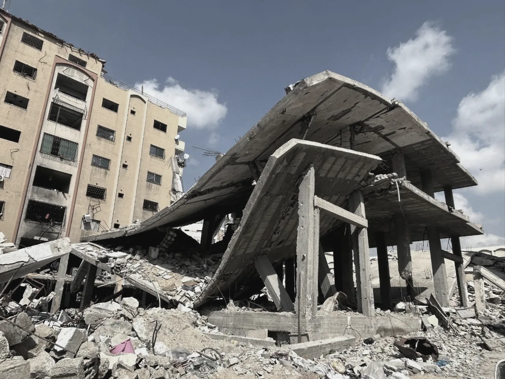
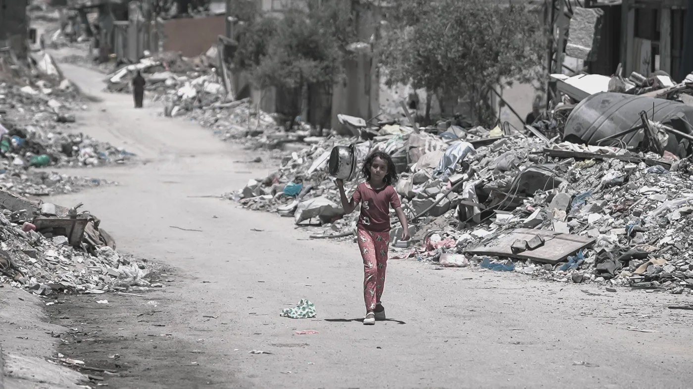
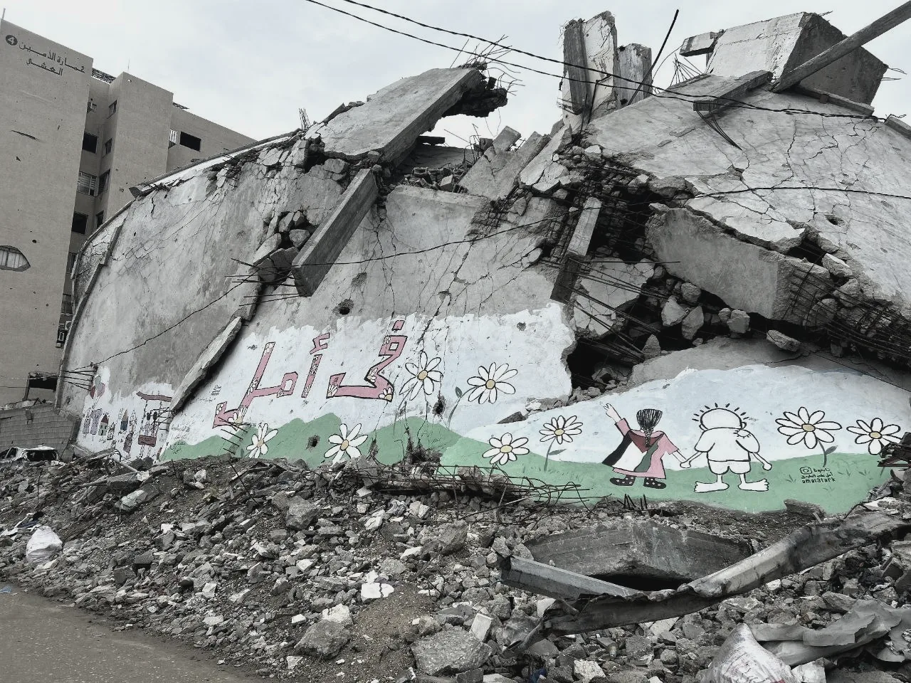

Soldaterna berättar hur de avlyssnade palestinska barns telefoner. Ett barn ropar på sin far när han kommer hem. Ropet bekräftar för systemet Lavender var den utpekade mannen befinner sig, och en säkerhetsofficer långt därifrån skriver under ett robotanfall mot familjens hem.

Så återger kritikern Hugo Emmerzael en scen ur *NAZA*, Yuval Abrahams och Rachel Szors dokumentär.[^1] Ett rop, en bekräftad plats, en underskrift. Det som skrivs under är ett tal.

## Ett tal för de ännu levande

NAZA är den israeliska arméns förkortning av *nezek agavi*, hebreiska för "sidoskada". Enligt Al Jazeera betecknar ordet antalet civila som väntas dödas i ett visst flyganfall.[^2] Talet räknas ut och godkänns före anfallet. Det gäller människor som lever vid underskriften och redan står inräknade bland de döda.

Filmen, som har fått sitt namn efter ordet, är en brittisk produktion av The Guardian och JW Films, gjord av två israeliska regissörer ur kvartetten bakom *No Other Land*. Den bygger på 24 anonyma intervjuer med israeliska soldater och underrättelseofficerare, filmade nattetid på ett tak i Tel Aviv, omkring sex mil norr om Gazas ruiner.[^3] Den hade världspremiär i Venedig den 10 september 2026 och fick juryns specialpris.[^4]

Ordet är gjort för att frikänna. En skada vid sidan av är en skada utanför det man siktade på, något som ingen ville. Men ett tal som godkänns i förväg ligger mitt i beslutet. Svensk straffrätt har ett namn för att handla i vetskap om att en följd är praktiskt taget säker: insiktsuppsåt. Ett NAZA-tal är just en sådan vetskap, uttryckt i siffror och försedd med underskrift. Det ord som skulle intyga att döden låg utanför avsikten är protokollet över uppsåtet. Och folkmord kräver uppsåt.

## Tjugo sekunder och en stämpel

Systemet var känt före filmen. I april 2024 skrev Yuval Abraham om det i +972 Magazine och Local Call utifrån källor inom underrättelsetjänsten, och filmen bygger vidare på den rapporteringen.[^5] Lavender hade då markerat omkring 37 000 palestinier som misstänkta militanta, de flesta lågt uppsatta. Under de första veckorna av bombningarna hösten 2023 beslöt armén att **upp till 15 eller 20 civila fick dödas för varje lågt uppsatt misstänkt** som systemet markerat, och vid flera tillfällen godkände den att **över 100 civila dödades i anfall mot en enda befälhavare**. **En officer uppgav att han ägnade omkring 20 sekunder åt varje utpekad person**, dussintals om dagen: "Som människa tillförde jag ingenting, utöver att vara en godkännandestämpel." **Systemet pekade ut fel människa i ungefär vart tionde fall, och det var känt.** Ett annat program, Where's Daddy?, följde de utpekade och användes för att **slå till när de hade kommit hem till sin familj**, ofta nattetid. Mot de lågt uppsatta användes ostyrda bomber.

I *NAZA* berättar de som utförde arbetet själva. Enligt In Review Online erkänner en underrättelseofficer att han har **skrivit under anfall med en NAZA på över 200**. Recensionen återger också en replik där datorn och befälet är likställda: "Om datorn eller ditt befäl säger åt dig att bomba en familj på tolv personer, är det ingen tvekan om att du gör det."[^6] Enligt Al Jazeera såg vittnena i filmen "med egna ögon" och hörde "med egna öron" att husen de pekade ut var fulla av familjer. En av de intervjuade som deltog i utpekandet säger att arbetet är "som ett tv-spel, eftersom allt görs på distans" och "vansinnigt roligt".[^7] En soldat talar om norra Gaza som en "annihilation zone", en utplåningszon. Recensenten sammanfattar hans vittnesmål: först dödar armén de flesta av invånarna, sedan kommer den för att jämna varje byggnad med marken, och på vägen förstörs varje familjealbum, fotografi och dagbok, varje tecken på liv som kunde påminna framtida historiker om att landet var bebott av verkliga människor.[^8]



Det ligger nära till hands att göra Lavender till berättelsens huvudperson. Men det var armén som beslöt hur många civila som fick dö. Systemet föreslog, människor satte talet, och en människa skrev under.

## Sex barn på tio dagar



Efter bomberna räknar andra. Enligt Gazas hälsoministerium har Israel sedan oktober 2023 **dödat omkring 73 500 palestinier och skadat 174 500**. Vapenvilan i oktober 2025 har inte stoppat dödandet. Mellan vapenvilan och den 2 september 2026 dödades enligt samma ministerium **1 334 människor** och 4 429 skadades i israeliska anfall, och talet fortsätter att stiga.[^9] När Abraham tog emot priset räknade han i festivalens egna dagar:

> Verkligheten är att Israel sedan den här festivalen började, bara under de här tio dagarna, har dödat minst sex palestinska barn i Gaza: en treårig flicka i en skola som bombades, en sjuåring med sin far i bilen, två systrar som sov hemma.[^10]

Han påminde också om att sanningen "har dokumenterats och varit känd från första dagen tack vare palestinska journalister", och om att fler än 200 av dem har dödats av Israel. Gaza behövde ingen film för att veta. Amnesty International hämtade titeln på sin rapport från ett vittne i Deir al-Balah: "Man känner sig som något mindre än en människa här."[^11] De israeliska vittnesmålen kommer i efterhand. De bekräftar, inifrån den apparat som dödade, vad palestinierna själva har sagt från början. När armén godtog femton eller tjugo döda civila för en enda lågt uppsatt misstänkt, hade den i förväg bestämt hur mycket mindre än en människa en civil i Gaza var värd. Det som vittnet kände stod redan i arméns egen uträkning.

## En olycka med underskrift

Ordet för detta har uttalats från fyra håll, oberoende av varandra. Amnesty fastslog den 5 december 2024, efter intervjuer med vittnen och en genomgång av israeliska ledares uttalanden, att Israel har begått och fortsätter att begå folkmord i Gaza. Organisationen fann tre av folkmordskonventionens handlingar belagda: dödande, allvarlig kroppslig eller psykisk skada och livsvillkor avsedda att förstöra gruppen. Också det särskilda uppsåtet ansåg den styrkt.[^12] Den 28 juli 2025 kom två israeliska organisationer, B'Tselem och Physicians for Human Rights Israel, till samma slutsats. B'Tselems rapport heter *Our Genocide* – vårt folkmord – och konstaterar att "Israel vidtar samordnade åtgärder för att avsiktligt förstöra det palestinska samhället i Gazaremsan".[^13]

Den 31 augusti 2025 antog folkmordsforskarnas internationella förening, International Association of Genocide Scholars, med 86 procent av de avgivna rösterna en resolution om att Israels politik och handlingar i Gaza uppfyller den rättsliga definitionen av folkmord.[^14] Den 16 september 2025 fann FN:s undersökningskommission för de ockuperade palestinska områdena att fyra av konventionens fem handlingar hade begåtts. Kommissionens ordförande Navi Pillay:

> Kommissionen finner att Israel bär ansvar för att ha begått folkmord i Gaza. Det är tydligt att det finns ett uppsåt att förstöra palestinierna i Gaza genom handlingar som uppfyller kriterierna i folkmordskonventionen.[^15]

Vid Internationella domstolen pågår Sydafrikas talan mot Israel, väckt den 29 december 2023. Domstolen beslutade om interimistiska åtgärder den 26 januari 2024 men har ännu inte avgjort saken.[^16]

```timeline
source: Internationella domstolen, 26 januari 2024; +972 Magazine och Local Call, 3 april 2024; Amnesty International, 5 december 2024; B'Tselem, 28 juli 2025; International Association of Genocide Scholars, 31 augusti 2025; OHCHR, 16 september 2025; OCHA, 4 september 2026; Democracy Now!, 14 september 2026; JTA, 18 september 2026
caption: Ordet folkmord, steg för steg, medan dödandet fortsatte.
note: Tidslinjen visar när slutsatserna kom, inte hur de motiverades. Internationella domstolen har ännu inte avgjort målet.
emphasis: september 2025
data:
  december 2023: Sydafrika väcker talan om folkmord mot Israel vid Internationella domstolen.
  januari 2024: Domstolen beslutar om interimistiska åtgärder. Målet pågår.
  april 2024: +972 Magazine och Local Call avslöjar systemen Lavender och Where's Daddy?
  december 2024: Amnesty International fastslår att Israel begår folkmord i Gaza.
  juli 2025: B'Tselem och Physicians for Human Rights Israel, två israeliska organisationer, kommer till samma slutsats i var sin rapport. B'Tselems heter "Our Genocide".
  augusti 2025: Folkmordsforskarnas internationella förening finner att den rättsliga definitionen av folkmord är uppfylld.
  september 2025: FN:s undersökningskommission fastslår att Israel har begått folkmord i Gaza.
  oktober 2025: Vapenvila. Fram till den 2 september 2026 dödas ändå 1 334 människor enligt Gazas hälsoministerium.
  september 2026: NAZA har premiär i Venedig. Premiärministern ställer sig bakom ett lagförslag som skulle frånta regissörerna medborgarskapet.
```

Mot tanken att NAZA-talet är uppsåt finns en allvarlig invändning. Varje armé som bombar i tätbebyggda områden räknar i förväg med civila döda; det kallas proportionalitetsbedömning. Folkmord kräver dessutom mer än vetskap om att människor ska dö. Det kräver det särskilda uppsåtet, *dolus specialis*, att helt eller delvis förstöra en grupp som sådan. Ett NAZA-tal visar att dödandet var känt, beräknat och godkänt, men inte ensamt att gruppens förstörelse var avsikten.

Svaret finns i det som vittnena och +972:s källor beskriver. När armén på förhand godtog femton eller tjugo civila för en lågt uppsatt misstänkt, och ibland över hundra för en befälhavare, hade bedömningen från fall till fall blivit en taxa. Med programmet Where's Daddy? väntade armén tills mannen var hemma, och i scenen med barnet var det ropet som bekräftade platsen. Familjen var inte en risk som anfallet tog, utan tecknet på att det var dags. Tjugo sekunder per utpekad person, i ett system som man visste tog fel i vart tionde fall, gjorde granskaren till det officeren själv kallade en godkännandestämpel. I utplåningszonen i norr skulle till och med familjealbumen bort. Invändningen får sin kraft av att den förklarar de döda med något annat än avsikt: de var priset för en militär fördel, prövat från fall till fall. Men en taxa bestäms innan något fall finns, en granskning på tjugo sekunder prövar ingenting, och den som vill hålla nere en kostnad väntar inte tills familjen är hemma. Kvar står mönstret, och det måste förklaras med något annat.

Abraham och Szor har skrivit att *NAZA* är "en film om ett system", som handlar om "order, riktlinjer och handlingsmönster, inte om avvikelser från dem". Massdödandet var enligt dem "en överlagd, beräknad och avsiktlig handling".[^17] I Venedig förklarade Abraham att underrättelseofficerarna hade berättat om ett systematiskt dödande, "inte av en slump, utan enligt en plan".[^18] Det var ur hela mönstret, tillsammans med den politiska och militära ledningens egna uttalanden, som FN-kommissionen och B'Tselem slöt sig till uppsåtet.

Ordet folkmord vilar på de fyra slutsatserna. I NAZA-talet får uppsåtet förvaltningens form: ett tal, en underskrift, en arbetsdag. **Det Israel gör i Gaza är folkmord**, och *NAZA* visar hur det går till.

## Utredningen gäller vittnena

I Israel svarade regeringen med hot. Kulturminister Miki Zohar kallade filmen vidrig, talade om förräderi och krävde att regissörernas medborgarskap skulle dras in.[^19] Premiärminister Benjamin Netanyahu kallade det "chockerande" att två israeliska regissörer som framställer armén som krigsförbrytare fick applåder i Venedig. Han sade att "vi bekämpar global antisemitisk hets" och att den är "outhärdlig" när den kommer "inifrån oss". Den 18 september ställde han sig bakom ett lagförslag om att dra in medborgarskapet för den som förtalar soldaterna eller staten utomlands. De ansvariga skulle träffas "både i plånboken och i medborgarskapet": "Deras plats är inte hos oss."[^20] Armén förnekar varje avsiktligt angrepp på civila och säger att vittnenas identitet inte går att kontrollera. Överbefälhavaren Eyal Zamir har beordrat en rättslig utredning för att spåra källorna, de soldater och underrättelseofficerare vars identitet filmen skyddar.[^21] Det som ska utredas är vem som berättade.

Mot detta står ett annat Israel. Den 18 september hade över 2 000 israeliska filmarbetare, bland dem Ari Folman, skrivit under ett upprop för regissörerna: "konstens och journalistikens främsta uppgift är att hålla upp en spegel för det samhälle de verkar i". 43 israeliska organisationer för mänskliga rättigheter, jämlikhet och fred uppmanade myndigheterna att inte åtala filmskaparna eller deras källor: "Medborgarskap är inget pris som regimen eller regeringen delar ut, utan en grundläggande rättighet som tillhör var och en av oss."[^22] I Venedig hade Abraham sagt vad förnekandet gör:

> Vi tror att förnekandet av ett brott är det som låter det fortsätta.[^23]

## Den som räknades tillfrågas

Hadithen om att ändra det onda återges i en berättelse om att säga emot makten. Makthavaren Marwān hade lagt högtidspredikan före bönen, och en man reste sig och protesterade. Abū Saʿīd al-Khudrī sade då att mannen hade gjort vad som ålåg honom, och anförde vad han hört Guds sändebud ﷺ säga:

> Den av er som ser något ont ska ändra det med sin hand; kan han inte, då med sin tunga; kan han inte, då med sitt hjärta – och det är trons svagaste form.[^24]

Plikten följer förmågan, skriver Ibn Rajab al-Ḥanbalī, men en del av den faller aldrig bort: "Avståndstagandet i hjärtat är oundgängligt. Den vars hjärta inte tar avstånd från det onda visar att tron har gått ur hans hjärta."[^25] Två israeliska regissörer har sagt emot sin egen regering. För den som läser detta långt från Gaza är det minsta att veta och att säga, och efter *NAZA* kan ingen längre säga sig ovetande.

"De troende är som en enda man", lyder en annan hadith, "värker hans huvud, svarar hela kroppen med feber och sömnlöshet."[^26] Sömnlösheten kommer av sig själv hos den som hör till kroppen.



Sura at-Takwīr räknar upp vad som sker när världen går under, och mitt i uppräkningen står en fråga:

> […] och den nyfödda, som begravdes levande, tillfrågas för vilket brott hon miste livet, […][^27]

Frågan ställs till den som dödades, inte till den som dödade. Ibn Kathīr förklarar varför: det sker "för att det ska vara ett hot mot den som dödade henne. Om den förorättade tillfrågas – vad ska då förövaren vänta sig?"[^28]

Ett NAZA-tal räknar bara civila, människor som armén själv inte anklagar för något. Svaret på versens fråga står redan i protokollet, ifyllt av den som skrev under innan bomben föll: inget.

---

[^1]: Hugo Emmerzael, "NAZA – Yuval Abraham & Rachel Szor [Venice '26 Review]", *In Review Online*, 11 september 2026. Originalets lydelse: "Abraham patiently listens as soldiers recall how they spy through the phones of Palestinian children. They hear a child call out to their father as he arrives home, which confirms for the Lavender system the location of a Hamas operative and prompts a remote security officer to sign off on a missile strike against the family residence." Citat ur engelska och arabiska källor är översatta för den här texten. Koranen citeras i Knut Bernströms översättning. Bilden överst: Hussein Jaber för UNRWA, flyktinglägret Jabalia, 16 oktober 2024, [via Wikimedia Commons](https://commons.wikimedia.org/wiki/File:Destruction_caused_by_Israeli_bombing_of_Jabalia_camp,_Gaza_Strip_(cropped).jpg), licens [CC BY 4.0](https://creativecommons.org/licenses/by/4.0/); beskuren och färgbearbetad. Bilderna i texten: Jaber Jehad Badwan, Gaza, augusti 2024, licens [CC BY-SA 4.0](https://creativecommons.org/licenses/by-sa/4.0/); Hla Bashbash, al-Nasr-gatan och al-Thawra-gatan i Gaza, februari 2025, licens [CC BY 4.0](https://creativecommons.org/licenses/by/4.0/). Samtliga via Wikimedia Commons, färgbearbetade.
[^2]: "Israeli film on Gaza receives 25-minute ovation at Venice premiere", *Al Jazeera*, 11 september 2026: "a Hebrew intelligence euphemism used to indicate the number of civilians expected to be killed in a given air strike".
[^3]: Emmerzael, *In Review Online*, a.a.: "interviews with 24 IDF soldiers from the semi-public vantage point of a Tel Aviv rooftop. A mere 60 kilometers north of Gaza's ruins".
[^4]: "'NAZA' Film on Gaza Genocide Wins Venice Special Jury Prize; Israel Threatens Directors' Citizenship", *Democracy Now!*, 14 september 2026.
[^5]: Yuval Abraham, "'Lavender': The AI machine directing Israel's bombing spree in Gaza", *+972 Magazine* och *Local Call*, 3 april 2024. Officerens ord: "I had zero added value as a human, apart from being a stamp of approval." Enligt källorna bedömdes systemet ha "90 percent accuracy".
[^6]: Emmerzael, *In Review Online*, a.a.: "One intelligence officer even confesses that he has signed off on strikes with a NAZA of over 200." Repliken: "If the computer, or your superior, tells you to bomb a family of 12, there is no question that you will do so."
[^7]: *Al Jazeera*, 11 september 2026: "witnessed with their own eyes and ears that the homes they were 'incriminating' were filled with families"; "like a video game, because everything is done remotely"; "insanely fun".
[^8]: Emmerzael, *In Review Online*, a.a. Bara "annihilation zone" återges där som soldatens egna ord. Resten är recensentens sammanfattning: "First, the IDF kills most of its inhabitants; then it comes to obliterate every building, in the process destroying every family album, photograph, diary, or other sign of life that would remind future historians that this land was in fact populated by real human beings."
[^9]: Totalsiffrorna: Gazas hälsoministerium, enligt *Al Jazeera*, 11 september 2026. Tiden efter vapenvilan: Gazas hälsoministerium, återgivet i FN:s kontor för samordning av humanitära frågor (OCHA), *Humanitarian Situation Report*, 4 september 2026, räknat från vapenvilans tillkännagivande den 10 oktober 2025.
[^10]: Yuval Abraham vid prisutdelningen i Venedig, återgivet i *Democracy Now!*, 14 september 2026. Samma tal: "this truth has been documented and is known from the very first day thanks to Palestinian journalists. More than 200 of them were killed by Israel in Gaza."
[^11]: Amnesty International, *'You Feel Like You Are Subhuman': Israel's Genocide Against Palestinians in Gaza*, 5 december 2024.
[^12]: Amnesty International, "Amnesty International concludes Israel is committing genocide against Palestinians in Gaza", 5 december 2024.
[^13]: B'Tselem, *Our Genocide*, 28 juli 2025: "Israel is taking coordinated action to intentionally destroy Palestinian society in the Gaza Strip." Slutsatsen grundas på Israels politik, dess följder och uttalanden från ledande politiker och militära befälhavare. Physicians for Human Rights Israel publicerade samma dag en egen analys av hur sjukvården i Gaza förstörts.
[^14]: International Association of Genocide Scholars, resolution antagen den 31 augusti 2025.
[^15]: OHCHR, "Israel has committed genocide in the Gaza Strip, UN Commission finds", pressmeddelande 16 september 2025. De fyra handlingarna: dödande, allvarlig kroppslig eller psykisk skada, livsvillkor avsedda att förstöra gruppen och åtgärder för att förhindra födslar. Uppsåtet grundades på uttalanden från civila och militära makthavare och på säkerhetsstyrkornas handlingsmönster.
[^16]: Internationella domstolen, *Application of the Convention on the Prevention and Punishment of the Crime of Genocide in the Gaza Strip (South Africa v. Israel)*, beslut om interimistiska åtgärder den 26 januari 2024.
[^17]: Yuval Abraham och Rachel Szor, "'NAZA': Exposing Israel's killing machine in Gaza", *+972 Magazine*, 10 september 2026, citerad i *Al Jazeera* 11 september 2026: "This is a film about a system. It focuses on orders, policies, and patterns of operation, not deviations from them."; "a premeditated, calculated, and intentional act".
[^18]: *Democracy Now!*, 14 september 2026, och *CBS News*, 14 september 2026: "not by accident, but by design".
[^19]: *Democracy Now!*, 14 september 2026; "Israel probing Naza film on Gaza for treason, inciting anti-Semitism", *Al Jazeera*, 14 september 2026.
[^20]: "Benjamin Netanyahu joins Israeli ministers attacking Venice-winning documentary 'NAZA'", *Euronews*, 15 september 2026: "It's shocking. We are fighting global antisemitic incitement and when it comes from within us it is intolerable. And now two Israeli directors portraying the IDF as war criminals receive applause at the Venice festival." "Netanyahu backs legislation that would strip 'NAZA' makers of citizenship", *JTA*, 18 september 2026: "both in their pockets and in their citizenship"; "Their place is not with us."
[^21]: *CBS News*, 14 september 2026 ("cannot be verified"; "any deliberate targeting of civilians"); *Al Jazeera*, 14 september 2026 ("a legal probe to hunt down sources").
[^22]: Uppropet till stöd för Yuval Abraham och Rachel Szor, september 2026, i *The Jerusalem Post*: "The central role of art and journalism is to hold up a mirror to the society in which they exist". Organisationernas uttalande 16 september 2026, samma källa: "Citizenship is not a prize granted by the regime or the government, but a fundamental right belonging to each and every one of us." Antalen: *JTA*, 18 september 2026.
[^23]: *Democracy Now!*, 14 september 2026: "We believe that the denial of a crime is what helps it persist."
[^24]: *Ṣaḥīḥ Muslim*, Kitāb al-īmān, nr 49, efter Abū Saʿīd al-Khudrī: من رأى منكم منكرا فليغيره بيده، فإن لم يستطع فبلسانه، فإن لم يستطع فبقلبه، وذلك أضعف الإيمان. Om mannen: أما هذا فقد قضى ما عليه.
[^25]: Ibn Rajab al-Ḥanbalī, *Jāmiʿ al-ʿulūm wa-l-ḥikam* 2:244–245: فدلت هذه الأحاديث كلها على وجوب إنكار المنكر بحسب القدرة عليه، وأما إنكاره بالقلب لا بد منه، فمن لم ينكر قلبه المنكر، دل على ذهاب الإيمان من قلبه.
[^26]: *Ṣaḥīḥ Muslim*, Kitāb al-birr wa-ṣ-ṣila wa-l-ādāb, nr 2586, efter an-Nuʿmān ibn Bashīr: المؤمنون كرجل واحد إن اشتكى رأسه تداعى له سائر الجسد بالحمى والسهر.
[^27]: Koranen, at-Takwīr 81:8–9, i Knut Bernströms översättning. Verserna står mitt i den mening som löper genom 81:1–14. Arabiska: وَإِذَا ٱلْمَوْءُۥدَةُ سُئِلَتْ ۝ بِأَىِّ ذَنۢبٍ قُتِلَتْ
[^28]: Ibn Kathīr, *Tafsīr al-Qurʾān al-ʿaẓīm* 8:333: فيوم القيامة تسأل الموءودة على أي ذنب قتلت، ليكون ذلك تهديدا لقاتلها، فإذا سئل المظلوم فما ظن الظالم إذا؟! På samma sida återges att Ibn ʿAbbās, genom ʿAlī ibn Abī Ṭalḥa, förklarar *suʾilat*, "tillfrågas", med *saʾalat*, "hon frågade". Abū aḍ-Ḍuḥā tillägger: hon kräver sitt blod. Al-Qurṭubī (*al-Jāmiʿ li-aḥkām al-Qurʾān* 19:233–234) förstår frågan till den dödade som en tillrättavisning av den som dödade.
