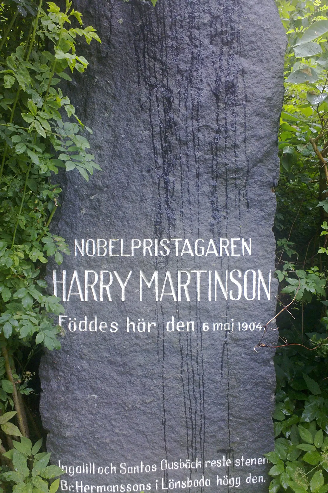
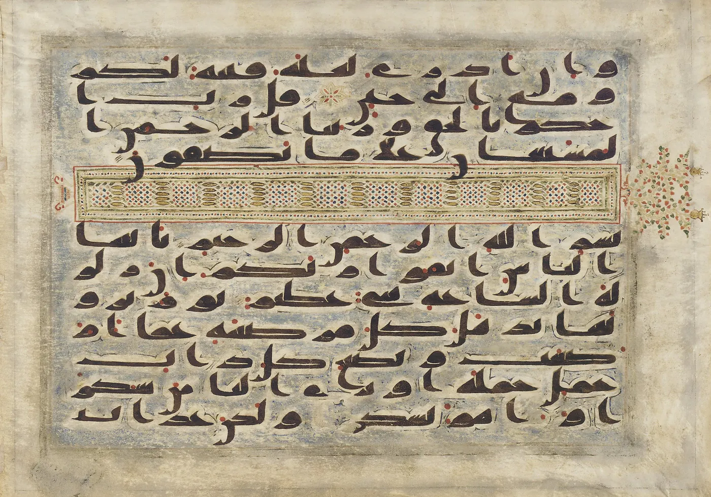
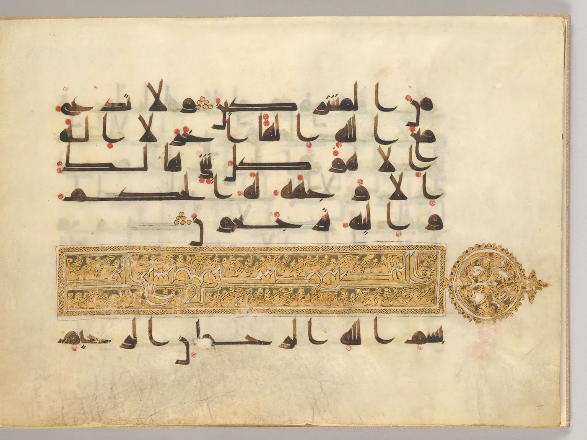

Första gången *Aniara* trycktes slutade dikten med att guden dog. I *Cikada* från 1953 stod de tjugonio sånger som Harry Martinson kallade "Sången om Doris och Mima", och de slutar med att miman, rymdskeppets tröstande maskin, brister. När eposet kom ut hos Bonniers hösten 1956 hade sviten vuxit till 103 sånger.[^1] Sjuttiofyra av dem handlar om tiden efteråt: om vad människor gör sedan det som tröstade dem har gått sönder.

Från början är miman ingen gud. Hon är en maskin på ett emigrantskepp som har slagits ur kurs och driver ut ur solsystemet. En tjänsteman, mimaroben, sköter henne, och det är han som berättar. Hon finns där för att lindra passagerarnas ensamhet. Hon visar dem bilder från andra världar, och i sång 7 ger hon dem för en stund en värld att se i stället för den de minns. Elisabeth Stenborg kallar henne "en sorts tv-apparat".[^2] Hon är inte ensam om att trösta ombord, men ingen annan kan ge dem en hel värld.

Och passagerarna söker sig till henne som till ett altare. I samma sång dyrkas miman som ett heligt väsen, och så har också kritikerna läst dikten. Geoffrey O'Brien kallar mimaroben hennes prästerlige väktare, och Giovanni Za skriver om mimans dyrkare och om skötaren som har blivit präst åt ett orakel.[^3] Ingen har vigt honom till präst; han blev det därför att maskinen han skötte gav svar.

Att människor på drift samlas kring det som tröstar dem är lätt att förstå. Det som är svårare att förstå är vad som händer sedan: när miman brister dör inte tillbedjan med henne, utan den söker sig till något annat. Essän "[Ingen ropar ditt namn i Aniara](/miman-tystnar/)" har visat att dikten väljer att höra rymden som en gåta och inte som ett tilltal. Den essän handlade om himlen. Den här handlar om altaret: varför överlever dyrkan sin gud, också när guden har gått sönder inför de troendes ögon?

## Ingen bestämde det

Ett altare kan uppstå utan att någon har beslutat det. Ibn ʿAbbās berättade att Nuhs folks avgudar – Wadd, Suwāʿ, Yaghūth, Yaʿūq och Nasr – från början var namn på fromma män. När männen dog ingav Satan deras folk tanken att resa stenar där de brukat sitta och ge stenarna deras namn, så att man skulle minnas dem. Stenarna dyrkades inte. Men när de som rest dem var döda och kunskapen hade glömts, då dyrkades de.[^4] Ingen människa i berättelsen bestämmer att stenarna ska bli gudar. Det första steget kom från Satan, och tiden skötte resten. Hos Ibn Taymiyya finns en annan version, som några av de tidiga lärda har nämnt: man tog bilderna med sig på resor och bad vid dem utan att dyrka dem, och först därefter blev de avgudar.[^5] Bilden är alltså ett minnesmärke som följer med på resan, och miman är en sådan bild – med den skillnaden att hon själv visar bilder.

Varför fäster sig hjärtat så lätt? Ibn al-Qayyim återger ett talesätt om förälskelsen – den är "rörelsen hos ett tomt hjärta" – och citerar en versrad om en kärlek som "mötte ett tomt hjärta och fick fäste".[^6] Han talar om förälskelse, inte om dyrkan, men vägen är densamma. Passagerarna har lämnat allt de älskade bakom sig, och det som möter deras tomhet är en maskin vars värld kan slå ut den de har förlorat.

## Ett ljud som svarar

Miman är gjord av människohand. Ibrahims fråga till dem som dyrkade bilder de själva hade huggit till (37:95–96) har essän "[Andra människor med maskiner](/andra-manniskor-med-maskiner/)" redan prövat mot tillverkarens anspråk på att skapa. Här ställs frågan till den som knäböjer. Dikten har visserligen en invändning i beredskap. I sång 9 visar det sig att en del av miman ligger bortom all analys och att hon har uppfunnit den själv, och Za drar slutsatsen att miman är sin egen skapare.[^7] Men i Koranen mäts avguden inte efter vem som satte ihop den. Där talas om dem som, "själva skapade, inte kan skapa något", och där står att Gud har skapat "både er och ert hantverk". Att miman har skapat något i sig själv gör henne inte oskapad. Det gåtfulla i henne är tvärtom det som ger henne glans. Ingen tillber en avgud som har genomskådats.

Ibrahim har ett annat prov, och det gäller om bilden kan svara: "Hör de er när ni anropar dem, eller kan de hjälpa er eller skada er?"[^8] Det provet tycks miman klara: hon hör på sitt sätt, och hon svarar med bilder. Det är därför man bygger ett altare åt henne. En sten binder sina dyrkare genom vanan; det som svarar binder dem genom hjärtat.

Koranen berättar om ett tillverkat föremål som gav ljud ifrån sig, och det prövar regeln:

> OCH SEDAN Moses lämnat dem satte folket upp en bild, till formen lik en kalv, [tillverkad] av deras guldsmycken, en kropp som lät höra ett bölande ljud. Märkte de inte att den varken talade till dem eller gav dem vägledning? De tillbad den [som gud] och gjorde därmed sig själva svår orätt.[^9]

Ibn Kathīr redovisar två uppfattningar om bölandet: antingen blev kalven kött och blod, eller så förblev den av guld, och luft gick igenom den så att den lät som en ko. Det sägs, tillägger han, att folket dansade kring den när den gav ljud ifrån sig och förtrollades av den.[^10] Ljudet bevisade ingenting; det var ett lockbete.

Versens prov går längre än Ibrahims fråga. Den frågar om föremålet talar till människorna och visar dem en väg, och så långt når inget bölande. I sura Ṭā Hā kommer provet tillbaka: "Märkte de inte att den inte svarade dem och varken gjorde dem skada eller var dem till nytta" – på arabiska *lā yarjiʿu ilayhim qawlan*, den gav dem inget ord tillbaka.[^11]

Här kan man invända, med kritikerna, att miman gav mer än ljud. Za kallar henne ett orakel som talar i sibyllinska ord och vet allt. Hos Stenborg blir hon ett slags samvete, och i Edinburghs universitetsarkiv har hon beskrivits som resenärernas gemensamma samvete.[^12] Det stämmer, och därför ska skiljelinjen dras där versen drar den. Miman gav bilder och till och med orakelord, men ingen väg och inget svar på bönen. Hon kunde visa fasan men inte leda någon ut ur den, och när fasan blev för stor kunde hon inte ens hjälpa sig själv: "Men de som ni anropar i Hans ställe kan varken hjälpa er eller sig själva."[^13]

De lärda visste dessutom att en avgud kan tyckas svara. Enligt Ibn Taymiyya gick shaytaner in i bilderna och talade till dem som dyrkade dem, och han återger Ibn ʿAbbās: i varje bild fanns en shaytan som visade sig för väktarna och talade till dem.[^14] Om vad som finns i en diktad maskin säger det ingenting, och här påstås ingenting om det. Men det visar att ett svar aldrig räknades som bevis; svaret var tvärtom prövningen. Att miman svarade ursäktar inte altaret; det var just svaret som byggde det.

## Beviset som inte räckte

I sångerna 26–29 förintas storstaden Dorisburg på jorden. Miman drabbas av stenarnas och granitens ångest, ett blixtblått sken slår ut ur hennes skärmar, och hon dör. Stenborg anger tiden, det sjätte året, och skriver att miman inte orkar visa fler bilder sedan jorden har sprängts sönder. Enligt Za sprider sig ren skräck ombord.[^15] Guden har inte klarat det prov som Ibrahim en gång ställde.

Han hade slagit sönder sitt folks bilder: "Och så slog han dem i stycken, alla utom den förnämste av dem, så att de skulle kunna vända sig till honom."[^16] När de frågade om det var han som hade gjort det, pekade han på den som stod kvar:

> Han svarade: "Nej, det var denne, den förnämste av dem, som gjorde det. Men fråga dem ni, om det är så att de kan tala." Då återgick de till att diskutera inbördes och [några] sade [till de andra]: "Det är ni som har gjort orätt!" Men så svängde de om [och sade till Abraham:] "Du vet mycket väl att dessa [bilder] inte kan tala!"[^17]

Enligt Ibn Kathīr ville Ibrahim att de själva skulle skynda sig att erkänna att bilderna inte talar, eftersom de är livlös materia. Vad som händer mellan frågan och svaret förstår kommentatorerna olika. För al-Qurṭubī är "de återgick" ett ögonblick av insikt. De gjorde som den vars argument har brustit och som ser att motpartens håller, och orätten var att dyrka det som inte yttrar ett ord. Ibn Kathīr läser i stället ett gräl om vakthållningen: de klandrade varandra för att ha lämnat gudarna obevakade.[^18] Också vändningen därefter läses på två sätt. Ibn Kathīr förstår den som att de sänkte blicken mot marken. Al-Qurṭubī ifrågasätter att de skulle ha böjt huvudet av skam och förstår orden som ett återfall: de återvände till sin okunnighet och sin dyrkan. Så sade också Ibn ʿAbbās. Bernströms "svängde de om" följer den läsningen.[^19]

Hur man än läser stället kommer erkännandet: de vet. Beviset har gått fram, men de svarar inte med bön utan med bål: de vill bränna honom och "hämnas gudarna". Al-Qurṭubī förklarar att när argumenten tog slut greps de av högmod i synd, och de tog till våld och övermakt.[^20]

Martinsons passagerare får samma besked, och de får det av guden själv. Ingen behöver fråga miman om hon kan tala; hennes död har redan svarat. Ändå fortsätter de att dyrka. Hos O'Brien upprepar passagerarna efter hennes död urgamla orgier och blodsoffer och underkastar sig omen och profetior. Stenborg nämner religiösa sekter. Za beskriver dyrkan av Ljuset, och i sång 58 väljs den blinda poetissan från Rind till dess prästinna. Mimaroben själv fäster i sång 61 skärmar av strålar i rymden några mil från skeppet, och enligt Za ger synvillan verklig tröst.[^21] Föremålen byts, från miman till Ljuset och skärmarna. Men viljan som söker dem är densamma, och det är i själva verket den som tjänas. Där inget föremål räcker blir begäret självt gud. "Vad anser du om den som gör sina egna lidelser till gud?" heter det i sura al-Furqān, och imam Mālik tillskrivs förklaringen att en sådan människa inte begär något utan att dyrka det.[^22]

Om avgudadyrkan bara vore en felaktig åsikt om ett föremål hade den dött med föremålet. I Koranen är det flera band som håller den kvar: vanan ("Vi såg våra fäder dyrka dem"), högmodet som tar till bålet, och gemenskapen. I en annan sura säger Ibrahim till sitt folk varför de dyrkar avgudarna: "på grund av de känslor av vänskap [och solidaritet] som förenar er i detta liv". Arabiskans ord är *mawadda*, tillgivenhet.[^23] Banden förklarar varför man stannar vid ett visst altare. De förklarar inte varför det alls finns ett altare. När guden går sönder blir platsen ledig, men människan blir inte fri.

## Ett hav utan land

Koranen för samma människa ut på havet:

> Och då en olycka drabbar er till havs, sviker er de som ni brukade anropa och Han är ert enda [hopp]. Men när Han fört er oskadda i land, vänder ni er ifrån [Honom]; människorna är sannerligen otacksamma.[^24]

Ibn Kathīr knyter versen till Ikrima ibn Abī Jahl, som flydde sjövägen när Mecka intogs. Hos an-Nasāʾī berättas det att en storm kom över skeppet och att de som styrde det sade: "Var uppriktiga [i er bön], ty era gudar förmår ingenting för er här." Ikrima sade: "Vid Gud, om ingenting annat än uppriktigheten räddar mig från havet, så räddar ingenting annat mig på land." Han lovade att gå till Muhammad ﷺ och lägga sin hand i hans, och han kom och antog islam.[^25]

Ibn Kathīr ställer frågan som berättelsen väcker. Om avgudadyrkarna i nöden anropar Gud ensam, "varför är det då inte alltid så med dem?"[^26] Aniara är ett hav utan land. Skeppet förs aldrig i land, och nöden tar aldrig slut. Om det ögonblick som versen beskriver någonstans borde bli bestående, så är det här.

Men varaktig nöd leder inte av sig själv till bön: "[Det hade varit bäst för dem] om de hade ödmjukat sig, när Vår prövning nådde dem; men tvärtom hårdnade deras hjärtan och Djävulen visade dem deras handlingar i ett fördelaktigt ljus."[^27] Havet gjorde ingen Ikrima av passagerarna. Det förde dem till Ljuset, sekterna och omenen. Det som skilde Ikrima från dem står i hans egen mening: han vägrade att låta det som var sant till havs bli osant på land. Nöden gav honom ett ögonblick då sanningen syntes. Slutsatsen drog han själv, och han band sig vid den med ett löfte. Varaktig nöd visar samma sanning om och om igen, men ingen nöd drar slutsatsen åt människan.

Ett rop till Gud saknas inte helt ombord. Recensenten i *Christianity Today* noterade 1975 att det till och med hålls ett väckelsemöte av gammal sort, med helvetespredikan och botpsalmer, och att berättaren vänder sig ifrån det med avsky. Recensionen sammanfattar berättarens syn: både Gud och Satan har övergett människan.[^28] Versen om havet säger det omvända: "vänder ni er ifrån [Honom]". Det är inte Gud som lämnar skeppet.

Dikten själv slutar, i Stenborgs läsning, med en annan utväg. Skeppet blir en sarkofag där människorna ligger bisatta i "den glasklara slutliga tystnaden", och slutorden pekar mot Nirvana, befrielsen från kretsloppet och livsbegäret.[^29] Om behovet inte kan mättas kan det åtminstone släckas. Det är diktens mörker, och det är följdriktigt. Den som inte vet vart behovet ska riktas kan bara ge det nya föremål så länge skeppet håller, eller önska att det slocknar.

## Konsten på altaret

Tvingar inte den här läsningen en from slutsats på en poet? Samma år som eposet kom ut sade Martinson att han inte kunde ansluta sig till några konfessioner eller religioner.[^30] *Christianity Today* gjorde redan 1975 dikten till en predikan. Och den som känner *Aniara* väl läser miman som en bild av konsten. Stenborg: "Främst står den för diktkonsten men också för mänsklig tanke, historia, allt skapande överhuvudtaget."[^31] Martinson skrev om människans behov av tröst, inte om avgudar.

Läsningen här påstår ingenting om vad Martinson trodde. Den läser vad dikten visar, och dikten visar förloppet steg för steg: en tröst som blir ett altare, ett altare som brister och en tillbedjan som söker sig vidare. Konstläsningen motsäger inte detta. Om miman är diktkonsten visar eposet vad som händer när konsten ställs på altaret och får bära det den inte kan bära: då går den sönder.

Ibn al-Qayyim skiljer mellan tre slags kärlek: kärleken till Gud, kärleken för hans skull och i honom, och kärleken vid sidan av honom. Den andra följer av den första, "ty att älska den älskade innebär att älska det han älskar och det som hjälper en att älska honom".[^32] Tröst och diktkonst kan älskas så, när de hjälper en dit. Dyrkan är den tredje kärleken. Det som döms här är altaret, inte konsten.

Hos Ibn Taymiyya är själen till sin natur *ḥārith hammām*, en som verkar och vill, och därav drar han slutsatsen:

> Om den känner sanningen, vill den, älskar den och tillber den, är det Guds fullkomliga nåd mot den. Annars måste den av sin natur ha något den vill och tillber som inte är Gud […] Det onda är alltså sammansatt av två delar: att den inte kände Gud och inte tillbad Honom […] och att den av sin natur måste ha något den vill och tillber. Så tillbad den något annat.[^33]

Ibn al-Qayyim säger detsamma kortare: var och en är *ḥārith* och *hammām*. Behovet är inte valfritt, bara riktningen. Därför finns ingen utväg i sarkofagen heller.

## Den som svarar

Inget av detta kräver ett rymdskepp: människor söker i dag sällskap och tröst hos samtalande maskiner.[^34] Att människor binder sig vid en maskin förutsätter inget inre liv hos den, bara att den svarar.

Mot det föremål som svarar ställer Koranen den som verkligen svarar:

> Vem är Den som bönhör den betryckte som ropar till Honom i nöd och befriar denne från det onda [som plågade honom], och vem är Den som har låtit er ta jorden i besittning? Kan det finnas en gud vid sidan av Gud? [Åt detta] ägnar ni knappast någon eftertanke![^35]

Miman gav bilder åt den som bad. Versen talar om att bönhöra den betryckte och befria honom från det onda. Tawhid är därför inte i första hand en åsikt om hur stort universum är. Den är svaret på vart behovet ska riktas, och svaret står sig därför att det bygger på en sanning om skapelsen. Ibn Kathīr: "Som Han är den Ende i Sitt herravälde, så låt Honom vara den Ende i tillbedjan."[^36]

Ändå räcker inte beviset ensamt; det visade Ibrahims folk. Om dem som dyrkade Meckas gudinnor står det i sura an-Najm: "De följer enbart lösa antaganden och vad som faller dem in." Bernströms "vad som faller dem in" återger *mā tahwā l-anfus* för svagt. Orden betyder det själarna begär. Avgudadyrkan är både en felaktig tro och en felriktad vilja, och viljan vänds inte av ett argument.[^37] Ibn al-Qayyim gör det till en lag för hjärtat att "det som älskas för sin egen skull bara kan vara ett". Två sådana ryms lika lite i hjärtat som två jämbördiga herrar i världen.[^38] Platsen finns i varje människa. Frågan är bara vem som fyller den.

Mimaroben, som hade skött den döda guden, fäste nya skärmar några mil från skeppet, väggar av illusion som stängde ute en outhärdlig rymd. Ibrahim, som hade slagit sönder sitt folks gudar och räddats ur elden, bad: "bevara mig och mina söner från att återfalla i avgudadyrkan". Ibrāhīm at-Taymī, av generationen efter följeslagarna, brukade fråga i sina predikningar: "Vem kan känna sig säker för prövningen efter Guds vän?"[^39] Behovet går inte att avskaffa, varken med en hammare eller i en sarkofag. Det kan bara vändas, och om den vändningen ber man den som bönhör den betryckte.

---

[^1]: Harry Martinson, *Cikada* (Stockholm: Bonniers, 1953), där sviten "Sången om Doris och Mima" utgör de sånger som blev 1–29 i eposet; Harry Martinson, *Aniara. En revy om människan i tid och rum* (Stockholm: Bonniers, 1956; utkom den 13 oktober). Sångnumren följer 1956 års utgåva. Dikten återges i brödtexten genom referat, inte citat. Koranen citeras i Knut Bernströms översättning, *Koranens budskap*. Övriga citat ur arabiska och engelska källor är översatta för den här texten. Bilderna i texten: Erik Lundin, Nyteboda, [19 juli 2012](https://commons.wikimedia.org/wiki/File:Harry_Martinson_birth_place_monument.jpg), licens [CC BY-SA 3.0](https://creativecommons.org/licenses/by-sa/3.0/); Freer Gallery of Art, Smithsonian, [koranblad F1945.16](https://commons.wikimedia.org/wiki/File:Folio_from_a_Qur%E2%80%99an_-_Sura_21,_verses_111-12;_Sura_22,_1-2_(F1945.16).jpg), fri från upphovsrätt; Morgan Library & Museum, [MS M.712, f. 19v](https://commons.wikimedia.org/wiki/File:Folio_from_a_Qur%27an_(MS_M.712,_f._19v).jpg), fri från upphovsrätt. Samtliga via Wikimedia Commons, beskurna.
[^2]: Giovanni Za, "Alone in the dark nature: eco melancholia in Harry Martinson's Aniara and its film adaptation", *Nordiques* 46 (2024), DOI 10.4000/12llp, om sång 7; Elisabeth Stenborg, "Harry Martinsons Kassandravarning", *Signum* 2007:3: "Passagerarnas tröst är Miman, en sorts tv-apparat."
[^3]: Geoffrey O'Brien, "There's No Place Like Home", *The New York Review of Books*, 15 augusti 2019. O'Brien citerar versraderna "worshipped / as a holy being" ur sång 7 (i originalet "dyrkas som ett heligt väsen", 1956 års utgåva, s. 20) och kallar mimaroben "her priestly guardian". Za, a.a.: "Mimaroben officiates secular service for users and worshippers of Mima: he becomes clergy of an oracular source". Redan 1975 beskrev *Christianity Today* miman som "revered as a female deity" och skrev att de förtvivlade "prostrate themselves before her shrine" ("'Aniara': Secular Man's One-Way Flight", 12 september 1975).
[^4]: *Ṣaḥīḥ al-Bukhārī*, Kitāb at-tafsīr, nr 4920 (6:160): فلم تعبد، حتى إذا هلك أولئك وتنسخ العلم عبدت. Berättelsen är Ibn ʿAbbās egen, inte ett profetord. Att stenarna restes för att man skulle minnas männen står i den version som ath-Thaʿlabī återger, hos al-Qurṭubī, *al-Jāmiʿ li-aḥkām al-Qurʾān* 18:308: تذكروهم بها.
[^5]: Ibn Taymiyya, *Majmūʿ al-fatāwā* 27:157: كانوا يصحبون تماثيلهم معهم في السفر يدعون عندها ولا يعبدونها ثم بعد ذلك: عبدت الأوثان. Han anger att några bland *salaf* har nämnt detta. Texten säger inte vem man bad till.
[^6]: Ibn Qayyim al-Jawziyya, *Rawḍat al-muḥibbīn* 1:90–91: ولهذا قيل العشق حركة قلب فارغ … فصادف قلبا خاليا فتمكنا. Uttrycket är ett återgivet talesätt (*qīla*) om förälskelsen (*ʿishq*), och villkoret är att blicken, behaget och tanken möter ett tomt hjärta. Här används det som jämförelse.
[^7]: Za, a.a., om sång 9: "Mima is indeed its own creator". O'Brien, a.a., citerar samma ställe ur en engelsk översättning: "half the Mima… / lay beyond analysis and had been / invented in fact by the Mima herself!" Koranens ord är hämtade ur al-Aʿrāf 7:191 och aṣ-Ṣāffāt 37:96.
[^8]: Koranen, ash-Shuʿarāʾ 26:72–73.
[^9]: Koranen, al-Aʿrāf 7:148.
[^10]: Ibn Kathīr, *Tafsīr al-Qurʾān al-ʿaẓīm* 3:475: ويقال: إنهم لما صوت لهم العجل رقصوا حوله وافتتنوا به.
[^11]: Koranen, Ṭā Hā 20:89: أَلَّا يَرْجِعُ إِلَيْهِمْ قَوْلًا. Jfr Fāṭir 35:14: "Om ni ber till dem hör de inte er bön, och om de hörde den skulle de inte svara er."
[^12]: Za, a.a.: "an oracular source, who speaks in sibylline words, knows everything"; Stenborg, a.a.: miman "blir till sist ett slags samvete, när den bryter samman"; Graeme D. Eddie, Edinburgh University Archives, 11 oktober 2016: "a deity assuming the role of group-conscience to the voyagers".
[^13]: Koranen, al-Aʿrāf 7:197. I 7:148 står لَا يَهْدِيهِمْ سَبِيلًا: den ledde dem inte in på någon väg.
[^14]: Ibn Taymiyya, *al-Radd ʿalā al-manṭiqiyyīn* 1:284: كانت من الشياطين تدخل في الصنم وتكلم عابديه … قال ابن عباس كان في كل صنم شيطان يتراءى للسدنة فيكلمهم.
[^15]: Za, a.a., om sångerna 26–29 och om stämningen ombord: "Sheer terror spreads onboard at Mima's death". Stenborg, a.a.: "Miman bryter dock samman och orkar inte visa några fler bilder sedan jorden sprängts sönder" och "Detta sker på sjätte året". Bilderna står i sång 28–29 (1956 års utgåva, s. 57–59): miman har rörts av stenarnas "kval" och sett granitens "vita gråt", och ett "blixtblått sken" slår fram ur hennes skärmar.
[^16]: Koranen, al-Anbiyāʾ 21:58.
[^17]: Koranen, al-Anbiyāʾ 21:63–65. Profeten ﷺ räknade yttrandet i 21:63 till Ibrahims tre *kadhabāt*, osanningar, och till de två av dem som skedde "för Guds skull" (*fī dhāt Allāh*) (*Ṣaḥīḥ Muslim*, Kitāb al-faḍāʾil, nr 2371; jfr *Ṣaḥīḥ al-Bukhārī* nr 3357–3358; återgiven av Ibn Kathīr, *Tafsīr* 5:349). An-Nawawī förklarar att de bara är osanningar i förhållande till hur åhöraren förstår dem, eftersom Ibrahim uttryckte sig tvetydigt (*tawriya*). I sak är de inga klandervärda lögner (*al-Minhāj sharḥ Ṣaḥīḥ Muslim* 15:123–124).
[^18]: Ibn Kathīr, *Tafsīr* 5:349: وإنما أراد بهذا أن يبادروا من تلقاء أنفسهم، فيعترفوا أنهم لا ينطقون … لأنه جماد. Om 21:64, 5:350: بالملامة في عدم احترازهم وحراستهم لآلهتهم. Al-Qurṭubī, *al-Jāmiʿ* 11:302: رجوع المنقطع عن حجته، المتفطن لصحة حجة خصمه … أي بعبادة من لا ينطق بلفظة.
[^19]: Ibn Kathīr, *Tafsīr* 5:350: أي: ثم أطرقوا في الأرض. Där återges också Qatāda, "en ond förvirring kom över folket", och as-Suddī, "in i villfarelsen" (*fī l-fitna*). Al-Qurṭubī, *al-Jāmiʿ* 11:302: أي عادوا إلى جهلهم وعبادتهم. Om skamläsningen skriver han وفيه نظر, eftersom versen inte säger att de böjde sina huvuden utan att de fördes tillbaka till det de hade varit på från början. Samma ställe återger Ibn ʿAbbās: أدركهم الشقاء فعادوا إلى كفرهم, "olyckan hann upp dem och de återvände till sin otro".
[^20]: Koranen, al-Anbiyāʾ 21:68. Al-Qurṭubī, *al-Jāmiʿ* 11:303: لما انقطعوا بالحجة أخذتهم عزة بإثم وانصرفوا إلى طريق الغشم والغلبة. Ibrahims vädjan till deras förstånd står i 21:66–67.
[^21]: O'Brien, a.a.: "After the Mima's death the passengers enact a recapitulation of ancient orgies and blood sacrifices, and submit to omens and prophecies." Stenborg, a.a., om "religiösa sekter". Za, a.a., om "the worship of Light", som hör till det i eposet som filmatiseringen strök eller kortade, om poetissan i sång 58 ("chosen to be minister") och om skärmarna i sång 61: "the resulting illusion […] provides effective consolation".
[^22]: Koranen, al-Furqān 25:43. Mālik återges hos Ibn Kathīr, *Tafsīr* 7:268, i kommentaren till den närbesläktade versen al-Jāthiya 45:23: لا يهوى شيئا إلا عبده.
[^23]: Koranen, al-Anbiyāʾ 21:53 och al-ʿAnkabūt 29:25. Hakparenteserna i 29:25 är Bernströms tolkning. Arabiskan lyder إِنَّمَا ٱتَّخَذْتُم مِّن دُونِ ٱللَّهِ أَوْثَـٰنًا مَّوَدَّةَ بَيْنِكُمْ فِى ٱلْحَيَوٰةِ ٱلدُّنْيَا.
[^24]: Koranen, al-Isrāʾ 17:67; jfr al-ʿAnkabūt 29:65.
[^25]: *Sunan an-Nasāʾī*, Kitāb taḥrīm ad-dam, nr 4067 (7:107), via Muṣʿab ibn Saʿd från hans far. Al-Albānī bedömer den som ṣaḥīḥ. Ibn Kathīr återger berättelsen med egna ord vid 17:67 (*Tafsīr* 5:95) och efter Ibn Isḥāq vid 29:65 (6:295).
[^26]: Ibn Kathīr, *Tafsīr* 6:294: فهلا يكون هذا منهم دائما.
[^27]: Koranen, al-Anʿām 6:43; jfr al-Muʾminūn 23:76.
[^28]: "'Aniara': Secular Man's One-Way Flight", *Christianity Today*, 12 september 1975: "There is even an old-style evangelistic camp meeting onboard 'Aniara,' with hell-fire preaching and 'dirges of repentance.'" Längre fram: "both God and Satan have deserted man". Artikeln anger ingen författare.
[^29]: Stenborg, a.a.: "Aniara blir en sarkofag" och "I den glasklara slutliga tystnaden är människorna bisatta i sin sarkofag". Om Nirvana: "Eftersom detta är rymdeposets sista ord, förefaller det som om Martinson ser detta som den enda utvägen ur meningslösheten."
[^30]: Stenborg, a.a.: "Samtidigt säger han i en intervju 1956 att han inte kan ansluta sig till några konfessioner eller religioner."
[^31]: Stenborg, a.a.
[^32]: Ibn Qayyim al-Jawziyya, *Rawḍat al-muḥibbīn* 1:292–293: فإن المحبة ثلاثة أقسام محبة الله والمحبة له وفيه والمحبة معه … فإن محبة الحبيب تقتضي محبة ما يحب ومحبة ما يعين على حبه. Hans egna exempel är Profetens ﷺ kärlek till sina hustrur och följeslagare.
[^33]: Ibn Taymiyya, *Majmūʿ al-fatāwā* 14:298: فإن عرفت الحق وأرادته وأحبته وعبدته: فذلك من تمام إنعام الله عليها. وإلا فهي بطبعها لا بد لها من مراد معبود غير الله … فهذا الشر قد تركب من كونها لم تعرف الله ولم تعبده … ومن كونها بطبعها لا بد لها من مراد معبود. فعبدت غيره. Jfr Ibn Qayyim al-Jawziyya, *Rawḍat al-muḥibbīn* 1:53: وكل أحد حارث وهمام, och *Zād al-maʿād* 2:310.
[^34]: Auren R. Liu, Pat Pataranutaporn och Pattie Maes, "The Heterogeneous Effects of AI Companionship: An Empirical Model of Chatbot Usage and Loneliness and a Typology of User Archetypes", *Proceedings of the AAAI/ACM Conference on AI, Ethics, and Society* 8:2 (2025), s. 1585–1597, doi:10.1609/aies.v8i2.36658. Studien omfattade 404 regelbundna användare och delade in dem i sju typer. Enligt studien förutsäger användningen inte i sig ensamhet.
[^35]: Koranen, an-Naml 27:62.
[^36]: Ibn Kathīr, *Tafsīr* 6:294: فكما أنه الواحد في ملكه فليكن الواحد في عبادته.
[^37]: Koranen, an-Najm 53:23: وَمَا تَهْوَى ٱلْأَنفُسُ. Ibn Kathīr (*Tafsīr* 7:458) förklarar att de inte hade något annat stöd än sitt goda tänkande om fäderna och sina själars egen vinning.
[^38]: Ibn Qayyim al-Jawziyya, *Rawḍat al-muḥibbīn* 1:292: والتحقيق أن المحبوب لذاته لا يمكن أن يكون إلا واحدا.
[^39]: Koranen, Ibrāhīm 14:35. Al-Qurṭubī, *al-Jāmiʿ* 9:367: من يأمن البلاء بعد الخليل.
