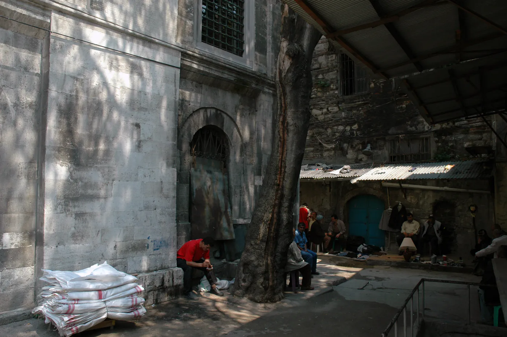
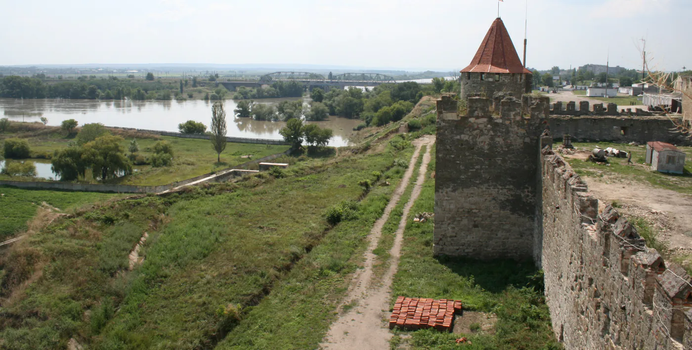
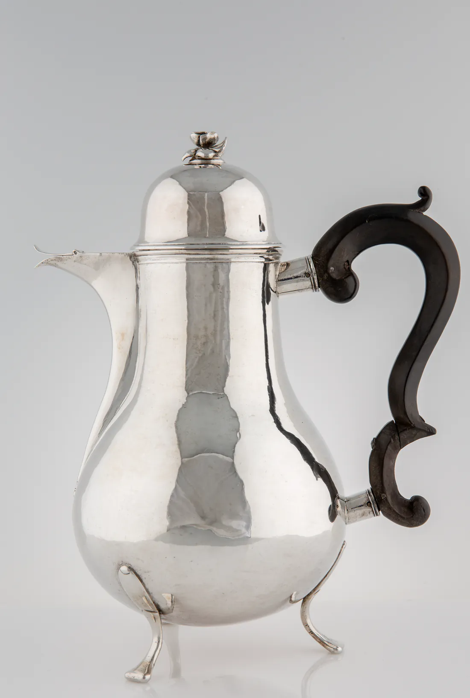

Sommaren 1685 kom omkring 425 gram kaffe från Amsterdam till Göteborg. Uppgiften finns i handlingar som förvaras i Landsarkivet i Göteborg, och sändningen räknas som det första belagda kaffet i Sverige.[^1] Mängden var mindre än ett vanligt kaffepaket i dag, och kaffet såldes till en början på apotek.

Om varifrån drycken kom säger handlingarna ingenting; Amsterdam var bara en hamn. Det som hör till dryckens historia – ordet, bruket, ett par svenska möten vid sultanens hov och i Bender – pekar längre bort, mot en hamnstad i Jemen och en tid på natten.

. Enligt plåtens förklaring låg det holländska och det engelska handelshuset i staden; på redden ligger europeiska skepp.")

Hur drycken ställdes inför rätta i Mecka 1511 och gick fri inom ett år, och hur Sverige förbjöd den i omgångar från 1756 till början av 1820-talet, har essän "[Kaffet inför rätta](/kaffet-infor-ratta/)" berättat, och den visade också att drycken är tillåten. Här gäller frågan tiden efter domen: vad gör bruket med det tillåtna, och vad blir det av en kopp som har rest ifrån det den en gång var till för?

## Ett av vinets namn

Arabiskans *qahwa* blev turkiskans *kahve* och, genom europeiska språk, svenskans kaffe. Men ordet är äldre än drycken. Redan i det äldsta arabiska lexikonet, al-Khalīl ibn Aḥmads *Kitāb al-ʿAyn* från 700-talet, betyder *qahwa* vin. Förklaringen är densamma där och i det stora lexikon som Ibn Manẓūr sammanställde fem sekel senare, *Lisān al-ʿArab*: vinet kallas så därför att det tar matlusten ifrån den som dricker det.[^2]

Drycken som håller sinnet vaket fick samma namn som drycken som grumlar det. Ordet som svenskar säger varje dag betydde först en dryck som islam förbjuder. Det har bytt dryck en gång, och det är inte det enda i den här historien som byter herre.

## Trötthet och tröghet

Under 1500-talet skrev ʿAbd al-Qādir al-Jazīrī en bok om att kaffet är tillåtet, *ʿUmdat al-ṣafwa fī ḥill al-qahwa*. Där spårar han drycken till Aden vid mitten av 1400-talet och till stadens mufti, den rättslärde Jamāl al-Dīn al-Dhabḥānī, död 875/1470. Enligt al-Jazīrī tog al-Dhabḥānī drycken i bruk och fann att den drev bort trötthet och tröghet.[^3] I Aden började man sedan dricka den för att hålla sig vaken i nattens bön och andakt.

Början är anspråkslös: drycken var inte bönen och lade ingenting till den. Den gjorde det lättare att hålla sig vaken när man ville det, och det ville man om natten. I al-Jazīrīs berättelse kommer kaffet in i historien som en tjänare åt natten. Vad natten själv är till för är äldre än koppen och står i Koranen och sunnan.

## Den sista tredjedelen

Suran Den insvepte börjar med en befallning om natten:

> DU som täcker över dig [med din mantel]! Vaka [i bön] under natten, inte hela, men halva natten - eller förkorta denna tid något, eller förläng den - och läs högt ur Koranen i en lugn och jämn rytm, med klart uttal och tanken fäst vid dess mening.[^4]

Plikten upphävdes sedan genom surans sista vers, och nattbönen – som Profeten ﷺ kallade den bästa bönen efter de föreskrivna[^5] – blev med ʿĀʾishas ord "frivillig efter att ha varit en plikt".[^6] Samma sura säger varför den hör hemma i mörkret: "Den nattliga [bönen] går med stadigare steg och dess ord ljuder renare".[^7] Steget blir stadigt av natten, inte av något som hjälper en att hålla sig vaken i den.

Om de gudfruktiga säger en annan sura att "de ägnade inte mera än en kort del av natten åt sömn och i den tidiga gryningen bad de om Guds förlåtelse för sina synder".[^8] De två verserna satte al-Bukhārī som rubrik över ett kapitel, och under dem står Profetens ﷺ ord, återgivna av Abū Hurayra:

> Vår Herre, välsignad och upphöjd, stiger varje natt ned till den närmaste himlen när den sista tredjedelen av natten återstår, och säger: Vem åkallar Mig, så att Jag kan svara honom? Vem ber Mig, så att Jag kan ge honom? Vem ber Mig om förlåtelse, så att Jag kan förlåta honom?[^9]

Hadithen finns hos både al-Bukhārī och Muslim och tas emot som den står, utan att frågan om hur ställs. Det var den natten som koppen i Aden tjänade.

## Muʿādh sover först

Åtta sekel innan Aden fick sin kopp sände Profeten ﷺ Abū Mūsā al-Ashʿarī och Muʿādh ibn Jabal till Jemen. I al-Bukhārīs kapitel om sändningen finns en kort berättelse som rör både drycken och natten:

> Abū Mūsā sade: "Guds profet, i vårt land finns en dryck av korn, al-mizr, och en dryck av honung, al-bitʿ." Han svarade: "Allt som berusar är förbjudet." Sedan gav de sig av, och Muʿādh sade till Abū Mūsā: "Hur läser du Koranen?" Han sade: "Stående, sittande och på min ridkamel, och jag läser den lite i taget." Muʿādh sade: "Jag för min del sover och står upp [i bön], och jag räknar med lön för min sömn så som jag räknar med lön för mitt stående."[^10]

Svaret om dryckerna är den regel som kaffet långt senare prövades mot och klarade. I nästa andetag nämner Muʿādh själv ett medel för nattbönen, och det är sömnen. I en annan berättelse i samma kapitel säger Muʿādh det utförligare: "Jag sover första delen av natten och står upp när jag har fått min del av sömnen."[^11]

Al-Bukhārī har gjort samma ordning till rubrik. Direkt efter hadithen om nedstigandet kommer kapitlet "Den som sov första delen av natten och vakade [i bön] under den sista". I rubriken står att Salmān al-Fārisī sade till Abū al-Dardāʾ: "Sov", och när det led mot slutet av natten: "Stå upp" – och att Profeten ﷺ sade: "Salmān har talat sant." Under rubriken frågar al-Aswad ʿĀʾisha hur Profetens ﷺ bön om natten var. Hon svarade: "Han sov dess första del och stod upp i dess sista och bad."[^12]

Versen om de gudfruktiga, som sov bara en kort del av natten, kan få sömnen att se ut som vakans fiende. Men om den bön som är Gud kärast sade Profeten ﷺ att det är Dāwūds: "han sov halva natten, stod upp en tredjedel av den och sov en sjättedel".[^13] Hos Dāwūd ligger sömnen på båda sidor om vakan.

Sömnen och en dryck som togs för att hålla sömnen borta är varandras motsatser, men båda kan tjäna samma timme. Det som kan bytas mot sin egen motsats och ändå tjäna samma sak har sitt värde i vad det används till. En skillnad finns ändå: bara Muʿādhs ord talar om lön, och de gäller hans sömn, inte någon kopp.

## Tahtakale, år 962

Från Jemen gick drycken vidare till Mecka och Kairo. I Istanbul var den okänd fram till år 962 efter hijra, omkring 1554–55. Så skriver den osmanske historikern İbrahim Peçevi, som i Robert Mantrans franska översättning berättar att två män, Ḥakam från Aleppo och Shams från Damaskus, öppnade var sin stora butik i kvarteret Tahtakale.[^14] Butikerna blev enligt Peçevi samlingsplatser för de nöjeslystna och sysslolösa, men också för några kvicka och belästa människor. Man läste, spelade tavla och schack, kom med nya dikter och talade om litteratur.

I Aden hade drycken tjänat natten, men i Istanbul var det husen som drog människorna till sig. Där bytte koppen herre, och de som märkte det stod i moskéerna. Hos Peçevi heter det att imamerna och muezzinerna klagade: "Folk rusar till kaffehusen, och ingen kommer till moskéerna." De lärda sade om husen: "Det är hus för dåligt leverne; det är bättre att gå till en krog än dit." Predikanterna lade ned stor möda på att få dem förbjudna.[^15]

Klagan var ingen överdrift av nitiska fromma. Den hade fog för sig, och det syns i Peçevis egen beskrivning. Tavla är ett brädspel av samma släkt som det spel som i hadithen heter *nardashīr*: "Den som spelar nardashīr är som den som har doppat sin hand i svinets kött och blod." Flertalet lärda har ansett spelet förbjudet.[^16] Även bönan prövades: muftierna förklarade i fatwor drycken otillåten, eftersom det förkolnade är otillåtet. Senare fastslog predikanter och muftier att bönan inte var helt förkolnad, och förbudet hävdes.[^17] Det som gick fri var bönan, inte huset.

Imamerna mätte huset efter vad det trängde undan. En dryck i en kopp var ingen synd. Men om huset var fullt när moskén stod tom, var det inte längre likgiltigt vad det var fullt av. Och när de lärda ställde kaffehuset bredvid krogen hade ordet hunnit ikapp drycken. *Qahwa* stod åter bredvid vinet, den här gången för husets skull. Medlet hade börjat tävla med målet.

## Främlingar bakom lyckta dörrar

Svenskarna mötte koppen hos osmanerna. Claes Brorson Rålamb ledde den svenska beskickningen till Höga porten 1657–1658, och i Turkiet lärde han sig, med Malmö stads ord, "konsten att dricka kaffe". I sin skildring av resan skrev han också den första översiktliga introduktionen till islam på svenska, under rubriken "Turckarnes Religion och tro hwar utj hon förnembligast består".[^18]

Ett halvsekel senare levde svenskar i åratal bland osmaner. Karl XII togs emot som en viktig bundsförvant och ledsagades av ett stort följe in i Bender den 22 juli 1709, och svenskarna blev kvar där till 1711, då de flyttade till Varnitza. "Mellan 1709 och 1714 regerades alltså Sverige från muslimskt territorium", skriver religionsvetaren Simon Sorgenfrei.[^19] Enligt Malmö stad var det med Karl XII och karolinerna på 1710-talet som bruket att dricka kaffe "verkar ha blivit mera allmänt".[^20] Den gängse berättelsen i Sverige går längre och låter kungen föra hem kaffet, men enligt källorna kom Rålamb och Göteborgspartiet före.

I kungens spår följde också några av dem som hade lånat honom pengar. Den 6 januari 1716 kom ett fartyg till Karlshamn med ett sextiotal personer – fordringsägare med familjer och tjänare – och där blev de kvar tills de 1719 flyttades till Stockholm.[^21] Enligt Sorgenfrei rörde det sig om närmare trettio fordringsägare och lika många familjemedlemmar. "Hälften av dem var muslimer, ofta officerare i den osmanska armén", medan resten mest var osmanska judar och en mindre grupp kristna armenier. De inkvarterades hos stadens borgare.[^22] I ett svar till amiralitetskonsistoriet skrev kungen:

> […] berörde judar och turkar fuller intet bör betagas inom lyckta dörrar och öva deras gudstjänst […] emedan de icke som undersåtare utan som främmande sig här i landet uppehålla.[^23]

I samma svar uttrycks förhoppningen att prästerskapet skulle kunna övertala någon av dem att anta den kristna läran. Medgivandet var ett fribrev åt främlingar, inget erkännande. Men enligt Sorgenfrei bröt det mot tidigare lagtext och praxis.

Under samma årtionde som kaffet blev allmännare i Sverige fick muslimsk gudstjänst ett fribrev här, som främling och bakom lyckta dörrar. Koppen behövde inget fribrev: under 1700-talets första hälft hade Stockholm enligt Smålands museum ett femtiotal kaffehus.[^24] Bönen förblev en gäst, medan koppen blev svensk.

## Druvan som pressas

Det som reste hit var medlet, medan målet stannade i Aden. Vad blir det då av koppen?

Ibn Taymiyya svarar med en mening som först låter sträng:

> Det tillåtna har bara tillåtits för de troende, som tar hjälp av det till lydnad. Gud har aldrig tillåtit någon något för att han skulle ta hjälp av det till otro, ogudaktighet eller olydnad.[^25]

Därför, fortsätter han, förbannade Profeten ﷺ den som pressar vinet och den som låter pressa det, så som han förbannade den som dricker det. Den som pressar druvor gör av dem en saft som kan användas till något tillåtet. Men när det är känt att avsikten är att göra vin av saften, får han inte låta det som i sig är tillåtet bli en hjälp till olydnad mot Gud. Hos Abū Dāwūd står hadithen under rubriken "Druvan som pressas till vin": Gud har förbannat "vinet, den som dricker det, den som skänker det, den som säljer det, den som köper det, den som pressar det, den som låter pressa det, den som bär det och den som det bärs till".[^26]

Ordet *qahwa* betydde en gång vin, och hos Ibn Taymiyya är det saften på väg att bli vin som visar regeln: det som till sitt slag är tillåtet får sin dom av det mål det tjänar.

Läst för sig kan meningen låta som om allt tillåtet blir förbjudet för den som inte har något fromt syfte med det. Så långt går inte Ibn Taymiyya. På ett annat ställe beskriver han en mellangrupp:

> Den som gör det tillåtna i tanklöshet, eller gör mer av det tillåtna än han behöver, sådant som inte används till hjälp för lydnad, och samtidigt fullgör de föreskrivna plikterna och undviker det förbjudna, inre och yttre, han hör till de måttfulla, de på högra sidan.[^27]

Att avsikten saknas kallar han strax före "en brist hos honom" – en brist, inte en synd. Den som dricker sin kopp utan en tanke på natten har inte gjort något orätt. Det som saknas är ett mål; tillåtelsen finns kvar.

## Det som koppen tränger undan

Ibn Taymiyya vänder också på frågan:

> Det överflödiga av det tillåtna, som inte hjälper till lydnad, är bättre borta än närvarande om han utan det skulle vara upptagen av lydnad mot Gud, ty då håller det honom borta från den. Men om det håller honom borta från något som är sämre, är det bättre för honom än det sämre. Och om det håller honom borta från olydnad mot Gud, är det en barmhärtighet för honom.[^28]

Det tillåtna mäts inte bara efter vad det är utan efter vad det tränger undan. Samma kopp kan stå mellan en människa och bönen, sysslolösheten eller synden, och i varje fall blir den något annat. I Aden togs den för att sömnen inte skulle tränga undan vakan. Huset i Istanbul trängde, enligt dem som stod kvar i moskéerna, undan moskén. Under en svensk arbetsdag dricker man den för att orka med eftermiddagen. Frågan om vad den tränger undan får olika svar på varje plats, och det är svaret som avgör.

Ibn Taymiyya tar själv steget från sängen till bordet. Till det som kan tas till hjälp för gudsdyrkan räknar han "sömnen som man avser som hjälp till gudsdyrkan, och att äta och dricka"; görs det utan den avsikten är det "en brist hos tjänaren".[^29] Sömnen och drycken står i samma mening hos honom: båda är medel, och ingetdera är gudstjänst i sig. Koppen som har rest ifrån sitt mål förblir tillåten. Förbjuden blir den bara som medel till synd, och ett medel till gott blir den bara genom sitt bruk. Domen följer bruket, inte bönan.

Hjalmar Bergman ställer två meningar bredvid varandra:

> Gott kaffe vill alla dricka. Och rätta vägen vill alla vandra, om blott de veta, var den går.[^30]

Den första meningen behöver inget villkor; den andra hänger på ett. I Aden hörde meningarna ihop, och koppen hade en riktning.

## Samtal efter kvällsbönen

En invändning kommer inifrån traditionen själv. Den kopp som höll Aden vaket för bön kan lika gärna hålla en människa vaken för det som traditionen ogillar. Profeten ﷺ ogillade, återger Abū Barza al-Aslamī, "att man sov före kvällsbönen och att man satt och samtalade efter den".[^31] Al-Nawawī förklarar varför:

> Skälet till att samtal efter kvällsbönen ogillas är att det leder till sena kvällar och att man riskerar att sova bort nattbönen […] Och därför att nattvak gör en trög om dagen inför det man har att göra av religionens plikter, lydnadshandlingar och världsliga angelägenheter.[^32]

Kaffehusen i Istanbul var hus för just sådana kvällar. Den kopp som håller en människa uppe i samtal kan få henne att sova bort både nattens sista tredjedel och gryningen. Är koppen då inte snarare nattbönens fiende än dess tjänare?

Svaret står i samma kommentar: "Det samtal som ogillas efter kvällsbönen är det som gäller saker utan nytta. Det som har nytta och är gott ogillas inte." De lärda är enligt al-Nawawī eniga om att samtal efter kvällsbönen ogillas "utom det som gäller något gott", och efter Abū Barzas hadith satte al-Bukhārī ett kapitel med rubriken "Nattligt samtal om kunskap och gott efter kvällsbönen".[^33] Samtalet ogillas inte för att det är samtal utan för vad det leder till och vad det tränger undan. Det är Ibn Taymiyyas regel, tillämpad på ord i stället för på en dryck. Men al-Nawawīs första skäl tillför regeln något: bruket har sin tid. Vakar man i nattens början riskerar man att sova bort dess slut. Det är Muʿādhs ordning omvänd: han sov först för att kunna stå upp sist. Samma kopp kan ge en människa den sista tredjedelen eller ta den ifrån henne, beroende på när den dricks. Invändningen beskriver vad en kopp blir när den tjänar fel sak, och därmed bekräftar den det den ville motbevisa: domen följer bruket.

Den andra invändningen kommer utifrån och säger att det här är att läsa in religion i en vanlig dryck. Kaffet blev svenskt just genom att lämna religionen bakom sig – det var därför det kunde bli allas – och ingen svensk som dricker kaffe har något med islam att göra.

Här påstås inte att koppen är gudstjänst. Drycken har ingen avsikt, och därför kunde den resa. Ett mål går inte att frakta i knappt ett halvkilo bönor från Amsterdam; det följer med en människa eller inte alls. Att kaffet blev svenskt utan sitt mål visar inte att målet var privat eller hörde till en annan tid, bara att det aldrig låg i koppen.

Om dem som dricker kan det vara sant att de inte har något med islam att göra, men inte om det som dricks. En vara för inte med sig någon lära från sitt ursprung, men den har en historia, och den här historien är muslimsk. Ordet på varje kaffepaket kommer från arabiskan. Svenskarna mötte bruket vid sultanens hov och i Bender. Det fribrev som visar att islam utövades i Sverige på 1710-talet skrevs för gäster från samma värld. Och vägen till det mål som koppen en gång tjänade står lika öppen nu som i Aden. Nattbönen är frivillig, och det frivilliga är ingens skyldighet och var och ens möjlighet.

## Också i november

Allt annat i den här historien har behövt föras hit. Bönorna kom från Amsterdam, ordet genom andra språk, bruket med ett sändebud och en armé. Natten har ingen behövt föra in: dess sista tredjedel faller varje natt över Karlshamn som över Aden, också i november, när nätterna är långa och morgonen dröjer.

---

[^1]: Riksarkivet, *Snapshot! 400 års minnesbilder ur arkiven* (2018), s. 403, om handlingar i Landsarkivet i Göteborg. Att kaffet till en början bara såldes på apotek: Kulturparken Småland/Smålands museum, kaffekanna, [DigitaltMuseum](https://digitaltmuseum.se/021027433893/kaffekanna). Bilderna i texten: Atlas of Mutual Heritage, [Mocka omkring 1680](https://commons.wikimedia.org/wiki/File:AMH-6606-KB_View_of_the_city_of_Mocha.jpg), fri från upphovsrätt; Dosseman, Tahtakale, [8 juni 2004](https://commons.wikimedia.org/wiki/File:R%C3%BCstem_Pasha_Mosque_substructure_in_2004.jpg), licens [CC BY-SA 4.0](https://creativecommons.org/licenses/by-sa/4.0/); Richardfabi, Bender, [3 maj 2008](https://commons.wikimedia.org/wiki/File:Transnistrienfortress.jpg), fri från upphovsrätt; Röhsska museet, foto Carl Ander, [kaffekanna RKM 18-1963](https://commons.wikimedia.org/wiki/File:R%C3%B6hsskaMuseet_Kaffekanna_rkm18-1963_D8A9004.tif), licens [CC BY 4.0](https://creativecommons.org/licenses/by/4.0/). Samtliga via Wikimedia Commons; bilderna av Mocka, Bender och kaffekannan är beskurna.
[^2]: al-Khalīl ibn Aḥmad, *Kitāb al-ʿAyn*, roten q-h-w: والقهوة: الخمر، [سميت قهوة] لأنها تقهي الإنسان، أي: تشبعه، وتذهب بشهوة الطعام. Ibn Manẓūr (d. 1311), *Lisān al-ʿArab*, samma rot: والقهوة الخمر، سميت بذلك لأنها تقهي شاربها عن الطعام أي تذهب بشهوته. Varför ordet kom att användas om kaffet är omstritt; att det betydde vin långt före kaffet är det inte. Översättningarna från arabiska och franska är gjorda för den här texten. Koranen citeras i Knut Bernströms översättning.
[^3]: ʿAbd al-Qādir al-Jazīrī, *ʿUmdat al-ṣafwa fī ḥill al-qahwa* (1500-talet), här efter Ralph S. Hattox, *Coffee and Coffeehouses: The Origins of a Social Beverage in the Medieval Near East* (University of Washington Press 1985). Uttrycket "trötthet och tröghet" återger den engelska lydelsen "drove away fatigue and lethargy" hos Bennett Alan Weinberg och Bonnie K. Bealer, *The World of Caffeine* (Routledge 2001), s. 10. Berättelsen om al-Dhabḥānī bygger på al-Jazīrī och är omstridd.
[^4]: Koranen 73:1–4.
[^5]: Muslim, *Ṣaḥīḥ*, Kitāb al-ṣiyām, nr 1163, från Abū Hurayra.
[^6]: Muslim, *Ṣaḥīḥ*, Kitāb ṣalāt al-musāfirīn, nr 746 (1:512–513), från ʿĀʾisha: فصار قيام الليل تطوعا بعد فريضة. Den vers som upphävde plikten är Koranen 73:20; jfr Ibn Qudāma, *al-Mughnī* 2:100: ثم نسخ. För Profetens ﷺ gemenskap är nattbönen frivillig enligt de lärdas enighet (al-Nawawī, *al-Minhāj sharḥ Ṣaḥīḥ Muslim* 6:26).
[^7]: Koranen 73:6.
[^8]: Koranen 51:17–18.
[^9]: al-Bukhārī, *Ṣaḥīḥ*, Kitāb al-tahajjud, nr 1145 (2:52–53), i kapitlet "Åkallan i bönen under nattens sista del", som har Koranen 51:17–18 som rubrik: ينزل ربنا تبارك وتعالى كل ليلة إلى السماء الدنيا حين يبقى ثلث الليل الآخر يقول: من يدعوني، فأستجيب له من يسألني فأعطيه، من يستغفرني فأغفر له. Även Muslim, *Ṣaḥīḥ*, Kitāb ṣalāt al-musāfirīn, nr 758.
[^10]: al-Bukhārī, *Ṣaḥīḥ*, Kitāb al-maghāzī, kapitlet om när Abū Mūsā och Muʿādh sändes till Jemen före avskedsvallfärden, nr 4344. Muʿādhs ord: أما أنا فأنام وأقوم، فأحتسب نومتي كما أحتسب قومتي.
[^11]: al-Bukhārī, *Ṣaḥīḥ*, nr 4341–4342: أنام أول الليل، فأقوم وقد قضيت جزئي من النوم، فأقرأ ما كتب الله لي، فأحتسب نومتي كما أحتسب قومتي. Ibn Rajab förklarar att han med sin sömn avsåg att få kraft att stå upp i nattens sista del: يعني: أنه ينوي بنومه التقوي على القيام في آخر الليل (*Jāmiʿ al-ʿulūm wa-l-ḥikam* 2:192–193).
[^12]: al-Bukhārī, *Ṣaḥīḥ*, Kitāb al-tahajjud, kapitlet باب من نام أول الليل وأحيا آخره och nr 1146 (2:53). Salmāns ord står i kapitelrubriken; med fullständig berättarkedja finns berättelsen i nr 6139.
[^13]: al-Bukhārī, *Ṣaḥīḥ*, nr 3420 och 1131: وأحب الصلاة إلى الله صلاة داود، كان ينام نصف الليل ويقوم ثلثه، وينام سدسه.
[^14]: Robert Mantran, "Le café à Istanbul au XVIIe siècle", i *Le café en Méditerranée. Histoire, anthropologie, économie. XVIIIe–XXe siècle* (IREMAM 1980), s. 17–30, [OpenEdition](https://books.openedition.org/iremam/1193), som översätter İbrahim Peçevi, *Tārīḫ* (Konstantinopel 1866), I:362–364. Mantran skriver den förste mannens namn Hakim. Om gästerna: "les amateurs de plaisir, les oisifs, mais aussi pour quelques beaux esprits".
[^15]: Mantran, "Le café à Istanbul", efter Peçevi: "les gens se précipitent vers les cafés, et personne ne vient dans les mosquées"; de lärda: "ce sont des maisons de mauvaise vie ; il vaut mieux aller dans une taverne que là"; "Les prédicateurs firent d'énormes efforts pour interdire les cafés". Till de klagande räknar Peçevi också en grupp som han själv kallar skenheliga, "les hypocrites dévots"; omdömet är hans.
[^16]: Muslim, *Ṣaḥīḥ*, Kitāb al-shiʿr, nr 2260: من لعب بالنردشير، فكأنما صبغ يده في لحم خنزير ودمه. Enligt al-Nawawī, *al-Minhāj* 15:15, är spelet förbjudet enligt al-Shāfiʿī och flertalet lärda. Om schack var de oense: i hans egen skola ogillades det, medan Mālik och Aḥmad förbjöd det.
[^17]: Mantran, "Le café à Istanbul": muftierna "émirent des fetva-s contre le café" med motiveringen att det som har bränts till kol är otillåtet; senare förklarade predikanter och muftier att kaffet "n'était pas complètement carbonisé", och "l'interdit fût levé".
[^18]: Malmö stad, ["När kaffet kom till Malmö"](https://malmo.se/Uppleva-och-gora/Arkitektur-och-kulturarv/Malmos-historia/Handelser-och-fenomen/Nar-kaffet-kom-till-Malmo.html), där det också heter att kaffet i Sverige "kanske första gången" omtalas av Rålamb. Simon Sorgenfrei, *Islam i Sverige – de första 1300 åren*, om Rålambs *Diarium under resa till Konstantinopel 1657–1658* (utg. Christian Callmer, 1963).
[^19]: Sorgenfrei, *Islam i Sverige – de första 1300 åren*.
[^20]: Malmö stad, "När kaffet kom till Malmö". Att kungen och hans uppvaktning under exilen i Osmanska riket hade vant sig vid att dricka kaffe: Sara Griberg, "Så blev kaffet Sveriges nationaldryck", *Populär Historia* 4/2017.
[^21]: Lars Ericson Wolke, "Vad hände med Karl XII:s kreditorer?", *Släkthistoria* 9/2017.
[^22]: Sorgenfrei, *Islam i Sverige – de första 1300 åren*, där det också framgår att var och en enligt kungens direktiv skulle få en silverdaler om dagen i uppehälle.
[^23]: Karl XII:s svar till amiralitetskonsistoriet, citerat efter Sorgenfrei, *Islam i Sverige – de första 1300 åren*. Svaret ger dem också rätt att begrava sina döda på en lämplig plats i staden. Förhoppningen om omvändelse avslutas med orden "så vore det både Gud och konungen behagligt".
[^24]: Kulturparken Småland/Smålands museum, kaffekanna (DigitaltMuseum).
[^25]: Ibn Taymiyya, *Majmūʿ al-fatāwā* 7:50: والمباحات لم تبح إلا لأهل الإيمان الذين يستعينون بها على الطاعات وإلا فالله لم يبح قط لأحد شيئا أن يستعين به على كفر ولا فسوق ولا عصيان.
[^26]: Ibn Taymiyya, *Majmūʿ al-fatāwā* 7:50–51. Abū Dāwūd, *Sunan*, Kitāb al-ashriba, nr 3674 (i andra utgåvor 3676), från Ibn ʿUmar; ṣaḥīḥ enligt al-Albānī. Hadithen finns även hos Ibn Mājah, nr 3380. Hadithens egen lydelse nämner bara den som pressar och den som låter pressa. Villkoret om avsikten kommer från Ibn Taymiyyas förklaring, och hans exempel gäller den som hjälper någon vars syndiga avsikt han känner till.
[^27]: Ibn Taymiyya, *Majmūʿ al-fatāwā* 10:459–460: وأما من فعل المباحات مع الغفلة أو فعل فضول المباح التي لا يستعان بها على طاعة مع أداء الفرائض واجتناب المحارم باطنا وظاهرا فهذا من المقتصدين أصحاب اليمين. Strax före: مع أن هذا نقص منه.
[^28]: Ibn Taymiyya, *Majmūʿ al-fatāwā* 10:460: ففضول المباح التي لا تعين على الطاعة عدمها خير من وجودها إذا كان مع عدمها يشتغل بطاعة الله … وإن شغلته عن معصية الله كانت رحمة في حقه.
[^29]: Ibn Taymiyya, *Majmūʿ al-fatāwā* 10:461: كالنوم الذي يقصد به الاستعانة على العبادة؛ والأكل والشرب واللباس والنكاح الذي يمكن الاستعانة به على العبادة؛ إذا لم يقصد به ذلك كان ذلك نقصا من العبد.
[^30]: Hjalmar Bergman, *Vi Bookar, Krokar och Rothar* (1912).
[^31]: al-Bukhārī, *Ṣaḥīḥ*, nr 547 och 599: وكان يكره النوم قبلها، والحديث بعدها.
[^32]: al-Nawawī, *al-Minhāj sharḥ Ṣaḥīḥ Muslim* 5:145–146.
[^33]: al-Nawawī, *al-Minhāj sharḥ Ṣaḥīḥ Muslim* 5:146–147, där han ger exempel på nyttigt samtal, bland dem att studera kunskap tillsammans och att samtala med en gäst: واتفق العلماء على كراهة الحديث بعدها إلا ما كان في خير. Kapitlet efter al-Bukhārī nr 599: باب السمر في الفقه والخير بعد العشاء.
