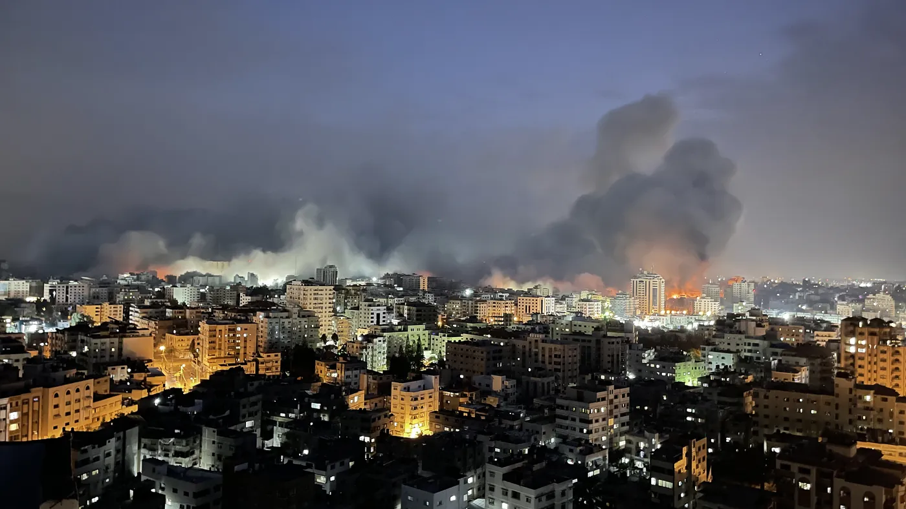
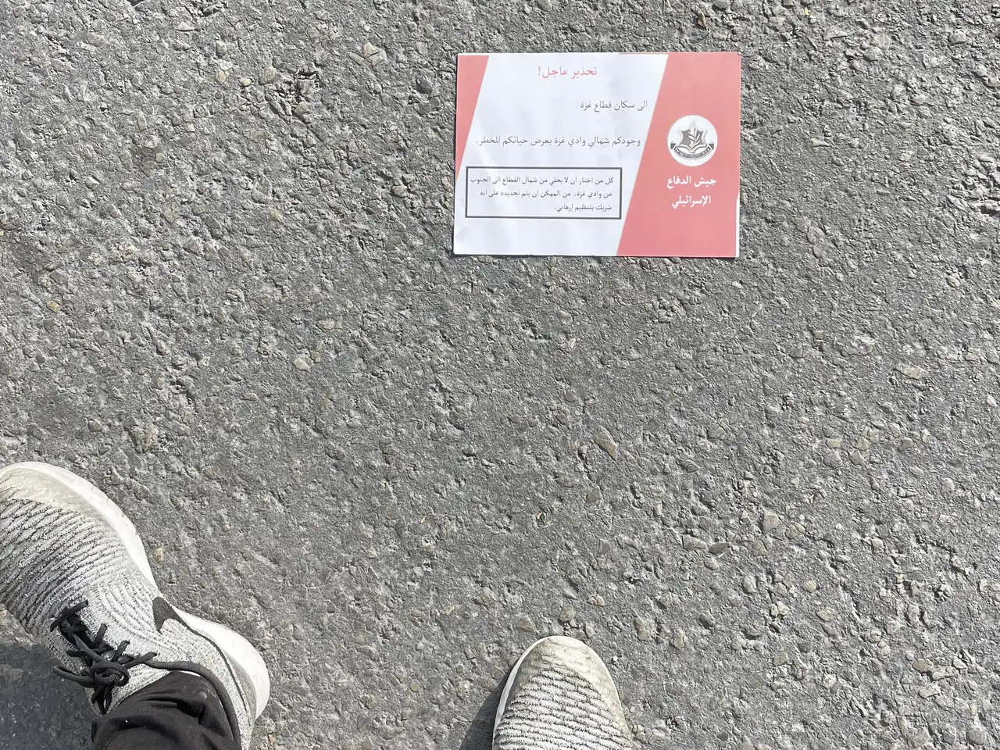
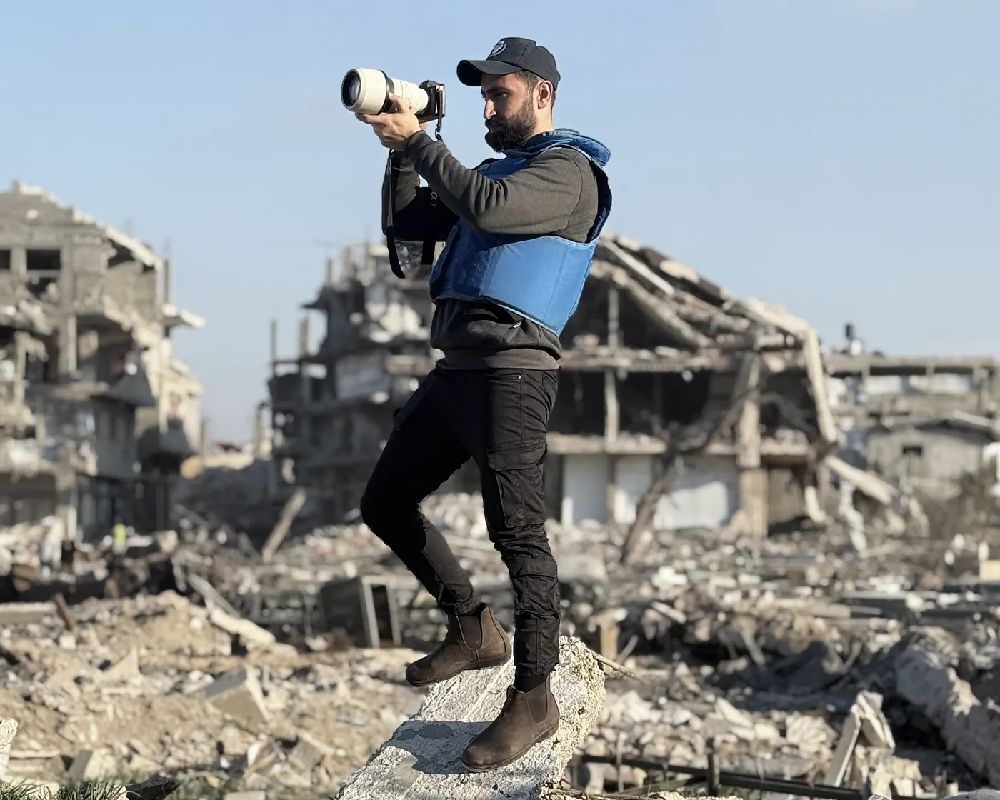
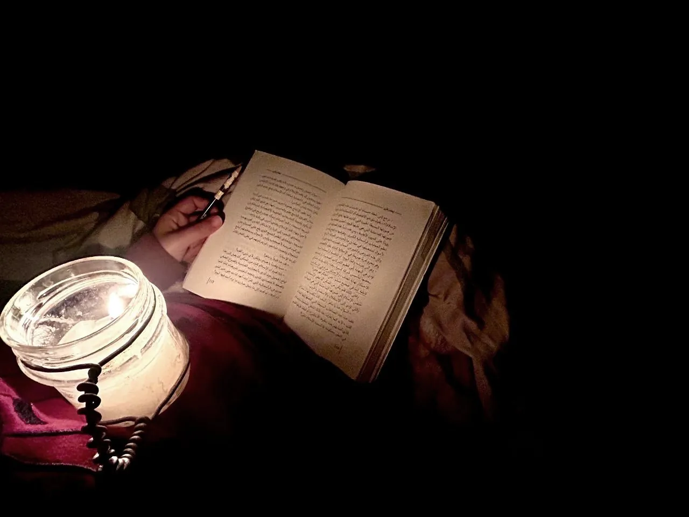

Texten är daterad den 6 april 2025 och undertecknad med fullt namn, Anas Jamal al-Sharif. Den publicerades från hans konto drygt fyra månader senare, den 10 augusti, sedan han hade dödats. Den börjar så:

> Detta är mitt testamente och mitt sista budskap. Om dessa ord når er, så vet att Israel har lyckats döda mig och tysta min röst.[^1]

Han var Al Jazeeras korrespondent i norra Gaza, uppvuxen i flyktinglägret Jabalia, far till en dotter som heter Sham och en son som heter Salah. Sent på kvällen den 10 augusti 2025 träffade ett israeliskt flyganfall ett tält för journalister utanför huvudporten till al-Shifa-sjukhuset i Gaza stad. Committee to Protect Journalists, CPJ, räknar sex dödade journalister: al-Sharif och korrespondenten Mohammed Qreiqeh, kameramännen Ibrahim Zaher och Mohammed Noufal, frilansarna Moamen Aliwa och Mohammad al-Khaldi. Armén bekräftade att al-Sharif var målet.[^2]

Testamentet förordnar inte om någon egendom. Det bärande verbet är *ūṣīkum* – "jag anförtror er", "jag ålägger er" – av samma rot som *waṣiyya*, testamente. Det förekommer nio gånger, och det som anförtros är ett land och människor:

> Jag anförtror er Palestina, juvelen i muslimernas krona och hjärtslaget hos varje fri människa i den här världen. Jag anförtror er dess folk och dess små, förorättade barn, som livet inte gav tid att drömma och leva i trygghet och fred. Deras rena kroppar krossades under tusentals ton israeliska bomber och robotar, slets sönder, och deras kvarlevor spreds över väggarna. Jag ålägger er att inte låta bojorna tysta er och inte låta gränserna hålla er stilla. Var broar mot landets och människornas befrielse, tills värdighetens och frihetens sol går upp över vårt rövade land. Jag ber er ta väl hand om de mina. Jag anförtror er min ögonsten, min älskade dotter Sham, som dagarna inte lät mig se växa upp så som jag hade drömt. Och jag anförtror er min käre son Salah, som jag önskade få vara ett stöd och en följeslagare för tills han vuxit sig stark, så att han kunde bära bördan efter mig och fullfölja uppdraget.[^3]

Mottagaren är ett "ni" utan namn. Vilka det är avgör testamentet självt i sin andra mening: de som orden når.

## Namnen på armarna

Han var inte ensam om att skriva i förväg. Tretton dagar innan testamentet daterades hade han gått i begravningståget efter Hossam Shabat, tjugotre år och korrespondent för Al Jazeera Mubasher, vars bil träffades i Beit Lahia den 24 mars 2025. Samma dag publicerade Shabats medarbetare det meddelande han hade lämnat efter sig. Det börjar: "Om du läser detta betyder det att jag har dödats – med all sannolikhet utpekad som mål – av de israeliska ockupationsstyrkorna." Det slutar, före underskriften: "Jag ber er nu: sluta inte tala om Gaza. Låt inte världen se bort. Fortsätt kämpa, fortsätt berätta våra historier – tills Palestina är fritt."[^4] Också honom hade armén pekat ut, som krypskytt i Hamas. Reportrar utan gränser kom fram till att handlingarna saknade bevis, och CPJ klassar hans död som mord.[^5]

Bildjournalisten Mariam Abu Dagga, frilans för Associated Press, dödades den 25 augusti 2025 i det israeliska anfallet mot Nassersjukhuset i Khan Younis, tillsammans med fyra andra journalister. Hon hade skrivit ett brev till sin son Ghaith och lämnat det hos en vän för att publiceras om hon dödades. "Jag vill att du ber för mig och inte gråter över mig, så att jag kan förbli glad", står det där. "Och när du blir stor, gifter dig och får en dotter, ge henne namnet Mariam efter mig." Algeriets FN-ambassadör läste upp brevet i säkerhetsrådet.[^6]

Fotografen Fatima Hassouna, tjugofem år, dödades den 16 april 2025 i ett anfall mot familjens hem i Gaza stad, tillsammans med flera familjemedlemmar, dagen efter beskedet att en film om henne hade tagits ut till Cannes. Hon hade skrivit: "Om jag dör vill jag ha en död som hörs. Jag vill inte bara vara en nyhetsflash, eller ett nummer i en grupp."[^7]

Mahmoud Abu Nujaila var läkare vid Läkare utan gränser på al-Awda-sjukhuset i norra Gaza. I slutet av oktober 2023 skrev han på den tavla där operationerna brukade planeras: "Den som stannar till slutet får berätta historien. Vi gjorde vad vi kunde. Minns oss." Den 21 november dödades han i ett anfall mot sjukhuset, tillsammans med läkarna Ahmad Al Sahar och Ziad Al-Tatari. Ord från tavlan lästes upp i Internationella domstolen den 11 januari 2024, i Sydafrikas talan.[^8]

Redan under bombningarnas tredje vecka skrev föräldrar sina barns namn på deras armar och ben. Al Jazeera beskrev den 28 oktober 2023 hur bruket hade spritt sig i FN-skolorna, där över 629 000 människor hade sökt skydd. Sara al-Khalidi, fyrtio år, var först rädd att namnen skulle dra olycka över barnen men ändrade sig när hon såg en läkare på al-Shifa göra detsamma. Om en natt då bomberna föll över hennes kvarter i Gaza stad sade hon: "I det ögonblicket tänkte jag att om huset träffades av en svår bombning skulle mina barn dö, och ingen skulle kunna känna igen dem." Mohammed Abu Odeh, tjugosju år, i lägret Shati: "När mina barn frågar varför jag gör det säger jag att det är för deras trygghet och skydd." När reportaget skrevs hade över 7 300 palestinier dödats, omkring 3 000 av dem barn, och 200 kroppar var enligt hälsoministeriet så sönderslagna att de inte gick att känna igen.[^9]

En korrespondent, en bildjournalist, en fotograf, en läkare, en mor, en far i ett flyktingläger: från den första månaden skrev människor i Gaza i förväg. Ett namn på en barnarm är testamentets minsta form. Det förordnar om en enda sak, att den döde ska gå att känna igen. Bara den som inte själv känner igen barnet behöver ett namn, och den som skriver det kan inte veta vem det blir. Mottagaren bestäms så som al-Sharif bestämmer sin: den som orden når är den de är skrivna till.

## En död med avsändare

Ett testamente skrivs i vanliga fall därför att dödens stund är okänd. De här skrevs därför att den som skrev kunde läsa vad som väntade, och för al-Sharif stod det på pränt.

Från november 2023 ringde israeliska officerare honom och uppmanade honom att sluta rapportera och lämna norra Gaza. Den 11 december dödades hans nittioårige far i ett israeliskt flyganfall mot familjens hem i Jabalia.[^10] Den 23 oktober 2024 publicerade armén handlingar som pekade ut sex av Al Jazeeras journalister i Gaza, bland dem al-Sharif och Shabat, som medlemmar i väpnade grupper; Al Jazeera kallade uppgifterna grundlösa. Den 24 mars 2025 dödades Shabat. Tretton dagar senare, den 6 april, skrev al-Sharif sitt testamente. I juli, sedan han gråtit i sändning under en rapport om svälten, angrep arméns arabiskspråkige talesman Avichay Adraee honom i uttalande efter uttalande: "krokodiltårar" den 23 juli, och dagen därpå påståendet att han tillhört Hamas väpnade gren sedan 2013.

Samma dag, den 24 juli, gick CPJ ut offentligt. Organisationen skrev att al-Sharif var utsatt för en förtalskampanj från den israeliska armén och att han själv uppfattade den som förspelet till ett mord på honom. Regionchefen Sara Qudah: "De senaste grundlösa anklagelserna är ett försök att tillverka samtycke till att döda al-Sharif." Själv sade han till CPJ: "Jag lever med känslan av att jag när som helst kan bombas och bli martyr. Min familj är också i fara, och jag har redan fått betala priset." Och: "Dessa hot är en tydlig uppvigling och ett försök att mörda min röst, antingen genom bomber eller genom moralisk förvrängning. Men jag kommer inte att sluta förmedla sanningen."[^11]

Den 31 juli förklarade sig FN:s särskilda rapportör för yttrandefrihet, Irene Khan, djupt oroad över arméns upprepade hot och anklagelser mot honom.[^12] Den 10 augusti kom anfallet mot tältet, sjutton dagar efter CPJ:s varning.

Testamentet skrevs mitt i det förloppet. Det är svaret på utpekandet, lämnat i förväg av den som visste att han inte skulle få svara efteråt:

> Jag har levt smärtan i alla dess enskildheter och gång på gång smakat värken och förlusten, och ändå har jag aldrig en dag tvekat att föra sanningen vidare som den är, utan förfalskning och utan förvrängning. Må Gud vara vittne mot dem som teg, mot dem som fann sig i att vi dödades, mot dem som ströp vår andning, dem vilkas hjärtan inte rördes av våra barns och kvinnors sönderslitna kroppar och som inte stoppade den massaker som vårt folk har utsatts för i mer än ett och ett halvt år.[^13]

Brevet från den som vet att han ska dö finns också i svensk litteratur. I Rydbergs *Singoalla* skriver en man under digerdöden: "Jag vet, att jag skall dö", och han tvivlar på att brevet kommer fram.[^14] Men pesten har ingen avsändare. Den här döden hade en, med talesman, handlingar och datum. Armén räknade de döda innan bomben föll; det har essän "Folkmordet skrevs under i förväg" visat. Det här är den andra handlingen om samma död, skriven av dem som skulle dö. Båda fick rätt.

## Omvärldens enda ögon

En läsare i Sverige har sett Gaza genom dem. Israel har sedan oktober 2023 hindrat utländska journalister från att resa in på egen hand. Undantaget är ett fåtal reportrar som har följt med armén under militär censur. Foreign Press Association vände sig till Israels högsta domstol i december 2023 och fick avslag i januari 2024, sedan domstolen godtagit säkerhetsskälen. En ny framställning har därefter skjutits upp gång på gång. I februari 2026 hade staten fått minst tio anstånd, och i april lämnade pressorganisationerna in en brådskande begäran sedan domstolen på nytt skjutit upp saken. I oktober 2026 gäller förbudet fortfarande.[^15] Irene Khan kallade i sitt uttalande de få lokala journalister som fanns kvar för "omvärldens enda ögon på det pågående folkmordet".[^16]

Den 9 april 2026 lämnade branschorganisationen Utgivarna ett upprop till Israels ambassadör Ziv Nevo Kulman, undertecknat av organisationens styrelse, tretton namn, bland dem cheferna för Sveriges Television, Sveriges Radio och TV4: "Det är djupt oroande att Israel fortfarande hindrar reportrar och fotografer från att komma in i Gaza för att objektivt rapportera om vad som händer där."[^17] SVT:s dokumentär "Gaza – till sista andetaget", som fick Röda Korsets journalistpris 2026, gjordes av Gilda Hamidi-Nia och Linda Hörnqvist tillsammans med de palestinska journalisterna Jayyab Abusafia, Salem El Rayyes och Ahmed Al Danaf, och fyra invånare filmade själva med kroppskameror.[^18]

Det en läsare i Sverige har sett inifrån Gaza sedan oktober 2023 har kommit genom människor som skrev sådana brev. Den som har sett bilderna har redan tagit emot något av dem.

## Hundrasjuttio namn

Mot detta står en invändning: somliga som förts upp som journalister var stridande. Det säger inte bara armén utan också de väpnade grupperna själva: efter vapenvilan i oktober 2025 publicerade Hamas och Islamiska jihad dödsrunor där personer som CPJ hade fört upp som journalister hyllades som stridande. CPJ granskade då 229 dödsfall på nytt, strök 22 namn, återinförde sex och klassade om tolv. Räknat från oktober 2023 har organisationen strukit 27 namn för deltagande i strid eller medlemskap i en väpnad gren.[^19]

Den 1 oktober 2026 publicerade armén så en databas, "The Press Files", över 170 dödade palestinier som den säger var medlemmar i väpnade grupper och inte journalister: 118 i Hamas väpnade gren, 49 i Islamiska jihad, tre i mindre grupper. Sjutton av dem ska enligt armén ha tagit sig in i Israel vid anfallet den 7 oktober 2023, och flera hade arbetat åt Reuters, AP, CNN och BBC.[^20] Anas al-Sharif står på förteckningen. Om honom har armén hävdat att han ledde en raketgrupp. Vid sidan av arméns handlingar har BBC uppgett att han före oktober 2023 gjort visst arbete med ett av Hamas medieteam i Gaza, något Al Jazeera har tillbakavisat.[^21] Har armén rätt, är testamentet en stridandes ord.

Svaret börjar med vad en granskning är. En räkning som stryker namn när underlaget kräver det är just därför en räkning och ingen paroll. CPJ säger sig ha talat med minst två nya källor i 220 av de 229 fallen, och en extern revision kom enligt organisationen fram till att den "hade följt sin etablerade och globalt tillämpade metod i alla de fall som ströks eller återinfördes till följd av processen". Granskningen har angripits från två håll, av dem som anser att för få namn ströks och av dem som anser att CPJ gav vika för arméns synsätt. Vad den gjorde är öppet redovisat. Efter den står 191 dödade journalister och mediearbetare kvar som Israel enligt CPJ bär ansvaret för.[^22]

Arméns uppgifter prövades på samma sätt, också de om al-Sharif. CPJ klassar fortfarande hans död som mord i ett riktat anfall, anser inte att de bilder armén lade fram är trovärdiga och skriver att armén har "ett långvarigt mönster av obelagda påståenden" om dödade palestinska journalister.[^23] Den som pekar ut stänger dessutom ute den som kunde pröva. CPJ fick hålla sig till publicerat arbete, inlägg, bilder och uttalanden, "eftersom Israel hindrar journalister och forskare från att resa in i Gazaremsan på egen hand".[^24]

Till detta kommer vad en israelisk journalist har lagt fram. Yuval Abraham beskrev den 14 augusti 2025, i den israelisk-palestinska tidskriften +972 Magazine och israeliska Local Call, en särskild enhet i armén kallad "Legitimization Cell". Med stöd av tre underrättelsekällor skrev han att den hade till uppgift att samla material som stärker bilden av Israel i internationella medier. Enheten skulle också leta rätt på journalister i Gaza som kunde framställas som hemliga Hamasmedlemmar, och drivkraften var enligt källorna "inte säkerhet utan pr". I minst ett fall förvanskades underrättelser så att en journalist felaktigt kunde framställas som medlem i Hamas väpnade gren. Det fallet gällde en annan journalist, som till sist inte angreps. Artikeln visar hur enheten arbetade, inte att al-Sharifs akt var förfalskad.

Om de handlingar armén då hade offentliggjort om al-Sharif, och som ingen oberoende har kunnat pröva, skrev Abraham att al-Sharif enligt dem rekryterades 2013 och var verksam tills han skadades 2017. Armén svarade att den inte avsiktligt skadar oinblandade, och i synnerhet inte journalister. Men även om handlingarna skulle vara riktiga tyder de på att han inte hade någon roll i det som pågått sedan oktober 2023.[^25]

Muhammad Shehada, skribent från Gaza, har i samma tidskrift gått igenom de 170 akterna. Enligt honom står al-Sharif som gruppledare 2019 och som "avstängd" och "utan placering" 2023 i de handlingar armén lade fram sedan han hade dödats. Årtalen är andra än dem Abraham återger, men i ingen av de två redogörelserna har han något uppdrag 2023. Av de 170 namnen finner Shehada bara 78 i CPJ:s databas med 191 namn. Mot minst 113 av de 191 riktar armén alltså ingen anklagelse alls.[^26]

Det gäller också tältet vid al-Shifa. Sex journalister dödades där, och en av dem var anklagad. "Israel utplånade ett helt nyhetsteam. Det har inte påstått att någon av de andra journalisterna var terrorist. Det är mord. Kort och gott", sade Sara Qudah dagen efter anfallet.[^27] Rättsfrågan besvarade CPJ:s chef Jodie Ginsberg i en mening: "Folkrätten är mycket tydlig på den här punkten: de enda som är berättigade mål under ett krig är aktiva stridande." Mediearbete åt Hamas gör enligt henne ingen till stridande.[^28]

Och ingen förteckning rör de andra som skrev. Barnen med namn på armarna står inte i någon databas, inte heller läkaren vid operationstavlan eller pojken som fick ett brev av sin mor.

## Det de såg

Vad de såg har sedan fått sitt namn av dem som har till uppgift att pröva sådant. Amnesty International fann den 5 december 2024 att Israel begår folkmord i Gaza. De israeliska organisationerna B'Tselem och Physicians for Human Rights Israel kom till samma slutsats den 28 juli 2025, International Association of Genocide Scholars den 31 augusti och FN:s undersökningskommission den 16 september samma år.[^29] Vid Internationella domstolen pågår Sydafrikas talan; där har ingen dom fallit. På de fyra slutsatserna bygger ordet folkmord i den här texten. Journalisterna i Gaza såg det som de fyra sedan fann. Dödandet upphörde inte med vapenvilan: sedan den 10 oktober 2025 har minst 1 460 palestinier dödats och 5 116 skadats enligt det palestinska hälsoministeriet.[^30]

## Efter att ha hört det

I traditionen är testamentet den friskes handling. "Det anstår inte en muslim som har något att förordna om att låta två nätter gå utan att ha sitt testamente skrivet hos sig", sade Profeten ﷺ.[^31] Ibn ʿUmar, som förde orden vidare, lade till: "Ingen natt har gått, sedan jag hörde Guds sändebud ﷺ säga detta, utan att mitt testamente har funnits hos mig."[^32] Ash-Shāfiʿī läste hadithen som en regel om fasthet och försiktighet: man skriver medan man är frisk.[^33] Skälet ger en av de vältalare som al-Māwardī citerar: "Tillbringa ingen natt utan testamente, även om din kropp är frisk och ditt liv har gott om rum; tiden är svekfull, och det som ska ske, det sker."[^34]

I Gaza var det inte tiden som svek. Dödens stund var känd och utpekad, och den hade en avsändare, nämnd vid namn i testamentets andra mening. Formen är ändå den gamla. Ibn Qudāma återger efter Anas ibn Mālik hur de första generationerna inledde sina testamenten: Guds namn, trosbekännelsen, vissheten om att Stunden kommer och att Gud uppväcker dem som ligger i gravarna, och så förmaningen till de efterlevande att frukta Gud och hålla sams.[^35] Al-Sharifs testamente har samma beståndsdelar, om än i annan ordning: fridshälsningen, orden "Gud vet", de efterlevande en efter en, och till sist bekännelsen:

> Om jag dör, så dör jag fast vid min övertygelse. Jag tar Gud till vittne på att jag är nöjd med Hans beslut, att jag tror på mötet med Honom och är viss om att det som finns hos Gud är bättre och varar längre. Gud, ta emot mig bland martyrerna, förlåt mig mina synder, de tidigare och de senare, och gör mitt blod till ett ljus som lyser upp frihetens väg för mitt folk och de mina.[^36]

Det sista är en bön och ingen titel; om den blir hörd avgör den som den riktas till.

Sedan kommer raden före slutet: "Jag höll fast vid löftet; jag har inte ändrat och inte bytt." Den gäller trofastheten – han har inte vacklat. Men verbet i den, *baddala*, är samma verb som i den vers al-Bukhārī sätter som rubrik över kapitlet där hadithen om de två nätterna står, versen som följer på orden om den som "känner döden nalkas":

> Om [testamentet] ändras efter att ha blivit uppläst, faller skulden för detta uteslutande på dem som gjort ändringen. Gud hör allt, vet allt.[^37]

Arabiskan säger "efter att ha hört det"; "uppläst" är Bernströms återgivning. Ibn Kathīr förklarar versen: den gäller den som byter ut testamentet och förvränger det, så att han ändrar vad det föreskriver, lägger till eller drar ifrån – "och dit hör i än högre grad att dölja det". Den dödes lön är redan hans hos Gud, tillägger han efter Ibn ʿAbbās, och skulden faller på dem som ändrade.[^38] Byta ut, förvränga, ändra: tre ordstammar, och alla tre finns i al-Sharifs text. Det han säger sig aldrig ha gjort med sanningen, *taḥrīf*, förvrängning, är det som versen enligt Ibn Kathīr lägger den till last som har hört testamentet.

Versen talar till den som förvaltar en kvarlåtenskap; klandret riktas, skriver al-Qurṭubī, mot arvingen eller förvaltaren, medan den som förordnade har gått fri genom sitt testamente.[^39] Steget till läsaren tar den här texten själv, och det är kort. Al-Sharif lämnade ingen egendom att förvalta. Han lämnade ett land och dess barn, en dotter och en son, en mor och en hustru, och han angav själv mottagaren: dem som orden når. "Hört det" kan enligt al-Qurṭubī betyda hört av testatorn själv eller av den som styrker testamentet, och en läsare i Sverige hör till det senare slaget.

Till CPJ sade al-Sharif att hans röst kunde mördas på två sätt, med bomber eller med förvrängning. Det första skedde den 10 augusti 2025. Det andra är möjligt så länge testamentet läses, och det kräver ingen armé: det räcker att lägga till, dra ifrån eller tiga. Testamentet har lästs upp. Det ber om två saker, och ingen av dem kräver att man är på plats. "Glöm inte Gaza", lyder sista raden, "och glöm inte mig i era goda böner om förlåtelse och om att bli mottagen."[^40]

---

[^1]: Anas al-Sharifs testamente, undertecknat "أنس جمال الشريف 06.04.2025" och publicerat från kontot @AnasAlSharif0 på X den 10 augusti 2025 kl. 21.23 UTC, då klockan i Gaza var strax efter midnatt (https://x.com/AnasAlSharif0/status/1954654953156358335). Inlägget avslutas med en rad från dem som skötte kontot: detta var vad han hade förordnat skulle publiceras när han dödats. Den arabiska texten är avstämd mot återgivningarna i Diwan al-Arab, "وصية الشهيد أنس الشريف", 12 augusti 2025, och El Bilad, https://www.elbilad.net/s@rq4hrfar140785; se även Al Jazeera, "The last will of Anas al-Sharif", 12 augusti 2025. Översättningarna från arabiska och engelska är genomgående gjorda för den här texten. Bilden överst: Jaber Jehad Badwan, Gaza, 29 januari 2025, [via Wikimedia Commons](https://commons.wikimedia.org/wiki/File:Gaza_war_2023_-_2025_IMG_3915.jpg), licens [CC BY-SA 4.0](https://creativecommons.org/licenses/by-sa/4.0/); beskuren och färgbearbetad. Bilderna i texten: Jaber Jehad Badwan, Gaza, [9 oktober 2023](https://commons.wikimedia.org/wiki/File:Israeli_airstrikes_light_up_the_streets_of_the_Gaza_Strip_during_the_bombing.jpg), [22 oktober 2023](https://commons.wikimedia.org/wiki/File:A_leaflet_from_the_Israeli_army_ordering_civilians_to_evacuate_their_homes.jpg) och [4 februari 2025](https://commons.wikimedia.org/wiki/File:Photographer_Jaber_Badwan_while_taking_photos_during_the_war.jpg), samma licens, de två första daterade efter bildfilernas uppgifter; Hla Bashbash, Gaza, [27 februari 2025](https://commons.wikimedia.org/wiki/File:Reading_under_the_candle_light-_Gaza_war_23-25.jpg), licens [CC BY 4.0](https://creativecommons.org/licenses/by/4.0/). Samtliga via Wikimedia Commons, beskurna eller färgbearbetade. Flygbladets text lyder: تحذير عاجل! الى سكان قطاع غزة: وجودكم شمالي وادي غزة يعرض حياتكم للخطر. كل من اختار ان لا يخلي من شمال القطاع الى الجنوب من وادي غزة، من الممكن ان يتم تحديده على انه شريك بتنظيم إرهابي.
[^2]: Committee to Protect Journalists, "Israel kills Al Jazeera journalists in targeted Gaza City airstrike", 10 augusti 2025, och personsidan "Anas al-Sharif", https://cpj.org/data/people/anas-al-sharif/. Att tältet stod utanför sjukhusets huvudport: Al Jazeera, "Anas al-Sharif among four Al Jazeera journalists killed by Israel in Gaza", 10 augusti 2025, https://www.aljazeera.com/news/2025/8/10/al-jazeera-journalist-anas-al-sharif-killed-in-israeli-attack-in-gaza-city.
[^3]: Anas al-Sharifs testamente, se not 1.
[^4]: "Hossam Shabat's last message", Dawn Images, 25 mars 2025, https://images.dawn.com/news/amp/1193421. Om al-Sharif i begravningståget: Sharif Abdel Kouddous, "Marked for Assassination: Gaza Journalists on Israeli Hit List Refuse to Stop Reporting", Drop Site News, 31 mars 2025, https://www.dropsitenews.com/p/gaza-journalists-hit-list-hossam-shabat. Begravningen hölls samma dag som Shabat dödades, måndagen den 24 mars: AFP:s bildtexter i Gulf Times, 24 mars 2025, https://www.gulf-times.com/article/702475/region/al-jazeera-journalist-killed-in-israeli-attack-on-gaza.
[^5]: CPJ, personsidan "Hossam Shabat"; Reportrar utan gränser om de handlingar armén offentliggjorde den 23 oktober 2024.
[^6]: Roya News, 25 augusti 2025, https://en.royanews.tv/news/62490 (brevet i engelsk återgivning); Al Jazeera, "Emotional Algerian UN envoy reads Mariam Abu Daqqa's letter to her son", 28 augusti 2025. Antalet dödade journalister är CPJ:s: "At least 5 Gazan journalists killed in Israeli strikes on Nasser Hospital", 25 augusti 2025, https://cpj.org/2025/08/at-least-5-gazan-journalists-killed-in-israeli-strike-on-nasser-hospital/.
[^7]: Dawn Images, 25 april 2025, https://images.dawn.com/news/amp/1193543.
[^8]: Front Line Defenders, "Mahmoud Abu Nujaila", https://www.frontlinedefenders.org/en/profile/mahmoud-abu-nujaila; Läkare utan gränser, uttalande 21 november 2023, https://www.msf.org/msf-doctors-killed-strike-al-awda-hospital-northern-gaza-palestine. I domstolen citerade Blinne Ní Ghrálaigh de två sista meningarna, "Vi gjorde vad vi kunde. Minns oss." Utskrift av anförandet den 11 januari 2024: Mondoweiss, https://mondoweiss.net/2024/01/on-the-urgent-need-for-provisional-measures-to-protect-palestinians-in-gaza-blinne-ni-ghralaighs-presentation-to-the-international-court-of-justice/.
[^9]: Linah Alsaafin och Ruwaida Amer, "'So world knows': Gaza parents mark children's names on bodies amid bombing", Al Jazeera, 28 oktober 2023, https://www.aljazeera.com/news/2023/10/28/so-world-knows-gaza-parents-mark-childrens-names-on-bodies-amid-bombing.
[^10]: CPJ, personsidan "Anas al-Sharif", se not 2.
[^11]: CPJ, "CPJ calls for Anas al-Sharif's protection in face of Israeli smears", 24 juli 2025, https://cpj.org/2025/07/cpj-calls-for-anas-al-sharifs-protection-in-face-of-israeli-smears/.
[^12]: FN:s kontor för mänskliga rättigheter (OHCHR), pressmeddelandet "Gaza: UN expert denounces serious threats by Israeli army against Al Jazeera correspondent", 31 juli 2025.
[^13]: Anas al-Sharifs testamente, se not 1. Arabiskans ord för "utan förfalskning och utan förvrängning" är *bilā tazwīr aw taḥrīf*.
[^14]: Viktor Rydberg, *Singoalla*.
[^15]: Times of Israel, "High Court says Israel can keep barring foreign reporters from Gaza", januari 2024; Amos Brison, "The legal fight to open Gaza to foreign press has failed", +972 Magazine, 6 februari 2026, https://www.972mag.com/gaza-foreign-press-supreme-court/; "Foreign Press, Media Rights Groups Ask Israeli Supreme Court To Speed Gaza Access Ruling", The Media Line, 16 april 2026, https://themedialine.org/headlines/foreign-press-media-rights-groups-ask-israeli-supreme-court-to-speed-gaza-access-ruling/; Al Jazeera, "Three years of Israel's genocide in Gaza: In numbers", 7 oktober 2026.
[^16]: Irene Khan, se not 12.
[^17]: Julia Nilsson, "Utgivarnas krav i nytt upprop: Släpp in journalister i Gaza", Journalisten, 9 april 2026, https://www.journalisten.se/nyheter/utgivarnas-krav-i-nytt-upprop-slapp-in-journalister-i-gaza/.
[^18]: Svenska Röda Korset, pressmeddelande 12 maj 2026, https://via.tt.se/pressmeddelande/4376824/.
[^19]: CPJ, "CPJ completes review of journalists killed in Israel and the Occupied Palestinian Territory", 24 september 2026, https://cpj.org/2026/09/cpj-completes-review-of-journalists-killed-in-israel-and-the-occupied-palestinian-territory/. Talet 27 är hämtat ur revisionsrapporten till granskningen och avser hela tiden sedan oktober 2023.
[^20]: Emanuel Fabian, Times of Israel, 1 oktober 2026, https://www.timesofisrael.com/idf-documents-terror-affiliations-of-170-palestinian-journalists-killed-in-gaza-war/. De tre i mindre grupper fördelar sig enligt armén på Folkliga motståndskommittéerna (två) och Mujahideenbrigaderna (en).
[^21]: BBC News, 11 och 13 augusti 2025, i den ordalydelse som återges av Harriet Williamson, "BBC Ignored Internal Request to Correct Claim Anas Al-Sharif Worked With Hamas", Novara Media, 10 september 2025, där också Al Jazeeras tillbakavisande återges.
[^22]: CPJ, 24 september 2026, se not 19. Talet 191 avser dödade journalister och mediearbetare i Israel och de ockuperade palestinska områdena sedan den 7 oktober 2023, enligt CPJ:s räkning per den 28 augusti 2026.
[^23]: CPJ, personsidan "Anas al-Sharif", se not 2.
[^24]: CPJ, 24 september 2026, se not 19.
[^25]: Yuval Abraham, "'Legitimization Cell': Israeli unit tasked with linking Gaza journalists to Hamas", +972 Magazine och Local Call, 14 augusti 2025, https://972mag.com/israel-gaza-journalists-hamas-hasbara/.
[^26]: Muhammad Shehada, "Debunking Israel's latest list of 'terrorist' journalists in Gaza", +972 Magazine, 7 oktober 2026, https://www.972mag.com/israeli-army-gaza-journalists-terrorists-debunked/. Talen är Shehadas egen räkning.
[^27]: CPJ, 10 augusti 2025 (uppdaterat den 11 augusti), se not 2.
[^28]: Jodie Ginsberg, vd för CPJ, till BBC efter anfallet: BBC News, "Who was Anas al-Sharif, prominent Gaza journalist killed by Israel?", 12 augusti 2025.
[^29]: Amnesty International, 5 december 2024; B'Tselem och Physicians for Human Rights Israel, 28 juli 2025; International Association of Genocide Scholars, resolution 31 augusti 2025; FN:s oberoende internationella undersökningskommission för det ockuperade palestinska området och Israel, 16 september 2025.
[^30]: Al Jazeera, 7 oktober 2026, se not 15.
[^31]: al-Bukhārī, *Ṣaḥīḥ*, Kitāb al-waṣāyā, nr 2738, efter Nāfiʿ från ʿAbdullāh ibn ʿUmar.
[^32]: Muslim, *Ṣaḥīḥ*, Kitāb al-waṣiyya, nr 1627, i återgivningen efter Sālim, där hadithen lyder "tre nätter". Ibn Kathīr anför hadithen och Ibn ʿUmars ord tillsammans i *Tafsīr al-Qurʾān al-ʿaẓīm* 1:494.
[^33]: an-Nawawī, *al-Minhāj sharḥ Ṣaḥīḥ Muslim* 11:74.
[^34]: al-Māwardī, *Adab ad-dunyā wa-d-dīn* 1:120.
[^35]: Ibn Qudāma, *al-Mughnī* 6:191–192. Al-Qurṭubī återger samma berättelse efter ad-Dāraquṭnī, *al-Jāmiʿ li-aḥkām al-Qurʾān* 2:267.
[^36]: Anas al-Sharifs testamente, se not 1.
[^37]: Koranen, al-Baqara 2:181, i Knut Bernströms översättning; orden om den som "känner döden nalkas" står i 2:180. Al-Bukhārī anför verserna 2:180–182 i rubriken till det kapitel där nr 2738 står.
[^38]: Ibn Kathīr, *Tafsīr al-Qurʾān al-ʿaẓīm* 1:495. Glosan har verben *baddala*, *ḥarrafa* och *ghayyara*; testamentet har *taḥrīf*, *ughayyir* och *ubaddil*.
[^39]: al-Qurṭubī, *al-Jāmiʿ li-aḥkām al-Qurʾān* 2:268.
[^40]: Anas al-Sharifs testamente, se not 1.
