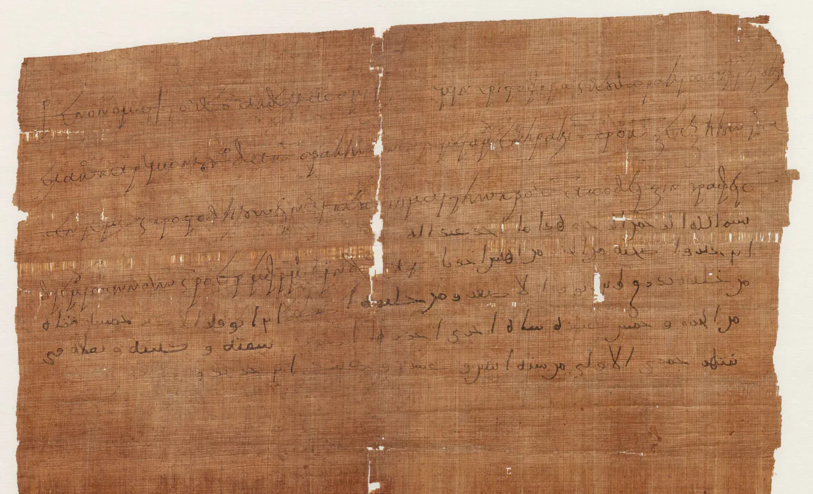

**Det islamiska nyåret** är den första dagen i muharram, den första månaden i hijrakalendern, och inleder ett nytt år i den muslimska tideräkning som utgår från profeten Muhammeds utvandring från Mecka till Medina år 622. Kalendern har tolv månmånader om 29 eller 30 dagar och ett vanligt år på 354 dagar, vilket gör att dagen faller omkring elva dygn tidigare i den gregorianska almanackan för varje år som går.[^1] Den svenska kalendersidan Islamiskt forum anger datumet till den 16 juni 2026, med tillägget att det muslimska dygnet börjar vid solnedgången och att kvällen innan därför räknas till dagen.[^2]

Varken Koranen eller hadithsamlingarna nämner en nyårsdag, och de klassiska rättsböckerna har inget kapitel om saken. Själva tideräkningen är ett administrativt beslut från kalifen Umar ibn al-Khattabs tid, fattat för att skuldsedlar skulle kunna dateras. Profeten anlände till Medina i rabiʿ al-awwal, och Malik ibn Anas ansåg därför att året borde börja där. Att året ändå fick börja i muharram hade praktiska skäl.

Kring månaden möter en svensk läsare tre olika beskrivningar, och bara en av dem har stöd i texterna. I den klassiska traditionen är muharram en fastemånad, och den dag texterna faktiskt talar om är den tionde, ashura. Sorgeriterna kring Husayn ibn Alis död vid Karbala år 680 saknar den grunden. Det gör också bilden av dagen som ett nyårsfirande med gratulationer och god mat, som förekommer i folklig praxis och i svenskt skolmaterial.

## Orden bakom det islamiska nyåret: hijra, muharram och nasiʾ

Hijra kommer av roten h-j-r, som betyder att bryta upp, lämna och skilja sig från. I källtexterna betecknar ordet händelsen, utvandringen år 622. Något datum och någon högtid avses inte. Adjektivet hijri, "som hör till hijra", är sent och administrativt: det beskriver en tideräkning. Den arabiska termen för själva nyårsdagen, *raʾs al-sana al-hijriyya*, "hijraårets huvud", förekommer varken i Koranen eller i hadithsamlingarna.

Muharram kommer av roten h-r-m, samma rot som i haram och ihram, och betyder ungefär det som är förbjudet eller fredat. Ibn Kathir återger ʿAlam al-Din al-Sakhawis förklaring att månaden heter så därför att den är fredad, och dennes eget tillägg att namnet är en förstärkning av dess okränkbarhet, eftersom araberna brukade kasta om den och göra den tillåten ett år och förbjuden ett annat.[^3] De övriga månadsnamnen förutsätter en kalender som låg fast mot årstiderna. Safar heter så därför att husen stod tomma när männen red ut, medan rabiʿ och jumada bär namn efter väderförhållanden. Månaderna i deras räkning vandrade inte, konstaterar Ibn Kathir.

Ashura är den tionde dagen i muharram, och ordet härleds vanligen ur ett arameiskt ord för "den tionde".[^4] *Nasiʾ* betyder uppskjutande och betecknar den förislamiska praktiken att flytta en fredad månad framåt, så att ett krigståg kunde genomföras utan att den fredade tiden kränktes. Termen förekommer en enda gång i Koranen.

I en hadith hos Muslim kallas muharram *shahr Allāh*, "Guds månad". Det är den enda hedersbeteckning månaden har i källorna, och hadithen handlar om fasta.

## Koranen och haditherna om muharram och de tolv månaderna

Kalenderns grundstadga står i den nionde suran, i en vers som fastställer både antalet månader och att fyra av dem är fredade:

> ANTALET månader är tolv enligt Guds dekret – vilket Han fastställde den dag då Han skapade himlarna och jorden. Av dem är fyra helgade; detta är [Guds] evigt sanna lag. Vanhelga därför inte dessa [månader] till skada för er själva. Och var orubbliga i ert motstånd mot dem som sätter gudar vid Guds sida, liksom de är orubbliga i sitt motstånd mot er, och var förvissade om att Gud är med de gudfruktiga.[^5]

Versen omedelbart därefter riktar sig mot skottmånadspraktiken:

> Genom att lägga till [en månad] ger de mer kraft åt förnekandet av sanningen och därmed växer förnekarnas förvirring – ett år förklarar de detta är tillåtet och ett [annat] år förbjuder de det så att det stämmer överens med antalet av Gud helgade månader. På så sätt förgriper de sig på det som Gud har heligförklarat.[^6]

Vilka de fyra månaderna är framgår av profetens predikan under avskedsvallfärden: "Tiden har vänt tillbaka till sin form från den dag då Gud skapade himlarna och jorden. Året har tolv månader, av dem fyra fredade. Tre i följd, dhu al-qaʿda, dhu al-hijja och muharram, samt rajab, mudarstammens månad, som ligger mellan jumada och shaʿban."[^7]

Att månfaserna är tidmått sägs uttryckligen:

> DE FRÅGAR dig om innebörden av månens nytändning. Säg: "Den visar människorna tidpunkten då [vissa skyldigheter skall fullgöras] och [tiden för] vallfärden." Det är inte fromhet att stiga in i ett hus genom [en dörr på] dess baksida; nej, fromhet visar den som fruktar Gud.[^8]

Två andra verser lägger till att fasernas gång är fastställd för att människor skall kunna räkna åren och mäta tiden.[^9] Tideräkning är därmed en tillåten mänsklig vetenskap, och det är också det argument som senare anförs för astronomisk beräkning framför okulär observation.

Om muharram som månad finns bara en hadith som pekar ut den. Enligt Abu Hurayra svarade profeten på frågan om vilken fasta som är bäst efter ramadan: "Guds månad, den ni kallar al-muharram."[^10] Om den tionde dagen finns däremot flera. Ibn Abbas berättar att profeten kom till Medina, fann att judarna fastade på ashura, frågade varför och fick svaret att det var dagen då Gud räddade Israels barn från deras fiende och att Mose fastade den. Han svarade: "Jag står Mose närmare än ni", fastade dagen och befallde att den skulle fastas.[^11] Ett år före sin död sade han om dagen: "Om jag lever till nästa år skall jag sannerligen fasta den nionde."[^12] Muʿawiya återgav senare från predikstolen i Medina profetens ord om rättsläget: detta är ashuradagen, Gud har inte föreskrivit er att fasta den, jag fastar, den som vill må fasta och den som vill må äta.

## Rättsskolorna om muharram, ashura och nyårsgratulationen

De fyra rättsskolorna är eniga om att frivillig fasta i muharram är förtjänstfull. al-Ghazali räknar i Bidayat al-hidaya de fredade månaderna bland de rekommenderade fastetiderna: dhu al-qaʿda, dhu al-hijja, muharram och rajab, en ensam och tre i följd. Han fortsätter omedelbart med en varning mot att göra fastan till en yttre räkneövning, och anför hadithen att mången fastande inte får ut annat av sin fasta än hunger och törst.[^13]

Om ashura går de lärda isär redan i frågan vilken dag det rör sig om. al-Nawawi skriver i al-Majmuʿ att ashura är den tionde och *tasūʿāʾ* den nionde, och tillägger att Ibn Abbas menade att ashura är den nionde, en uppgift som står i Muslims samling.[^14] al-Qurtubi uppger däremot att al-Shafiʿi själv lutade åt den nionde med stöd av en hadith från al-Hakam ibn al-Aʿraj, och avvisar samtidigt tanken att profeten skulle ha följt Mose lag, eftersom Quraysh enligt ʿAʾisha fastade dagen redan före islam.[^15] Inom den shafiitiska skolan ger därmed huvudlinjen och grundaren olika svar. al-Nawawi ger tre skäl att lägga till den nionde: att skilja sig från judarna, som nöjer sig med den tionde, att inte låta ashura stå ensam, på samma sätt som fredagsfastan inte får stå ensam, och att gardera sig ifall nymånen har iakttagits en dag för sent och den nionde i själva verket är den tionde.

Om vad man i övrigt gör på dagen står uppgifterna mot varandra. al-Marghinani skriver i den hanafitiska standardhandboken al-Hidaya att profeten på ashuradagen uppmanade till kohl på ögonen och till fasta, en rekommendation och ingen plikt.[^16] Ibn Taymiyya hävdar raka motsatsen: det som är styrkt om dagens förtjänst är fastan, att den sonar ett år och att Gud räddade Mose från drunkning på den. Allt annat som görs på dagen är en förkastlig innovation som ingen av imamerna rekommenderat. Han räknar upp kohl, hårfärgning, kokta gryn, offerkött och extra frikostighet mot familjen, och härleder själv bruket till Husayns mördare och deras likar.[^17]

Samma skrift avvisar sorgeriterna. Ibn Taymiyya beskriver bruket att göra dagen till en dödsvaka där dråpet läses upp och klagosånger framförs, och underkänner det med hadithen "Han hör inte till oss som slår sig för kinderna, river sönder kläderna och ropar jahiliyyans rop."[^18] Han förnekar däremot inte sorgen som sådan. Husayns död kallar han en verklig olycka, som den troende möter med orden att vi tillhör Gud och till honom återvänder. Den sorg som är tillåten är alltså densamma som varje troende är skyldig en dräpt troende. Skillnaden i synen på muharram följer i sin tur av en skillnad i lära, om imamatet och om följeslagarnas ställning.

Vilken dag som blir årets första hänger på en gammal oenighet om månobservation. al-Nawawi räknar upp sex shafiitiska ståndpunkter om vad en observation på en ort binder, och stannar för den som binder orter med samma horisont som observationsplatsen. Ibn Qudama ger den hanbalitiska regeln att en observation binder alla länder, och återger samtidigt hadithen om Kurayb, som sett nymånen i Syrien natten till fredagen och i Medina fick höra av Ibn Abbas att de sett den natten till lördagen. På frågan om inte Muʿawiyas observation räckte svarade Ibn Abbas: "Nej."[^19]

Om gratulationen råder ingen enighet men inte heller något förbud. Enligt Ibn Uthaymin skall den som blir gratulerad svara, men man bör inte själv inleda sådana hälsningar. Ahmad ibn Hanbal skilde på samma sätt mellan att svara, vilket är en plikt, och att inleda, vilket varken är sunna eller förbjudet, medan ʿAbd al-Karim al-Khudayr tillåter en allmän välönskan när avsikten är vänlighet.[^20] Den tillåtande hållningen bygger på den vanliga åtskillnaden mellan gudstjänsthandlingar, som kräver belägg i texterna, och seder, som är tillåtna så länge inget förbud visats. Ingen av dem kallar hälsningen en gudstjänsthandling.

## Hijrakalenderns historia: från Umars beslut till dagens månobservation

Före islam räknade araberna år från byggandet av Kaba, senare från Kaʿb ibn Luʾayys död och därefter från Elefantåret.[^21]

Den fredade tiden manipulerades öppet. Hos al-Azraqi stiger mannen som förrättade *nasiʾ* upp vid Kabas mur på avfärdsdagen och ropar till pilgrimerna: "Ni människor, gör inte era fredade ting tillåtna, och håll era heliga tecken i ära. Jag blir åtlydd och klandras inte." Genom att förbjuda muharram ett år och safar ett annat kunde de som styrde vallfärden låta den vandra genom hela året och återkomma till sin utgångspunkt vart tjugofjärde år.[^22] Ibn Kathir namnger Junada ibn ʿAwf al-Kinani som den som varje år ropade ut vilken månad som gällde.[^23]

År 16 efter hijra lät Umar ibn al-Khattab införa en tideräkning, och anledningen var praktisk. En skuldsedel förföll "i shaʿban", varpå Umar frågade vilken shaʿban som avsågs, detta års, förra årets eller nästa års. Han samlade följeslagarna och sade: "Ge folk något varmed de kan känna igen när deras skulder förfaller." Förslaget att räkna efter härskarna, som perserna gjorde, förkastades, och detsamma gällde tideräkningen från Alexander, som sträckte sig för långt tillbaka. Också profetens födelse och hans kallelse fördes fram. Ali ibn Abi Talib och andra föreslog utvandringen, eftersom den är uppenbar för var och en och tydligare än både födelsen och kallelsen, och Umar och följeslagarna fann det gott.[^24] al-Dhahabi nämner samma årtal och tillägger att tideräkningen infördes på Alis inrådan.[^25]

Sedan återstod frågan om vilken månad året skulle börja i. Profeten kom till Medina i rabiʿ al-awwal, och Malik ibn Anas ansåg enligt al-Suhayli att året borde räknas därifrån. Majoriteten valde muharram av försiktighet: månaden var redan det arabiska månårets första, och då kom månaderna inte i olag.[^26] Ibn Hazm höll enligt Ibn al-Qayyim fast vid rabiʿ al-awwal, och samma verk anför, med en kedja som Ahmad ibn Hanbal godtog som sund, att den förste som daterade efter hijra var Yaʿla ibn Umayya i Jemen, alltså före Umars beslut.[^27]

Också årtalet är osäkert. Ibn Kathir förlägger beslutet till år 16 på ett ställe och till år 17 eller 18 på ett annat, vilket talar för att samtiden inte uppfattade det som en märkesdag värd att fixera.[^24]

Sorgen kring månaden har däremot ett bestämt datum. Husayn ibn Ali dödades vid Karbala den 10 muharram 61, den 10 oktober 680.[^28] I buyidernas Bagdad hade dagen blivit en offentlig sorgedag: aska och halm ströddes på gator och torg, säckväv hängdes på bodarna, och många drack inget vatten den natten till minne av att Husayn dödades törstig. Ibn Kathir skildrar i samma andetag motrörelsen bland en del av Syriens folk, som på ashura kokade gryn, badade, parfymerade sig, tog på sig sina finaste kläder och gjorde dagen till en fest uttryckligen för att gå de andra emot.[^29] Han framställer alltså bruken som svar på varandra och underkänner dem båda: varken sorgeriterna eller festmåltiden har stöd i sunnan. Det förklarar inte allt firande av ashura, men det visar hur tidigt dagen blev en stridsfråga.

I modern tid har striden om riterna flyttat in i shiaislam. Tatbir, att slå sig med knivar eller kedjor, är förbjudet i Iran och bland Libanons shiitiska samfund sedan mitten av 1990-talet, med motiveringen att bruket saknar förebild hos deras egna imamer.[^30] Den klassiska hållningen avvisar det på annan och äldre grund, med hadithen om den som slår sig för kinderna och river sönder sina kläder.

Enligt en sammanställning hos moonsighting.com samlades den 18 februari 2016 en internationell kongress i Istanbul, där Yusuf al-Qaradawi, ordförande i Europeiska fatwarådet, föreslog en gemensam hijrakalender. Kriteriet blev att månen någonstans på jorden vid lokal solnedgång skall stå minst fem grader över horisonten med minst åtta graders elongation.[^31] Uppgiften kommer från en enskild källa och har inte kunnat stämmas av mot kongressens egna handlingar. Under alla omständigheter har kalendern inte genomförts överallt.

## Det islamiska nyåret i Sverige

Svensk rätt känner inte dagen. Lag (1989:253) om allmänna helgdagar räknar upp söndagar, nyårsdagen, trettondedag jul, långfredagen, påskdagen, annandag påsk, första maj, Kristi himmelsfärds dag, pingstdagen, nationaldagen, midsommardagen, alla helgons dag, juldagen och annandag jul.[^32] Ingen icke-kristen religiös högtid finns med, varken judisk, muslimsk eller annan. Frågan har prövats i modern tid, om än från motsatt håll. I motion 2020/21:2672 föreslog Joar Forssell (L) att de religiösa helgdagarna skulle ersättas av lediga dagar som var och en disponerar själv, med hänvisning till att ingen kultur eller religion bör gynnas av staten. Konstitutionsutskottet svarade den 4 februari 2021: "Utskottet anser liksom tidigare att antalet helgdagar inte bör ändras och är inte berett att förorda att någon gällande helgdag tas bort eller att någon ny helgdag införs."[^33] Något förslag om att lägga till en muslimsk helgdag har däremot aldrig legat på utskottets bord.

Europakonventionen ger inget stöd åt en annan ordning. I Kosteski mot f.d. jugoslaviska republiken Makedonien slog Europadomstolen den 13 april 2006 fast att artikel 9 inte som sådan garanterar arbetstagarens rätt att ta ledigt från arbetet på religiösa högtidsdagar. Klaganden hade bötfällts för frånvaro på en muslimsk högtid, och domstolen fann ingen kränkning. Den godtog också att staten kan kräva åtminstone någon form av belägg för att den som åberopar undantaget verkligen tillhör samfundet.[^34]

I skolan finns en öppning. Enligt 7 kap. 18 § skollagen får en elev beviljas kortare ledighet för enskilda angelägenheter, och Skolverket anger med hänvisning till förarbetena religiösa högtider som ett exempel på sådan angelägenhet. Längre ledighet kräver synnerliga skäl. Rektorn beslutar efter en samlad bedömning, och någon rätt till ledighet finns inte.[^35]

I arbetslivet saknas prejudikat om just denna fråga. De två mest anförda svenska avgörandena om religion i arbetslivet är AD 2017 nr 65 och AD 2018 nr 51. I det senare fann Arbetsdomstolen att en tolkförmedling utsatt en muslimsk kvinna för indirekt diskriminering och dömde ut 40 000 kronor i diskrimineringsersättning. Skyddet omfattar enligt domstolen uppfattningar som nått en viss nivå av övertygelse, seriositet, koherens och betydelse, och den citerade Europadomstolens princip att "en överprövning av det befogade i religiösa uppfattningar eller uttryck är enligt Europadomstolen inte förenlig med statens skyldighet att förhålla sig neutral och opartisk".[^36] Skyddet gäller därmed också en tolkning som bara en minoritet av de troende följer. Något svenskt avgörande om nekad ledighet för en muslimsk högtid finns däremot inte.

Hur många som berörs beror på vad som mäts. Pew Research Center uppskattade antalet personer med muslimsk bakgrund i Sverige år 2016 till 810 000, åtta procent av befolkningen, ett mått som utgår från ursprungsland och migrationsdata, inte från tro eller praktik.[^37] Myndighetsstatistiken över betjänade i trossamfund räknar annorlunda och avser medlemmar och andra som regelbundet deltar i verksamheten.[^38]

Vilken dag nyåret infaller avgörs i praktiken av institutioner. Islamiska Förbundet i Sverige följer Europeiska fatwarådet och astronomisk beräkning, och rådets metod utgår från global månobservation, där hela jorden räknas som en enda plats när nymånen skall skådas.[^39] Förbundet har därmed valt hanbaliternas globala ståndpunkt framför al-Nawawis horisontregel, och det är en av orsakerna till att två moskéer i samma svenska stad kan lägga 1 muharram på olika dagar.

Skolmaterialet ger en tredje bild. SO-rummet beskriver dagen som ett tillfälle att berätta om händelser ur Muhammeds liv och önska varandra ett gott nytt år, och tillägger att man festar och äter mycket god mat.[^40]

Festbeskrivningen är inte gripen ur luften. Ashura räknas på många håll som en tacksägelsedag och en glädjens dag, och i Maghreb firas den med fasta, allmosor, hågkomst av de döda, särskilda rätter, eldar som man hoppar över och karnevaler. Bruket är gammalt: den som ställer frågan till Ibn Taymiyya beskriver hur folk badar, smyckar sig, hälsar på varandra och kokar gryn just den dagen.[^41] Skolmaterialet ger firandet fel datum och fel innebörd. Det bruk som beskrivs hör hemma på den tionde muharram, inte på den första, och det är just det som Ibn Taymiyya och Ibn Kathir avvisar.

Det muharrambruk som syns offentligt i Sverige är ett annat. Imam Ali Islamic Center i Järfälla, grundat 1997, samlade den 24 oktober 2015 ett tåg från Humlegårdsparken till Sergels torg, och enligt arrangören brukar 2 000 till 2 500 personer delta.[^42] Det är en sorgeprocession, och den hör till de sorgeriter som den klassiska hållningen, med Ibn Taymiyya, avvisar. Den sorg som är tillåten över Husayn är densamma som över varje dräpt troende.

## Kalender och nyår i svensk idéhistoria

Frågan vem som avgör vilket datum det är har också en svensk historia. I november 1699 beslöt Sverige att gå över till den gregorianska kalendern gradvis, genom att utelämna skottdagen under elva skottår, och resultatet kallades "nya stilen" för att man skulle slippa nämna påven. Skottdagen ströks 1700 som planerat. Under stora nordiska kriget glömdes den bort både 1704 och 1708, och Sverige hamnade i en egen kalender, tio dagar efter den gregorianska och en dag före den julianska. I januari 1711 beslöt Karl XII att återvända till gamla stilen, och en tillökningsdag lades in efter den 29 februari 1712. Den dagen blev den 30 februari 1712, ett datum som aldrig officiellt existerat någon annanstans. Först 1753 gick Sverige över till den gregorianska kalendern, genom att den 17 februari följdes av den 1 mars.[^43]

Att almanackan var en myndighetsfråga hindrade inte att den ifrågasattes som mått på årstiderna. Linné skrev i Öländska resa 1745 om "våren, som ej bör mätas efter kalendarium utan efter klimatet och värmen".[^44]

Också högtidernas innehåll förändrades. Hjalmar Bergman noterade i Vi Bookar, Krokar och Rothar hur de svenska festdagarna bytt karaktär under ett par generationer:[^45]

> Mickelsmässan var alltjämt en syndens stora dag. Men jul och valborgsmässa och midsommar och Lucia hade blivit fromma, stillsamma dagar.
> — Hjalmar Bergman, *Vi Bookar, Krokar och Rothar*

Nyårsnatten i svensk prosa vid sekelskiftet hade mindre av fest än av bokslut. Hos Hjalmar Söderberg heter det om Martin Birck: "Då nyårsnattens stjärna brann öfver de hvita taken, tänkte Martin med en frysande känsla på den rad af gråa vinterdagar som väntade."[^46]

Detta är en annan traditions historia. Den svenska kalenderstriden gällde vem som hade rätt att fastställa datum i ett Europa som var delat av reformationen, och de citerade författarna skrev om en nyårsnatt i sin egen tid. Om vad islamisk rätt föreskriver för muharram säger materialet ingenting, och det anförs inte heller som stöd för någon hållning i den frågan.

## Vanliga invändningar mot det islamiska nyåret

Den tyngsta invändningen kommer inifrån traditionen. Muhammed ibn Salih al-Uthaymin formulerar den som ett historiskt påstående: han känner inte till någon uppgift om att de tidiga generationerna gratulerade varandra vid nyåret, och de betraktade inte den första i muharram som årets begynnelse förrän under Umar ibn al-Khattabs kalifat.[^20] Det är riktigt. Just därför behandlar de lärda 1 muharram som ett datum, inte som en gudstjänst. Invändningen leder emellertid inte till ett förbud, och al-Uthaymin drar samma gräns som Ahmad ibn Hanbal: gratulationen ska besvaras, men man inleder den inte själv. Den som tillåter hälsningen ser en välönskan som en sed och ingen rit, och den som önskar en medmänniska väl vid ett årsskifte gör inte anspråk på någon belöning och åberopar ingen text. Det som avvisas är att ge dagen ett föreskrivet rituellt innehåll.

Den mest spridda nyårsseden är också den svagast underbyggda. Årsslutsbönen, *duʿāʾ ākhir al-sana*, som varje år cirkulerar i meddelanden och forum tillsammans med en berättelse om änglar som ännu inte hunnit skriva färdigt föregående års goda gärningar, saknar överföringskedja. IslamWeb fann vid sin genomgång ingen uppgift om den i de stora hadithsamlingarna och konstaterade att texten bara återfinns i verk som inte granskar sina hadither. Slutsatsen är att man skall avstå från den.[^47]

En tredje invändning gäller kalenderns godtycklighet. Om Umar kunde bestämma vilket år som är år 1, vad är då heligt med den? Antalet månader, deras ordning och vilka fyra som är fredade anges i 9:36 som Guds dekret, och al-Qurtubi framhåller att hedningarnas namnbyten inte ändrade något av det Gud fastställt: att de kallade muharram safar och safar muharram förskjöt inte helgden.[^48] Vad Umar införde var en epok att räkna från.

En fjärde invändning är att muslimer inte ens är eniga om vilken dag det är. Det stämmer, och oenigheten är gammal och principiell. al-Nawawi räknar upp sex ståndpunkter om vad en observation binder, Ibn Qudama återger den motsatta regeln, och Ibn Abbas svarade nej på frågan om Muʿawiyas observation räckte för Medina. Istanbulkongressen 2016 försökte lösa saken och lyckades inte överallt. Striden gäller vem som fastställer datum. Vad som är föreskrivet den dagen berör den inte.

Sist kommer en invändning som gäller den svenska ordningen. 1 muharram har ingen ställning i svensk helgdagslagstiftning, och konstitutionsutskottet avvisade så sent som 2021 varje ändring av helgdagsförteckningen, om än utan att något förslag om en muslimsk helgdag hade lagts fram. Europakonventionen ger ingen rätt till ledighet, och det finns inget svenskt avgörande om nekad ledighet för en muslimsk högtid. Den som vill vara ledig för ashurafastan är hänvisad till rektorns bedömning eller arbetsgivarens välvilja. Det är en verklig brist i den svenska ordningen, och den låter sig inte avhjälpas med hänvisning till religiös rätt.

---

[^1]: Muslimska kalendern, svenskspråkiga Wikipedia.
[^2]: Islamiskt nyår, Islamiskt forum.
[^3]: Ibn Kathir, Tafsir al-Quran al-azim, till al-Tawba 9:36, med citat ur ʿAlam al-Din al-Sakhawis al-Mashhur fi asmaʾ al-ayyam wa-l-shuhur.
[^4]: Ashura, engelskspråkiga Wikipedia.
[^5]: Koranen, al-Tawba 9:36.
[^6]: Koranen, al-Tawba 9:37. Versen är förkortad vid meningsgräns.
[^7]: Sahih al-Bukhari nr 4662, från Abu Bakra; parallell i nr 3197 och i Sahih Muslim nr 1679.
[^8]: Koranen, al-Baqara 2:189. Versen är förkortad vid meningsgräns.
[^9]: Koranen, Yunus 10:5 och al-Isra 17:12.
[^10]: Sahih Muslim nr 1163, från Abu Hurayra; samma hadith i Sunan Ibn Maja nr 1742.
[^11]: Sahih al-Bukhari nr 2004, från Ibn Abbas; jämför nr 2003, från Muʿawiya, och nr 2005, från Abu Musa.
[^12]: Sahih Muslim nr 1134, från Ibn Abbas.
[^13]: al-Ghazali, Bidayat al-hidaya, avsnittet om frivillig fasta. Uppgiften återges här som referat och inte som ordagrant citat.
[^14]: al-Nawawi, al-Majmuʿ sharh al-Muhadhdhab, kapitlet om frivillig fasta.
[^15]: al-Qurtubi, al-Jamiʿ li-ahkam al-Quran, avsnittet om ashura-fastan.
[^16]: al-Marghinani, al-Hidaya fi sharh Bidayat al-mubtadi, kitab al-sawm. Hållningen anges där som rekommendation (nadb).
[^17]: Ibn Taymiyya, Minhaj al-sunna al-nabawiyya, avsnittet om ashura. Härledningen av bruket till Husayns mördare är Ibn Taymiyyas egen.
[^18]: Hadithen står i Sahih al-Bukhari, kitab al-janaʾiz, och i Sahih Muslim, kitab al-iman, från Ibn Masʿud; den anförs av Ibn Taymiyya i Minhaj al-sunna al-nabawiyya.
[^19]: Ibn Qudama, al-Mughni, kapitlet om fastan, där hadithen om Kurayb och Ibn Abbas återges.
[^20]: Ibn Uthaymin, återgiven i IslamQA nr 21290, där även Ahmad ibn Hanbals åtskillnad och ʿAbd al-Karim al-Khudayrs ståndpunkt refereras.
[^21]: Ibn Kathir, al-Bidaya wa-l-nihaya, om tideräkningen före islam.
[^22]: al-Azraqi, Akhbar Makka, avsnittet om nasiʾ.
[^23]: Ibn Kathir, Tafsir al-Quran al-azim, till al-Tawba 9:37.
[^24]: Ibn Kathir, al-Bidaya wa-l-nihaya, händelserna år 16 efter hijra; på annat ställe anges år 17 eller 18.
[^25]: al-Dhahabi, Tarikh al-islam, om tideräkningens införande år 16 och om att det skedde på Alis inrådan.
[^26]: Ibn Kathir, al-Bidaya wa-l-nihaya, där Malik ibn Anas ståndpunkt refereras via al-Suhayli.
[^27]: Ibn al-Qayyim, Zad al-maʿad, avsnittet om tideräkningen, där Ibn Hazms hållning återges och där uppgiften om Yaʿla ibn Umayya anförs med en kedja som Ahmad ibn Hanbal höll för sund.
[^28]: Ashura, engelskspråkiga Wikipedia.
[^29]: Ibn Kathir, al-Bidaya wa-l-nihaya, om ashura i Bagdad under buyiderna.
[^30]: Ashura, engelskspråkiga Wikipedia.
[^31]: Global Hijri Calendar, moonsighting.com, om kongressen i Istanbul den 18 februari 2016. Uppgiften är egenpublicerad och har inte kunnat stämmas av mot kongressens egna handlingar.
[^32]: Lag (1989:253) om allmänna helgdagar, 1 §. Lagen utfärdades den 18 maj 1989.
[^33]: Konstitutionsutskottets betänkande 2020/21:KU15, Allmänna helgdagar m.m., beslut den 4 februari 2021.
[^34]: Kosteski mot f.d. jugoslaviska republiken Makedonien, mål nr 55170/00, Europadomstolens tredje sektion, dom den 13 april 2006, slutgiltig den 13 juli 2006.
[^35]: 7 kap. 18 § skollagen; Skolverket, Ledighet i skolan.
[^36]: AD 2018 nr 51.
[^37]: Pew Research Center, Europe's Growing Muslim Population (29 november 2017), basår 2016.
[^38]: MUCF, Trossamfund – antal betjänade.
[^39]: Islamiska Förbundet i Sverige, Fastställande av datum för ramadan och eid al-fitr 2025.
[^40]: SO-rummet, Några viktiga muslimska högtider.
[^41]: Ashura, engelskspråkiga Wikipedia, om ashura som tacksägelsedag och om bruken i Maghreb; frågeställarens beskrivning av badandet, smyckandet och grynkoket återges av Ibn Taymiyya i Minhaj al-sunna al-nabawiyya.
[^42]: Imam Ali Islamic Center, pressmeddelandet Imam Hussein Manifestation – Ashura (2015). Deltagarantalet är arrangörens egen uppgift och avser 2015.
[^43]: Svenska kalendern, svenskspråkiga Wikipedia.
[^44]: Carl von Linné, Öländska resa (1745).
[^45]: Hjalmar Bergman, Vi Bookar, Krokar och Rothar (1912).
[^46]: Hjalmar Söderberg, Martin Bircks ungdom (1901).
[^47]: IslamWeb, fatwa nr 45049, om den så kallade årsslutsbönen.
[^48]: al-Qurtubi, al-Jamiʿ li-ahkam al-Quran, till al-Tawba 9:36.
