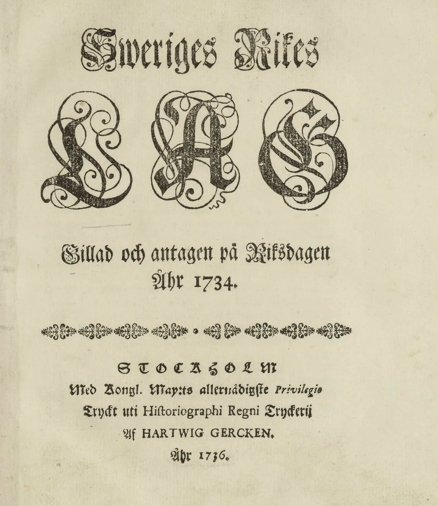

**Sharia** är den väg Gud enligt islamisk lära har föreskrivit för människan: den vägledning om tro, gudstjänst, moral och samliv som muslimer hämtar ur Koranen och ur profeten Muhammeds sunna. Ordet betyder ursprungligen vägen ner till vattenkällan. I den arabiska Koranen betecknar det ingenstans en lagbok, ett domstolsväsen eller en strafflag.

Den svenska debatten gäller kroppsstraffen, religiösa domstolar och frågan om svensk rätt kan sättas åt sidan. Ordet används då om minst tre skilda saker: den uppenbarade vägledningen, *fiqh* och de moderna strafflagarna. *Fiqh* är den mänskliga rättsvetenskap som uttolkar vägen, och i många enskilda frågor har juristerna kommit till olika svar. Strafflagarna har ett fåtal moderna stater stiftat under samma namn. Betydelserna glider in i varandra, och ett påstående om en av dem behöver inte gälla de andra.

Europadomstolen ställde sig 2003, i sitt avgörande om det turkiska Välfärdspartiet, bakom kammarens bedömning att sharia är "stable and invariable", stabil och oföränderlig.[^39] Den klassiska rättslitteraturen säger motsatsen om sig själv: Ibn Khaldun ägnar ett helt avsnitt av sin *Muqaddimah* åt varför oenigheten mellan juristerna med nödvändighet uppstår. I Sverige nämner ingen lag ordet sharia. Fyra av varandra oberoende regler i gällande rätt stänger dörren för varje försök att göra religiös rätt bindande mot någons vilja.

## Vad ordet sharia betyder på arabiska

Roten *sh-r-ʿ* hör i klassisk arabiska samman med vägen: att öppna eller staka ut en väg, och särskilt den nedtrampade stigen fram till ett vattenhål i öknen. Substantivet *sharīʿa* bär kvar bilden: platsen där man kommer ner till vattnet och dricker.

I Koranen förekommer det i denna form på en enda plats, i sura al-Jāthiya:

> Därefter har Vi visat dig [Muhammad] en väg till förverkligandet [av trons] syfte; följ därför denna väg och fäst dig inte vid de okunnigas önskningar.[^1]

Knut Bernström översätter ordet med "väg", inte med "lag". Verbet av samma rot står i 42:13, där det som föreskrivs är *dīn*, tron, och inte en samling paragrafer. En besläktad form, *shirʿa*, förekommer i 5:48 tillsammans med *minhāj*. al-Qurtubi återger där al-Mubarrads förklaring att *sharīʿa* är vägens början och *minhāj* den fortlöpande vägen, och Ibn ʿAbbās läsning att uttrycket betyder "sedvänja och väg".[^2]

Vid sidan av sharia står en rad termer som ofta klumpas ihop med den. *Fiqh* är den mänskliga förståelsen av vägen, alltså rättsvetenskapen. *Usūl al-fiqh* är metodläran för hur regler härleds, *furūʿ* de härledda reglerna. *Qadāʾ* är dömandet, *fatwa* ett icke bindande svar från en lärd och *qānūn*, ett lånord från grekiskan, stiftad lag. Att likställa sharia med *fiqh* är att förväxla det uppenbarade med utläggningen av det.

Ibn Taymiyya klagade redan på 1300-talet över att människor använde ordet utan att skilja mellan dess innebörder, och gjorde själv en tredelning: *al-sharʿ al-munazzal*, det nedsända, som är Boken och sunnan och som ingen får träda utanför; *al-sharʿ al-muʾawwal*, det uttolkade, som är juristernas arbete och kan ifrågasättas; och *al-sharʿ al-mubaddal*, det förvanskade, som felaktigt tillskrivs religionen.[^3] Ordet har dessutom ett helt icke-juridiskt bruk. Hos Ibn al-Qayyim ställs sharia som lydnadens väg mot *haqīqa*, den skådande erfarenheten: sharia är att man dyrkar honom, *haqīqa* att man bevittnar honom.[^4]

## Vad Koranen och sunnan säger om sharia

Den vers som oftast åberopas till stöd för att lagen får se olika ut i olika samfund står i sura al-Māʾida:

> [Muhammad!] Vi har uppenbarat Koranen för dig med sanningen, som bekräftar det som består av [äldre tiders] uppenbarade Skrifter och vars uppgift det är att vaka över det. […] För var och en av er har Vi fastställt en lag och en levnadsregel. Om Gud hade velat hade Han helt visst gjort er till ett enda samfund, men det var Hans vilja att sätta er på prov genom det som Han har skänkt er. Tävla därför med varandra om att göra gott! […][^5]

al-Qurtubi läser versen så att Gud gav Tora åt dess folk, Evangeliet åt dess och Koranen åt dess, och att detta gäller lagarna och gudstjänsten, medan grunden, *tawhid*, är densamma för alla. Enligt honom säger just denna vers uttryckligen att det är Guds vilja att lagarna skiljer sig åt.[^2]

Några verser tidigare står den text som mer än någon annan har åberopats i modern islamistisk statsideologi: att Tora uppenbarades med vägledning och ljus, att profeterna dömde efter den, och att de som inte dömer i enlighet med vad Gud har uppenbarat är förnekare.[^6] Den klassiska exegetiken drog inte den slutsats som moderna rörelser drar. Från Ibn ʿAbbās och flera andra av de tidiga lärda återges läsningen att otron i denna vers är *kufr dūna kufr*, en otro som inte utesluter ur islam, och Ibn Taymiyya påpekar att både Ahmad och al-Bukhari återger den.[^7]

Straffversen om stöld hör till de mest kända texterna över huvud taget:

> MANNEN SOM stjäl och kvinnan som stjäl skall som straff för detta brott få handen avhuggen; [denna föreskrift] är en sträng varning från Gud. Gud är allsmäktig, vis.[^8]

I versen omedelbart därefter står att Gud tar emot ångern hos den som ångrar sig och bättrar sig. De två verserna läses tillsammans i hela den klassiska litteraturen, och sammanställningen är utgångspunkten för två läror: att ånger i vissa fall häver de fastställda straffen, en fråga där rättsskolorna går isär, och att tvivel avvärjer dem.

I frågan om sharias föränderlighet väger en hadith tyngst. Från ʿAmr ibn al-ʿĀs återges att Profeten sade: "När domaren dömer och anstränger sig i sitt omdöme och träffar rätt, får han två belöningar; och när han dömer och anstränger sig men träffar fel, får han en belöning."[^9] Hadithen är *muttafaq ʿalayh*, återgiven av både al-Bukhari och Muslim, och Ibn Qudama åberopar den som sunnans grund för hela domarämbetet.[^10] Traditionen räknar alltså själv med att en dom kan bli fel utan att domaren därmed syndar.

al-Qurtubi lägger dock till en inskränkning. Belöningen tillfaller bara den som verkligen är behörig att utöva *ijtihād*. Den som saknar behörigheten är enligt honom en *mutakallif*, en som tar på sig vad han inte förmår, och han har ingen ursäkt för sitt felaktiga domslut. Inte heller den behörige belönas för själva felet: han lönas för sin ansträngning, och synden lyfts från honom.[^11]

## Rättsskolornas oenighet om vad sharia kräver

De fyra rättskällorna är Koranen, sunnan, *ijmāʿ* (de lärdas samstämmighet) och *qiyās* (analogislutet). Ibn Khaldun går igenom dem och noterar att de inte godtogs av alla: zahiriterna förkastade analogislutet och höll sig till texterna och samstämmigheten allena, och enstaka jurister ifrågasatte även samstämmigheten.[^12]

Ibn Khaldun förklarar också varför oenigheten inte går att undvika. Bevisen består till största delen av texter på arabiska, och om många av ordens betydelser råder välkänd oenighet. Sunnans överföringsvägar har dessutom skiftande styrka, och dess bestämmelser står i de flesta fall till synes mot varandra. De måste därför vägas mot varandra, och de lärda väger dem olika.[^13]

Hur detta ser ut i praktiken framgår av al-Qurtubis genomgång av en enda familjerättslig fråga, den om giftermålsförmyndaren. Enligt honom är saken avgjord i Boken och sunnan: det finns inget äktenskap utan förmyndare. Men al-Zuhri och al-Shaʿbi ansåg att en kvinna som gifter bort sig själv med en jämlike inför två vittnen ingår ett giltigt äktenskap, och Abu Hanifa och Zufar sade detsamma. Ibn al-Mundhir svarade att Abu Hanifas ståndpunkt strider mot sunnan och avviker från vad de flesta lärda anser. Abu Yusuf och Muhammad ibn al-Hasan, Abu Hanifas egna lärjungar, intog en mellanställning: förmyndaren kan godkänna äktenskapet i efterhand, eller domaren ge sitt godkännande i hans ställe.[^14]

Samma sak gäller domarämbetet. Ibn Rushd återger oenigheten om domaren måste kunna utöva *ijtihād*. al-Shafiʿi krävde det. Abu Hanifa ansåg en lekmans domslut giltigt.[^15] al-Māwardī räknar upp fyra kunskapsområden som en domare måste behärska: Koranen, den fastställda sunnan, de tidiga generationernas tolkningar och analogiläran. I Koranen ska han känna det upphävande och det upphävda, det entydiga och det mångtydiga, det allmänna och det särskilda. I sunnan ska han känna överföringsvägarna och äkthetsgraderna, och hos de tidiga generationerna både det de var eniga om och det de tvistade om. Först den som behärskar alla fyra får döma.[^16]

Straffrätten utgör dessutom en mindre del av sharia än debatten ger intryck av. Ibn Taymiyya delar lagens plikter i gudstjänsthandlingar, straff och botgöringar, och skiljer inom straffen mellan de fastställda och dem som är överlämnade till myndighetens bedömning.[^17] Ibn al-Qayyim delar överträdelserna i tre slag. Först de som har ett fastställt *hadd*-straff, och dit räknar han också *qisās*. Sedan de som kräver botgöring men saknar *hadd*. Sist de som saknar bådadera, där avskräckningen sker genom *taʿzīr*, ett straff som utmäts efter domarens skön.[^18] Till detta kommer rättsmaximen *idraʾū l-hudūd bi-l-shubuhāt*, avvärj de fastställda straffen vid tvivel. Intisar Rabb har spårat hur maximen gick från enskilda domares praxis till fast lära hos hanafiter och malikiter, och hur *shubha* kom att omfatta varje osäkerhet som undergräver den visshet straffet kräver.[^19] Närliggande, men med egen grund, är ʿUmar ibn al-Khattābs ord att ingen hand huggs av under ett nödår. Ibn Qudama återger dem tillsammans med Ahmads regel att stöld under hungersnöd inte straffas, eftersom den som stjäl då är att likna vid en nödställd.[^18b]

Ovanpå detta ligger läran om lagens syften, *maqāsid al-sharīʿa*. al-Juwayni (d. 1085) var den förste att räkna upp de fem nödvändigheter som lagen skyddar: religionen, livet, avkomman, egendomen och förnuftet. al-Ghazali (d. 1111) gav dem systematisk form i *al-Mustasfā*, och al-Shatibi (d. 1388) behandlade dem utförligast i *al-Muwāfaqāt*.

Oenigheten har samtidigt en bestämd räckvidd. Den löper genom *furūʿ*, de härledda reglerna, och gäller vad texterna kräver i det enskilda fallet. Källorna själva, trosgrunden och de texter vars innebörd är entydig omfattas inte av den. Det är samma gräns som al-Qurtubi drar i sin kommentar till 5:48, mellan lagarna, som har växlat, och *tawhid*, som aldrig har gjort det.[^2]

## Sharias historia från Medina till moderna strafflagar

Före islam avgjordes tvister på Arabiska halvön av skiljemän, *hakam*, som parterna själva utsåg och vars auktoritet vilade på deras anseende. Profeten dömde i Medina i denna form. Under de fyra rättledda kaliferna och umayyaderna växte kadiämbetet fram, med domare som makthavaren utsåg.

Metodläran har däremot ett daterbart ursprung. Ibn Khaldun namnger al-Shafiʿi (d. 820) som den förste som skrev i ämnet, i den berömda *Risāla*, där han behandlade befallningar och förbud, klargörande och överlevererad tradition, upphävande och analogislutets rättsgrund. Därefter behandlade hanafiterna ämnet, och med Abu Zayd al-Dabusi fullbordades disciplinen.[^20]

Att det blev just fyra skolor har historiska skäl. Ibn Khaldun beskriver hur man med tiden inskränkte sig till att följa de fyra imamerna, eftersom *ijtihād* blivit för svårt och det inte längre fanns någon som upprätthöll de övriga skolorna. De skolor som inte fick samma uppslutning – zahiriterna, Abu Thawrs anhängare och al-Tabaris krets – dog efter hand ut.[^21] Mellan de fyra fortsatte oenigheten som ett normalt tillstånd: ibland står al-Shafiʿi och Malik mot varandra medan Abu Hanifa instämmer med en av dem, ibland tvärtom.[^21]

Ibn Khaldun skiljer också mellan två slags styre, *siyāsa sharʿiyya* och *siyāsa malakiyya*, det lagbundna och det furstliga.[^22] Distinktionen lämnar ett stort område av världsligt beslutsfattande utanför det som härleds ur uppenbarelsen. I det osmanska riket fylldes detta område av *qānūn*, sultanens stiftade lag, som i sekler gällde jämsides med kadiernas *fiqh*.

Brytpunkten kom med kodifieringen. Tanzimatreformerna från 1839 och sedan *Mecelle*, den osmanska civillagboken 1869–1876, gjorde för första gången delar av hanafitisk rätt till paragrafer i en statlig lagbok. Wael Hallaq menar att det var här det avgörande skedde: kodifieringen utplånade det tolkningsutrymme som var fiqhens själva arbetsform och reducerade en flerstämmig tradition till en enda giltig tillämpning.[^23] Det som moderna stater i dag kallar sharia är i den meningen en statsprodukt av sent datum.

Den moderna strafflagstiftningen är yngre än så. Pakistan införde sina Hudood Ordinances 1979, Iran antog sin lag om hudud och qisas 1982, Sudan de så kallade septemberlagarna 1983, delstater i norra Nigeria från 1999–2000 och Brunei från 2014, där de fastställda straffen dock trädde i kraft först 2019. År 1990 antog Organisationen för islamiskt samarbete Kairodeklarationen om mänskliga rättigheter i islam, vars artiklar 24 och 25 föreskrev att alla rättigheter och friheter i deklarationen är underordnade den islamiska sharian och att sharian är deklarationens enda tolkningskälla. I den reviderade lydelsen från 2020 är den bestämmelsen struken. Ett förbehåll för islams principer och för nationell lagstiftning står dock kvar.[^24]

## Sharia i svensk rätt och svensk debatt

Ingen svensk författning nämner sharia. Spärrarna är fyra, och alla är generella och religionsneutrala.

Den första ligger i skiljedomsrätten. Enligt 1 § lagen om skiljeförfarande får endast tvister "i frågor som parterna kan träffa förlikning om" lämnas till skiljemän, och 33 § gör en skiljedom ogiltig både om den prövar en fråga som inte får avgöras av skiljemän och om domen eller dess tillkomst är uppenbart oförenlig med grunderna för rättsordningen i Sverige.[^25] Äktenskapsskillnad, vårdnad och straff är indispositiva och kan därför aldrig avgöras av ett religiöst organ, oavsett vad parterna kommit överens om.

Den andra finns i den internationella privaträtten. I NJA 2017 s. 168 prövade Högsta domstolen ett *mahr*-avtal som ingåtts vid en vigsel i Iran. Domstolen fann att svensk rätt blev tillämplig på makarnas förmögenhetsförhållanden, och att parternas avtal om mahr "är närmast att anse som ett föravtal om en framtida partiell bodelning. Det är därmed inte giltigt".[^26] Det islamiska ursprunget spelade ingen roll i domskälen. Avgörande var att föravtal om bodelning bara är giltiga när upplösningen är omedelbart förestående. Före domen var praxis oenhetlig: Mosa Sayed har kartlagt hur hovrätterna behandlat mahr än som underhåll, än som bodelning.[^27]

Den tredje ligger i erkännandereglerna. Genom en ändring i 1904 års lag infördes den 1 januari 2019 ett undantagslöst hinder mot att erkänna utländska barnäktenskap, och den 1 juli 2021 utvidgades förbudet till månggifte sedan kravet på anknytning till Sverige tagits bort.[^28c] Ett utländskt äktenskap erkänns i dag inte om det finns hinder mot det enligt svensk lag. Enligt Nationellt centrum för kvinnofrid tog Skatteverket under 2021–2023 emot 134 ansökningar om erkännande av barnäktenskap ingångna utomlands, varav 118 avslogs och 16 registrerades.[^28] I myndighetens egen kartläggning 2025 hade 41 nya registrerade månggiften tillkommit sedan kartläggningen 2017, och alla utom två visade sig bero på fel i folkbokföringen.[^28b] Talen mäter myndighetsärenden, inte förekomst.

Den fjärde gäller djurskyddet. Alla djur som slaktas i Sverige måste först bedövas; halalslakt är tillåten om bedövning sker före avblodningen, medan kosherslakt, som sker på obedövade djur, inte godtas.[^29] Kravet infördes genom 1937 års slaktlag och trädde i kraft året därpå, alltså långt före den muslimska invandringen. Här är svensk rätt strängare mot religiös praxis än lagstiftningen i de flesta andra EU-länder. Europadomstolen godtog 2024 ett belgiskt krav på bedövning vid religiös slakt. Det belgiska kravet gäller en reversibel bedövning som inte dödar djuret, och den svenska lagen saknar helt undantag för religiös slakt.[^29b]

Domstolarna har också gett religiös praxis rätt. I AD 2018 nr 51 fann Arbetsdomstolen att ett tolkföretag utsatt en kvinna för indirekt diskriminering när det avbröt en rekrytering sedan hon av religiösa skäl inte tagit en manlig företrädare i hand, och tillerkände henne 40 000 kronor.[^30] I HFD 2022 ref. 51 prövade Högsta förvaltningsdomstolen Skurups och Staffanstorps förbud mot huvudduk i kommunala förskolor och skolor. Förvaltningsrätten hade upphävt förbuden, och domstolen avslog kommunernas överklaganden. Klädsel som uttrycker religiös tillhörighet omfattas enligt domstolen av yttrandefriheten i regeringsformen, och förbudet saknade lagstöd.[^31]

Debatten har två laddade poler. Riksdagsledamoten Ann-Sofie Alm (M) begärde i motion 2025/26:1712 att en kriminalisering av organiserad tillämpning av parallella rättssystem, "exempelvis sharialagar", skulle utredas. Båda yrkandena avslogs.[^32] I augusti 2026 rapporterade Flamman om Walving-Lundberg Business Court, ett privat skiljedomsinstitut vars ena avdelning tillämpar islamiska regler på civilrättsliga tvister. Amineh Kakabaveh, ordförande i Varken hora eller kuvad, kallade saken "ytterst allvarlig för den svenska demokratin". Grundaren Mattias Walving-Lundberg kallade tvärtom avdelningen "sekulariserande": den flyttar enligt honom dömandet från imamer till en ordning som kan granskas och som står under svensk domstolskontroll.[^33]

Det allvarligaste problemet i Sverige ligger vid sidan av båda. Uppdrag granskning talade 2022 med tio kvinnor som var civilrättsligt skilda i Sverige men som imamer vägrat bevilja religiös skilsmässa utan mannens samtycke.[^34] Konflikten står inte mellan sharia och svensk lag. Den svenska domen finns, men den saknar verkan i den ordning kvinnan lever i.

Låsningen är inte islamspecifik. I judisk rätt uppstår samma sak när en man vägrar utfärda skilsmässobrevet *get*: hustrun blir *aguna*, kedjad, civilrättsligt fri men religiöst bunden. Där finns en betydligt längre rättslitteratur och i flera länder motmedel i lag, bland annat den brittiska Divorce (Religious Marriages) Act 2002, som låter en domstol skjuta upp den civilrättsliga skilsmässan tills den religiösa har utfärdats.[^35]

## Sharia och den svenska statskyrkans rättsordning

Frågan om lagen är funnen eller stiftad har en svensk historia, och svaren har växlat från tid till tid. Olaus Petris domareregler, nedskrivna omkring 1540 och från 1635 tryckta tillsammans med rikets lagböcker, öppnar med att påminna domaren om att hans ämbete hör Gud till, och gör klart att det som inte är rätt och skäligt inte heller kan vara lag.

Uppenbarad text användes också direkt som rättskälla. Karl IX lät 1608 trycka Kristoffers landslag med ett utdrag ur Moses lag som bihang, och domstolarna åberopade det i grova brottmål ända fram till 1734 års lag. Missgärningsbalken där föreskrev alltjämt dödsstraff för hädelse, trolldom och grovt hor, och 1686 års kyrkolag reglerade tro och gudstjänst med statens tvångsmedel bakom sig. Först Gustav III:s straffreform 1779 avskaffade flera av dessa straff.

Under 1800-talet blev förhållandet mellan tron och rättsordningen en huvudfråga i svensk idédebatt. Erik Gustaf Geijer varnade i sitt tal vid reformationsjubileet 1817 för en frihet utan förankring:[^36]

> En frihet utan grund av tro och rättvisa kan rasa och åter upprepa den världsgamla läran om huru nära anarkien är beslägtad med despotismen.
>
> — Erik Gustaf Geijer, *Tal vid jubelfesten 1817*

Sextio år senare ställdes frågan på huvudet. I en av de mest citerade dialogerna i August Strindbergs *Röda rummet* (1879) hävdar den ene att lagen skrivits av hela folket, av det allmänna rättsmedvetandet och av Gud, varpå den andre frågar vem som skrivit lagen för den fattige och svarar själv: den rike, alltså herren för slaven. Hjalmar Söderberg lägger 1912 en tredje hållning i munnen på en romanfigur, att den moraliska lagen är densamma för alla oberoende av klimat, ras, ålder, kön och intelligens, och att det räcker att vara människa för att känna den.[^37] Ellen Key drev samtidigt kravet att en verksam skyddslagstiftning för kvinnor och barn borde vara det sociala samvetets mest kategoriska imperativ, alltså att lagen skulle mätas mot sina följder för de svagaste.[^38]

Avvecklingen av den konfessionella rättsordningen tog lång tid. Religionsfrihetslagen 1951 gjorde det för första gången möjligt att lämna Svenska kyrkan utan att gå in i ett annat samfund, och först den 1 januari 2000 skildes kyrka och stat åt.

Den svenska ordningen var en statskyrka: en och samma statsmakt stiftade lagen om tron, tillsatte prästerskapet och avvecklade till sist det den själv hade infört. *Fiqh* växte fram hos enskilda lärda vid sidan av statsapparaten och har aldrig haft ett organ med den befogenheten. Frågan om vad de islamiska källorna kräver avgörs därför på andra grunder.

## Invändningarna mot sharia

Den vanligaste invändningen är att sharia i sig utesluter pluralism. Europadomstolen formulerade den i Refah-domen 2003: sharia, som troget speglar de dogmer och gudomliga regler religionen fastställt, är stabil och oföränderlig, och principer som politisk pluralism eller den ständiga utvecklingen av offentliga friheter har ingen plats i den.[^39] Domen prövade ett parti som ville införa rättslig pluralism i Turkiet, och slutsatsen om partiet var rimlig. Premissen om sharia var det inte. Ibn Khaldun, al-Qurtubi och al-Māwardī beskriver alla en tradition som förutsätter oenighet, kräver vägning och belönar den domare som anstränger sig och ändå dömer fel. Europadomstolen tog de moderna staternas kodifierade strafflagar och kallade dem traditionen.

Domstolens egen praxis rättade sedan bilden. I Molla Sali mot Grekland 2018 fann stora kammaren enhälligt att Grekland kränkt konventionen genom att sätta en muslimsk mans civilrättsliga testamente ur spel och tillämpa islamisk arvsrätt på hans änka.[^40] Domstolen avgjorde saken på diskrimineringsgrund och tog inte ställning till islamisk arvsrätt som sådan. Den slog fast att ingen får underkastas en särordning utan sitt samtycke, och kallade den fria självidentifikationen en hörnsten i minoritetsskyddet.

Den principen gäller åt båda hållen, också för det svenska skiljedomsinstitutet. Ett förfarande som två parter fritt har valt, och som står under domstolskontroll enligt 33 § lagen om skiljeförfarande, träffas inte av Molla Sali-domens kritik. Ett förfarande som en kvinna hamnar i genom påtryckning från sin omgivning träffas av den fullt ut. Det avgörande är samtycket, varken reglernas religiösa ursprung eller institutets namn.

En annan invändning riktar sig mot staterna själva. Ann Elizabeth Mayer har visat hur regimer tar över formen från FN:s allmänna förklaring om de mänskliga rättigheterna men ändrar klausulerna så att de underordnas sharia, och hur samma stater säger en sak på engelska och en annan på arabiska, där "lag" preciseras till sharia och inte *qānūn*. Kairodeklarationens artiklar 24 och 25 är hennes tydligaste belägg, hämtade ur en undertecknad mellanstatlig text. Att OIC strök klausulen 2020 ändrar inte vad 1990 års text sade, och förbehållet för islams principer står kvar. Ellen Key formulerade den liberala kärnan i invändningen redan 1903:[^41]

> Allsidiga erfarenheter kunna ej vinnas, så länge religion och lag fastställa en enda sed som den rätta.
>
> — Ellen Key, *Lifslinjer*

En modern reformjuristisk linje besvarar invändningen inifrån. Abdullahi Ahmed An-Naʿim, rättsprofessor vid Emory University, hävdar att en stat som tillämpar sharia med tvång sviker Koranens krav på att islam ska antas frivilligt. Han stöder sig på versen:

> TVÅNG skall inte förekomma i trosfrågor. Vad som är rätt handlande är nu klart skilt från fel och synd. […][^42]

An-Naʿim drar av detta slutsatsen att en stat som är neutral i fråga om religiös lära är villkoret för att fromheten ska vara äkta.[^43]

Den klassiska rätten besvarar invändningen på annan grund. Den förutsätter inte att styret är teokratiskt. Ibn Khaldun skiljer, som framgått ovan, mellan det lagbundna och det furstliga styret. Ibn Taymiyya går längre och behandlar frågan om vad som gäller när villkoren inte kan uppfyllas: de krav som ställs på domare och ämbetsmän ska uppfyllas i den mån det är möjligt, liksom villkoren för bön och andra plikter, och där förmågan brister ålägger Gud ingen mer än den förmår.[^45] Traditionen räknar alltså med att förutsättningarna kan brista, utan att lagen därför upphävs. Invändningen träffar den moderna stat som gör sharia till paragraf och verkställer den med tvång; den träffar inte den ordning juristerna beskriver.

Straffen finns i texterna och ska inte bortförklaras. Hur muslimer ser på sharia som lag varierar kraftigt, visar Pews mätningar. Bland dem som vill ha sharia som officiell lag stödde 87–95 procent att den tillämpas i familje- och egendomstvister i Pakistan, Egypten, Jordanien och Malaysia, men bara 24–26 procent i Kosovo och Bosnien-Hercegovina. I de flesta av länderna var stödet för kroppsstraff lägre än för familjerätten, men inte i alla: i Pakistan var det något högre.[^44] Undersökningen omfattade inga västländer och alltså inte Sverige. Den klassiska rätten omgärdade straffen med beviskrav som gör rutinmässig tillämpning omöjlig, och en modern stat som verkställer dem regelmässigt bryter mot traditionens egna regler.

Kvar står det svenska problemet: en kvinna som är skild enligt svensk lag men vägras religiös skilsmässa. Den klassiska rätten ger henne en utväg som inte kräver mannens samtycke. I malikitisk rätt kan en domare upplösa äktenskapet genom *faskh* när mannen skadar hustrun, försummar underhållet, är frånvarande eller oförmögen till samlevnad, och mannen behöver inte tillfrågas.[^46] Den malikitiska läran ger alltså inget stöd åt den som säger till en svensk kvinna att hon förblir bunden så länge hennes man vägrar. Läran har funnits i tolv sekler; det som saknas i Sverige är en instans med behörighet att tillämpa den.

---

[^1]: Koranen, al-Jāthiya 45:18.
[^2]: al-Qurtubi, *al-Jāmiʿ li-ahkām al-Qurʾān*, kommentaren till 5:48.
[^3]: Ibn Taymiyya, *al-Furqān bayna awliyāʾ al-Rahmān wa-awliyāʾ al-Shaytān*.
[^4]: Ibn Qayyim al-Jawziyya, *Madārij al-sālikīn*, avsnittet om sharia och haqīqa.
[^5]: Koranen, al-Māʾida 5:48.
[^6]: Koranen, al-Māʾida 5:44.
[^7]: Ibn Taymiyya, *Kitāb al-īmān*: "وقال ابن عباس وغير واحد من السلف … كفر دون كفر، وظلم دون ظلم، وفسق دون فسق. وقد ذكر ذلك أحمد والبخاري وغيرهما". Formuleringen återges också av Ibn al-Qayyim i *Madārij al-sālikīn*, där den i den lydelsen tillskrivs ʿAtāʾ.
[^8]: Koranen, al-Māʾida 5:38.
[^9]: Sahīh Muslim, kitāb al-aqdiya, hadith 1716; även Sahīh al-Bukhārī 7352.
[^10]: Ibn Qudāma al-Maqdisī, *al-Mughnī*, kitāb al-qadāʾ.
[^11]: al-Qurtubi, *al-Jāmiʿ li-ahkām al-Qurʾān*, genomgången av hadithen om den dömande som anstränger sig: *man lam yakun mahallan li-l-ijtihād fa-huwa mutakallif lā yuʿdhar bi-l-khataʾ fī l-hukm*.
[^12]: Ibn Khaldun, *Muqaddimah*, avsnittet om rättskällorna.
[^13]: Ibn Khaldun, *Muqaddimah*, avsnittet om fiqh.
[^14]: al-Qurtubi, *al-Jāmiʿ li-ahkām al-Qurʾān*, kommentaren till 4:25.
[^15]: Ibn Rushd, *Bidāyat al-mujtahid wa-nihāyat al-muqtasid*, kitāb al-aqdiya.
[^16]: al-Māwardī, *al-Ahkām al-sultāniyya*, kapitlet om domarämbetets villkor.
[^17]: Ibn Taymiyya, *al-Hisba fī al-islām*.
[^18]: Ibn Qayyim al-Jawziyya, *Zād al-maʿād*, avsnittet om straff och taʿzīr.
[^18b]: Ibn Qudama, *al-Mughnī*, kapitlet om stöld: "قال أحمد: لا قطع في المجاعة … وروى الجوزجاني، عن عمر، أنه قال: لا قطع في عام سنة".
[^19]: Intisar A. Rabb, *Doubt in Islamic Law: A History of Legal Maxims, Interpretation, and Islamic Criminal Law* (Cambridge University Press, 2015).
[^20]: Ibn Khaldun, *Muqaddimah*, avsnittet om usūl al-fiqh.
[^21]: Ibn Khaldun, *Muqaddimah*, avsnittet om rättsskolorna.
[^22]: Ibn Khaldun, *Muqaddimah*, avsnittet om dynastiernas förfall: "فتتعين السياسة لذلك إما الشرعية أو الملكية".
[^23]: Wael Hallaq, *Sharīʿa: Theory, Practice, Transformations* (Cambridge University Press, 2009), särskilt kapitlen om kodifieringen.
[^24]: OIC:s deklaration om mänskliga rättigheter, antagen vid utrikesministerrådets 47:e session 2020, som ersätter Kairodeklarationen (1990).
[^25]: Lag (1999:116) om skiljeförfarande, 1 § och 33 §.
[^26]: NJA 2017 s. 168, mål T 2415-15, dom 29 mars 2017.
[^27]: Mosa Sayed, "Några aspekter på mångkulturens utmaningar med särskilt fokus på islamisk rätt", *Svensk Juristtidning* 2013 s. 877, med hänvisning till RH 1993:116 och RH 2005:66.
[^28]: Nationellt centrum för kvinnofrid, Uppsala universitet, med uppgifter från Skatteverket för 2021–2023. Lagändringarna bygger på prop. 2017/18:288 respektive SOU 2020:2 och prop. 2020/21:149.
[^28b]: Skatteverket, *Kartläggning av barnäktenskap och månggifte i Sverige*, rapport 2025:07, 19 februari 2025.
[^28c]: SFS 2018:1973 respektive SFS 2021:465 (prop. 2020/21:149). Punkten om vigsel under 18 år upphävdes 1 juli 2021; hindret följer sedan dess av den generella regeln om hinder enligt svensk lag.
[^29]: Jordbruksverket, "Religiös slakt".
[^29b]: Executief van de Moslims van België m.fl. mot Belgien, Europadomstolen (kammaren), dom 13 februari 2024, nr 16760/22 m.fl.
[^30]: AD 2018 nr 51, dom 15 augusti 2018.
[^31]: HFD 2022 ref. 51 (I och II), mål 4266-21 och 4120-21, dom 8 december 2022.
[^32]: Motion 2025/26:1712 av Ann-Sofie Alm (M), inlämnad 2 oktober 2025.
[^33]: *Flamman*, "Jurist driver svensk shariadomstol: 'Sekulariserande'", 11 augusti 2026.
[^34]: SVT Uppdrag granskning, "Skilsmässa i Allahs namn", 18 maj 2022.
[^35]: Divorce (Religious Marriages) Act 2002, som ändrade section 10A i Matrimonial Causes Act 1973.
[^36]: Erik Gustaf Geijer, *Tal vid jubelfesten 1817*.
[^37]: Hjalmar Söderberg, *Den allvarsamma leken* (1912); positionen formuleras av en av romanfigurerna.
[^38]: Ellen Key, *Barnets århundrade* (1900).
[^39]: Refah Partisi m.fl. mot Turkiet, Europadomstolen (stora kammaren), dom 13 februari 2003, § 119 och § 123.
[^40]: Molla Sali mot Grekland, Europadomstolen (stora kammaren), dom 19 december 2018, ansökan nr 20452/14.
[^41]: Ellen Key, *Lifslinjer*, första delen (1903).
[^42]: Koranen, al-Baqara 2:256.
[^43]: Abdullahi Ahmed An-Naʿim, intervju i *UNESCO Courier*, 11 januari 2019; jfr *Islam and the Secular State* (Harvard University Press, 2008).
[^44]: Pew Research Center, "The World's Muslims: Religion, Politics and Society", 30 april 2013.
[^46]: Ibn Rushd, *Bidāyat al-mujtahid wa-nihāyat al-muqtasid*, kitāb al-talāq, kapitlet om upplösning vid utebliven försörjning. Jämför /fordjupning/skilsmassa.
[^45]: Ibn Taymiyya, *al-Siyāsa al-sharʿiyya fī islāh al-rāʿī wa-l-raʿiyya*, avsnittet om ämbetsmännens villkor: "وكذلك ما يشترط في القضاة والولاة من الشروط يجب فعله بحسب الإمكان … فأما مع العجز فإن الله لا يكلف نفسا إلا وسعها".
