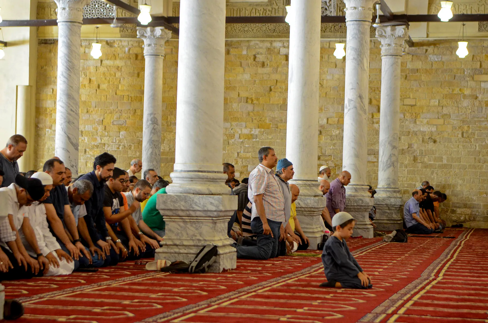
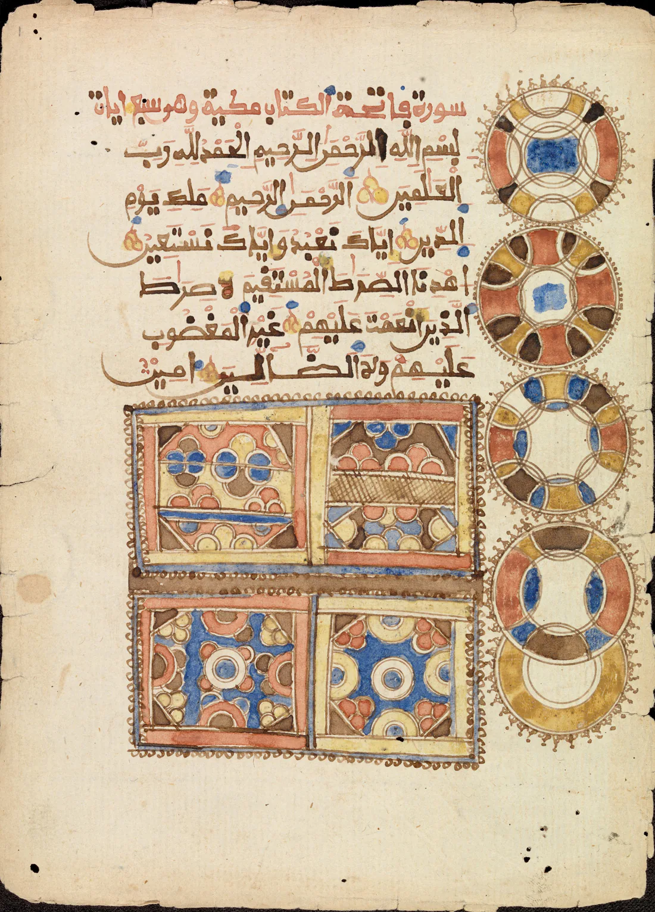

**Man ber i islam genom att först rena sig, vända sig mot Kaba i Mecka och sedan utföra bönen i en fast följd av ställningar – stående med recitation, bugning (*rukūʿ*), nedfallande (*sujūd*) och sittande – som upprepas i varje bönecykel.** Bönen, på arabiska *salāt*, är islams andra pelare och den handling som mest konkret binder den troende till Gud fem gånger om dygnet. Formen är fastlagd och följer det mönster som profeten Muhammed själv visade.

## Vad måste man göra innan bönen börjar?

Innan det första *Allāhu akbar* ska flera villkor vara uppfyllda. Bönens tid ska ha inträtt. Var och en av de fem bönerna har sin bestämda tid, räknad efter solens läge där man befinner sig (se [bönetider för orten](/bonetider/)). Den bedjande ska ha utfört den rituella tvagningen, *wudūʾ*, ha rena kläder och be på en ren plats. Saknas vatten, eller kan det inte användas, ersätts tvagningen av *tayammum*, en symbolisk rening med ren jord. Kroppen ska vara anständigt täckt. Slutligen vänder man sig mot *qibla*, riktningen mot [Kaba](/fordjupning/kaba/) i Mecka, och fattar avsikten, *niyya*, att be just denna bön. Avsikten hålls i hjärtat och uttalas aldrig högt. I klassisk fiqh kallas de bönens giltighetsvillkor: saknas något av dem är bönen ogiltig, hur noggrant den än utförs.

## Hur går bönen till steg för steg?

Bönen inleds stående. Man höjer händerna och öppnar bönen med *takbīrat al-ihrām*, "Allāhu akbar" ("Gud är större"). Den inledande takbiren sägs bara en gång. Resten av bönen består av *rakaʿāt*, likadana bönecykler, som var och en följer samma ordning:

1. **Stående.** Man reciterar al-Fātiha, under de två första rakaʿāt följd av ytterligare ett stycke ur Koranen.
2. **Bugning (*rukūʿ*).** Man böjer sig framåt med rak rygg och händerna på knäna, och lovprisar Gud.
3. **Resning (*iʿtidāl*).** Man reser sig åter till stående.
4. **Nedfall (*sujūd*).** Man faller ned så att panna och näsa, händerna, knäna och tårna rör marken.
5. **Kort sittande (*julūs*).** Man reser sig till en kort sittande ställning och faller sedan ned i *sujūd* en andra gång.

Därmed är en rakaʿa fullbordad och nästa börjar. I böner om tre eller fyra rakaʿāt sitter man i *tashahhud* redan efter de två första cyklerna. Efter den sista läses *tashahhud* på nytt, och bönen avslutas med *taslīm*: man vänder huvudet åt höger och åt vänster och säger "as-salāmu ʿalaykum".



Rörelsen är densamma varje gång: kroppen sänks stegvis från stående ända till marken och reser sig igen. I varje ställning ska kroppen dessutom hinna komma till ro innan nästa börjar. Lugnet kallas *tumaʾnīna* och räknas av flertalet rättsskolor som en nödvändig del av bönen. Kravet går tillbaka på en berömd händelse. En man bad i moskén, och profeten sände tillbaka honom tre gånger med orden "Gå tillbaka och be, för du har inte bett". Först då lärde han honom bönen, moment för moment, och upprepade samma villkor vid varje steg: att buga tills kroppen kommit till ro, resa sig tills ryggen är rak och falla ned tills kroppen åter är stilla (Sahīh al-Bukhārī 757). I *al-Qawāʿid an-nūrāniyya* förklarar Ibn Taymiyya varför:

> Bönen är hjärtats föda liksom maten är kroppens föda. Och eftersom kroppen inte får någon näring av en smula mat, får hjärtat ingen näring av en bön som hackas fram – det krävs en fullgången bön för att hjärtan ska mättas.

Den som jäktar genom rörelserna har därför inte förrättat bönen fullt ut.

## Vad reciterar man i bönen?

Kärnan i recitationen är al-Fātiha, Koranens öppningskapitel, som inleds "Lov och pris tillkommer Gud, världarnas Herre" (Koranen 1:2). Kapitlets sju verser innehåller lovprisning av Gud och en bön om vägledning på den raka vägen, och de läses i sin helhet i varje rakaʿa. I Fajr och i kvällsbönernas första rakaʿāt sker recitationen högt, i Dhuhr och Asr tyst.



I bugningen upprepas *subhāna rabbiya al-ʿazīm* ("ära åt min Herre, den Väldige") och i nedfallandet *subhāna rabbiya al-aʿlā* ("ära åt min Herre, den Högste"). I den avslutande sittställningen läses *tashahhud*, som innehåller trosbekännelsen att ingen har rätt att dyrkas utom Gud och att Muhammed är hans sändebud, följd av bönen om välsignelse över profeten och hans familj. Om al-Fātihas ställning lämnade profeten Muhammed inget tvivel: "Den som inte läser Bokens öppning har ingen bön" (Sahīh al-Bukhārī 756).

## Hur många gånger om dagen ber man, och hur många rakaʿāt?

Islam föreskriver fem obligatoriska (*fard*) böner per dygn, var och en knuten till en bestämd tid:

> Bönen är alla troendes plikt, knuten till bestämda tider.
> — Koranen 4:103

Det ger sammanlagt sjutton obligatoriska rakaʿāt: Fajr i gryningen (2), Dhuhr efter middagshöjd (4), Asr på eftermiddagen (4), Maghrib strax efter solnedgången (3) och Isha på natten (4). Eftersom tiderna följer solen skiftar de med årstid och ort, och bönetabeller räknas ut lokalt. Den som är på resa får korta bönerna med fyra rakaʿāt till två. Utöver de fem finns frivilliga böner (*nawāfil*), bland dem *witr* som avslutar natten och de regelbundna *sunna*-bönerna före och efter de föreskrivna.

```chart
type: line
unit: timmar
caption: Tiden mellan isha och nästa fajr i Stockholm, den femtonde i varje månad.
source: islam.se, bönetider för svenska orter, egen beräkning 2027
sourceUrl: https://islam.se/bonetider/
note: Nattens längd mellan den sista och den första bönen, alltså det fönster som återstår för sömn och för suhūr under fastan. Från maj till juli nås aldrig den skymningsvinkel isha annars räknas från; den delen av kurvan följer högbreddsregeln sjundedelen av natten och inte solen direkt.
data:
  Januari: 12,3
  Februari: 10,5
  Mars: 8,7
  April: 6,8
  Maj: 5,1
  Juni: 3,9
  Juli: 4,4
  Augusti: 6,0
  September: 7,9
  Oktober: 9,9
  November: 11,6
  December: 12,8
```

## Varför ber muslimer på just detta sätt?

Bönens form går tillbaka på profeten Muhammed själv. När han undervisade sina följeslagare sade han: "Bed så som ni har sett mig be" (Sahīh al-Bukhārī 631). Böneställningarna är därför desamma i Mecka som i Malmö och har sett likadana ut i fjorton sekler. Syftet anges i Koranen, där Gud talar till Mose:

> Jag är Gud; ingen gudom finns utom Jag. Dyrka Mig därför och förrätta bönen för att minnas Mig!
> — Koranen 20:14

Bönen är alltså inte i första hand en begäran om något, utan *dhikr*: att minnas Gud och ställa sig inför honom med hela kroppen. Någon präst eller mellanhand finns inte; varje muslim förrättar bönen på samma sätt och står själv inför sin Herre. Formen anpassas efter förmågan: kan man inte stå ber man sittande, och kan man inte sitta ber man liggande.
