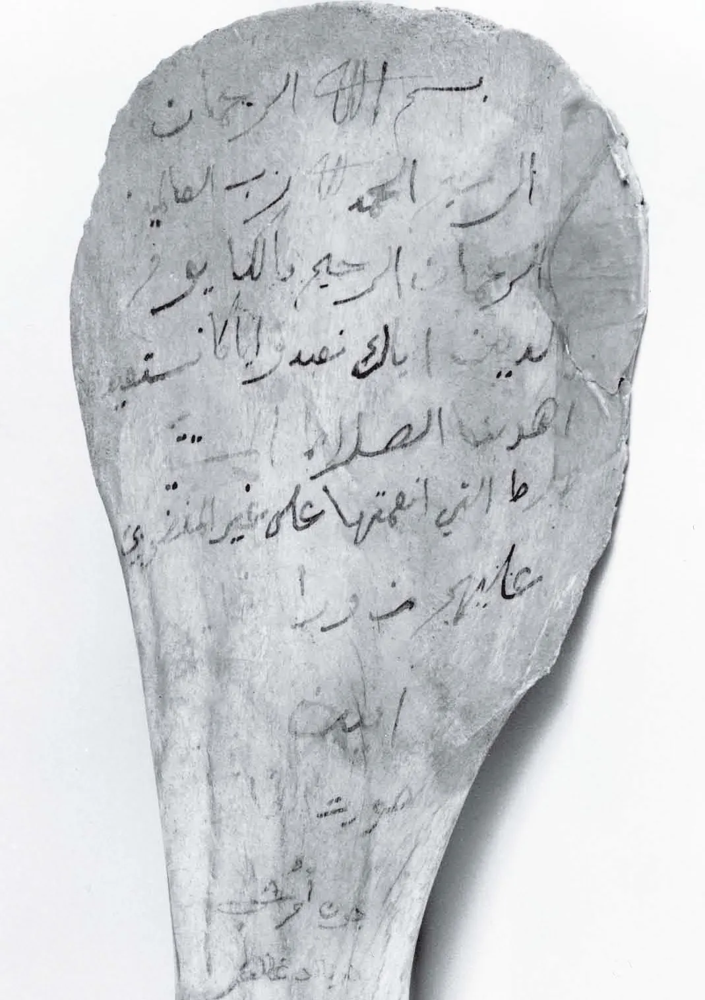

**Nej, profeten Muhammed skrev inte Koranen.** Enligt islam är Koranen Guds eget tal (*kalām Allāh*), ordagrant uppenbarat för Muhammed genom ängeln Jibril (Gabriel) under tjugotre år. Profeten var mottagaren och förmedlaren av budskapet – aldrig dess författare.

## Vem är då Koranens upphovsman enligt islam?

Koranen (av arabiskans *qurʾān*, "recitation" eller "uppläsning") är enligt islam Guds oskapade tal. Den uppenbarades för profeten Muhammed genom ängeln Jibril, med början i grottan Hira utanför Mecka omkring år 610. Under tjugotre år tog profeten emot budskapet, *āya* för *āya*, och reciterade det vidare till sina följeslagare. Texten omfattar 114 *suror* (kapitel). I den klassiska traditionen, *ahl as-sunna*, är detta en grundpelare: Koranen är *kalām Allāh*, Guds tal, och ingen mänsklig komposition. Profetens uppgift var att förmedla ordet oförvanskat, utan att forma det, redigera det eller lägga till något eget.

## Kunde profeten Muhammed läsa och skriva?

Nej. Koranen beskriver honom uttryckligen som *ummī*, "den olärde Profeten" (7:157), en man som varken kunde läsa eller skriva. Det bekräftas av den mest berömda berättelsen om uppenbarelsens början. När Jibril första gången kom till honom i grottan Hira befallde ängeln "Läs!" (*iqraʾ*), och Muhammed svarade: "Jag kan inte läsa" (Sahīh al-Bukhārī 3). Enligt islam är påståendet att han skulle ha skrivit boken själv just därför ohållbart. Koranen drar själv slutsatsen:

> Du har aldrig läst upp [något ur en] uppenbarad Skrift innan denna [uppenbarades för dig]; inte heller har du egenhändigt skrivit ned något [ur en Skrift]; annars kunde de som ifrågasätter [uppenbarelsens sanning] haft fog för sina tvivel.
> — Koranen 29:48

Att en man som aldrig lärt sig skriva framförde arabiskans oöverträffade mästerverk räknas i islam som ett av bevisen för att texten kommer från Gud.

## Hittade inte profeten bara på Koranen själv?

Invändningen är lika gammal som uppenbarelsen själv. Redan profetens motståndare i Mecka påstod att "det är bara en människa som lär honom denna [Koran]", ett påstående Koranen tillbakavisar (16:103). Inte heller har Muhammed någon egen röst i texten:

> och han talar inte av egen drift – nej, [det är] uppenbarelsens ord,
> — Koranen 53:3–4

Till tvivlarna riktar sig dessutom en öppen utmaning, *tahaddī*: den som tror att en människa författat Koranen uppmanas att frambringa en enda *sura* av samma slag (2:23). Profetens egna ord i *sunna* och hadith skiljer sig också märkbart i stil från Koranen, och de två har aldrig blandats samman. Hade en människa hittat på Koranen kunde en annan människa ha gjort likadant; på fjorton sekler har ingen lyckats.

## Hur bevarades Koranen om profeten inte skrev den?

Genom två kanaler samtidigt: minne och nedteckning. Följeslagarna lärde sig verserna utantill allteftersom de uppenbarades. De som kan hela Koranen utantill kallas *huffāz* och räknas i dag i miljontal. Profeten utsåg också särskilda skrivare, *kuttāb al-wahy*, bland dem Zayd ibn Thābit, som tecknade ned orden på palmblad, läderbitar och ben och fick exakt besked om var varje vers hörde hemma. Efter profetens död samlades materialet till en bok under kalifen Abu Bakr, och texten standardiserades till ett enhetligt exemplar, *mushaf*, under Uthman ibn Affan. Gud lovar i Koranen själv att vaka över den:

> Det är Vi som har uppenbarat denna Koran steg för steg och Vi skall helt visst slå vakt om den!
> — Koranen 15:9

## Varför spelar det någon roll vem som skrev Koranen?

Frågan rör islams själva grundval. För världens omkring två miljarder muslimer står och faller tron med att Koranen är Guds ord och inte en människas. Vore den Muhammeds verk, vore den mänsklig litteratur och ingen uppenbarelse. Detta hänger ihop med *tawhīd*, Guds absoluta enhet: endast Gud är källan till vägledningen, och profeten är hans tjänare och sändebud, inte en medförfattare.
