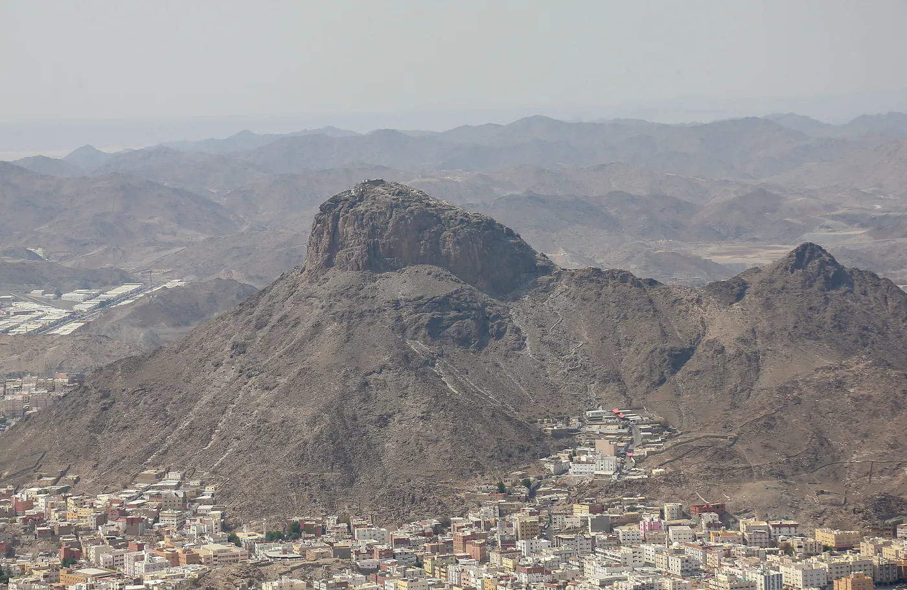

**Muhammed (med fullständigt namn *Muhammad ibn ʿAbdullah*, ca 570–632) var islams siste profet och sändebud – den man som muslimer tror tog emot Koranen från Gud och därmed beseglade den långa raden av profeter från Adam till Jesus.** Han föddes i Mecka, förkunnade *tawhīd*, Guds absoluta enhet, och dog i Medina. Hans liv och ord, *sunna*, är efter Koranen den näst viktigaste källan i islam.

## När och var levde Muhammed?

Muhammed föddes omkring år 570 i Mecka, i den mäktiga stammen Quraysh och klanen Banū Hāshim. Mecka var vid den tiden en handelsstad och ett hedniskt kultcentrum, där Kaba omgavs av hundratals avgudabilder. Muhammed blev tidigt föräldralös: fadern ʿAbdullah dog före hans födelse, modern Āmina när han var omkring sex år. Han uppfostrades först av farfadern ʿAbd al-Muttalib och sedan av farbrodern Abū Tālib. Som vuxen försörjde han sig på handel och blev känd för sådan ärlighet att meckaborna kallade honom *al-Amīn*, "den pålitlige". Han gifte sig med affärskvinnan Khadīja, vars handelsresor han hade lett, och hon blev den första som trodde på hans budskap.

Den äldsta levnadsteckningen, *sīra*, skrevs av Ibn Ishāq mer än hundra år efter profetens död och är bevarad i Ibn Hishāms bearbetning. De sena källorna har granskats hårt av modern historieforskning. Patricia Crone, den källkritiska skolans mest kända namn, slår ändå fast att det inte råder något tvivel om att Muhammed existerade, och att belägget för en profet verksam bland araberna under 600-talets första decennier är ovanligt starkt. Ett av de tyngsta beläggen kommer inte från muslimskt håll. Den syriske prästen Tomas skrev omkring år 640 en krönika där det under fredagen den 4 februari 634 noteras ett slag "mellan romarna och Muhammeds araber" öster om Gaza. Notisen är torr och daterad på dagen, skriven av en utomstående utan något intresse av att stödja islams anspråk, och den knyter profetens namn till en händelse mindre än två år efter hans död. Vid sin död hade köpmannen från Mecka enat större delen av Arabiska halvön.

## Hur blev Muhammed profet?

Omkring år 610, vid ungefär 40 års ålder, drog han sig tillbaka för eftertanke i grottan Hira på berget Jabal an-Nūr utanför Mecka. Där visade sig enligt islam ärkeängeln Jibrīl (Gabriel), och uppenbarelsen började med ett enda ord: *Iqra* – läs. Det var de första verserna ur sura al-ʿAlaq (96). Enligt traditionen svarade Muhammed: "Jag kan inte läsa" (Sahīh al-Bukhārī 3), och ängeln upprepade befallningen tre gånger innan orden kom. Skakad av mötet sökte sig Muhammed hem till Khadīja, som lugnade honom.

Uppenbarelsen kom till Muhammed utan att han hade sökt den. Den fornnordiska diktningen tecknar den motsatta vägen till kunskap; i *Hávamál* berättar Oden själv hur han vann runorna:

> Jag vet att jag hängde i det vindpinade trädet nio hela nätter, sårad av spjut och given åt Oden, jag själv åt mig själv, i det träd där ingen vet ur vilken rot det växer. Ingen gav mig bröd eller horn att dricka ur. Jag spanade nedåt, tog upp runorna, tog dem skrikande, och föll så tillbaka.

Oden vinner sin visdom genom våld mot sig själv; Muhammed blir tilltalad. Därför lägger islam sådan vikt vid att profeten var *ummī*, att han varken kunde läsa eller skriva. Den som aldrig har läst en skrift kan inte ha hämtat sitt stoff ur de tidigare skrifterna, och Koranen för själv det argumentet: "Du har aldrig läst upp [något ur en] uppenbarad Skrift innan denna [uppenbarades för dig]; inte heller har du egenhändigt skrivit ned något [ur en Skrift]; annars kunde de som ifrågasätter [uppenbarelsens sanning] haft fog för sina tvivel" (Koranen 29:48).

Uppenbarelserna fortsatte sedan i ungefär 23 år, fram till hans död, och utgör tillsammans Koranen. I tretton år förkunnade han i Mecka mot avgudadyrkan och för de svagas rätt, men motståndet hårdnade: de första muslimerna förföljdes, och en grupp sändes i skydd till det kristna Abessinien. År 622 utvandrade Muhammed och hans följeslagare till Medina – *hijra*, utgångspunkten för den islamiska tideräkningen.

## Vad var Muhammeds budskap?

Kärnan i Muhammeds budskap var *tawhīd*: att det finns en enda Gud utan medhjälpare, och att han själv var Guds sändebud. Han hävdade inte att han kom med en ny religion, utan att han återupprättade samma budskap som tidigare profeter fört fram, från Abraham (Ibrāhīm) och Mose (Mūsā) till Jesus (ʿĪsā). Tron på sändebuden hör till islams trosartiklar, och med Muhammed avslutas profetlängden:

> Troende! Muhammad är inte fader till någon av era män. Han är Guds Sändebud och Profetlängdens Sigill.
> — Koranen 33:40

Därför kallas han *khātam an-nabiyyīn*, profeternas insegel. Samtidigt beskriver Koranen hans uppdrag som barmhärtighet:

> Vi har sänt dig [Muhammad] enbart av nåd till alla folk.
> — Koranen 21:107

## Vad gjorde Muhammed i Medina?

I Medina gick Muhammed från förföljd förkunnare till ledare för ett samhälle. Han byggde en moské, kärnan i dagens Profetens moské, och knöt ett brödraskap mellan utvandrarna från Mecka, *muhājirūn*, och medinaborna som tagit emot dem, hjälparna (*ansār*). Uppenbarelserna fortsatte och kom nu ofta att gälla samhällslivet: familjerätt, handel, krig och fred. Med Mecka rådde öppen konflikt; muslimerna segrade vid Badr år 624 och led svåra förluster vid Uhud år 625. Fördraget i Hudaybiyya år 628 gav en tids vapenvila, och år 630 intog Muhammed Mecka i stort sett utan blodsutgjutelse och lät rensa Kaba från avgudabilderna.

Under avskedsvallfärden år 632, inför tiotusentals pilgrimer, uppenbarades versen som förklarar religionen fullbordad. ʿUmar ibn al-Khattāb mindes både dagen och platsen, en fredag medan profeten stod på ʿArafat (Sahīh al-Bukhārī 45):

> Denna dag har Jag fullbordat det religiösa regelverket för er och skänkt er Min välsignelse i fullaste mått. Jag har beslutat att Islam skall vara er religion.
> — Koranen 5:3

Några månader senare, i juni 632, dog Muhammed i Medina.

## Varför är Muhammed ett föredöme för muslimer?

För muslimer är Muhammed mer än en budbärare. Hans liv är mönstret för hur tron ska levas. Hans *sunna* – hans handlingar, ord och tysta gillanden, bevarade i *hadīth*-samlingar som Sahīh al-Bukhārī – vägleder allt från bön till handel. De som håller fast vid denna *sunna* kallas *ahl as-sunna*, "traditionens folk". Koranen säger det uttryckligen:

> I GUDS Sändebud har ni ett gott föredöme för alla som [med bävan och hopp] ser fram mot [mötet med] Gud och den Yttersta dagen och som ständigt har Gud för ögonen.
> — Koranen 33:21

Själv sammanfattade han sitt syfte: "Jag sändes endast för att fullkomna de ädla karaktärsdragen" (al-Bukhārī, al-Adab al-Mufrad 273). Vittnesbördet att Muhammed är Guds sändebud är den andra halvan av trosbekännelsen, *shahada*. Ibn al-Qayyim binder samman de två halvorna i *Madārij as-sālikīn*:

> Det är två slags enhet, och ingen räddas undan Guds straff utom genom dem båda: att den som sände är en enda, och att sändebudet är den ende som följs.

Att följa honom är ändå aldrig att dyrka honom: profeten förblir en tjänare (*ʿabd*) och ett sändebud.

## Hur många följer Muhammed i dag?

Muslimer världen över ber mot Mecka, fastar i ramadan och formar sina liv efter Muhammeds exempel, oavsett språk eller folk. Varje gång hans namn uttalas följs det av fridshälsningen ﷺ. I dag har islam omkring två miljarder anhängare, ungefär en fjärdedel av mänskligheten, och är världens näst största religion (Pew Research Center). Mellan 2010 och 2020 växte antalet muslimer mer än antalet anhängare av alla andra religioner tillsammans. Nästan sex av tio muslimer bor i Asien- och Stillahavsregionen, där Indonesien, Pakistan och Indien har de största muslimska befolkningarna.
